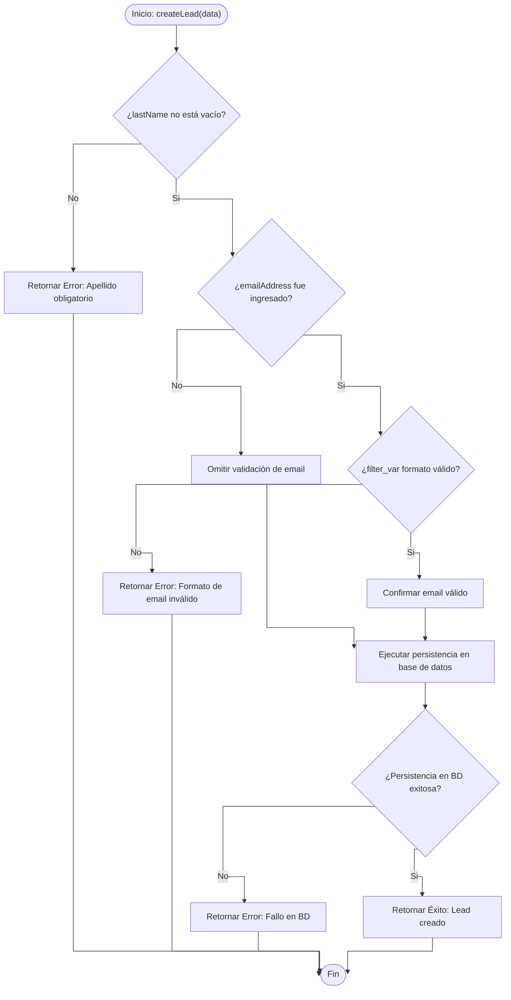
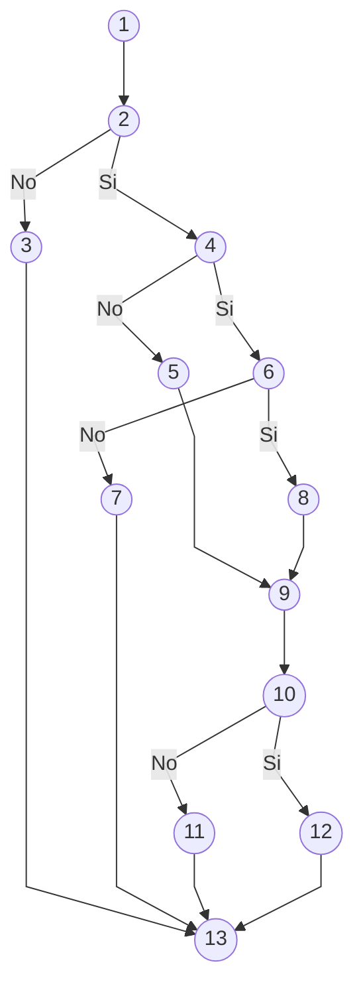

# Pruebas de Caja Blanca - Funcionalidad 1: Creacion de un Cliente Potencial (Lead Creation)

## 1. Descripcion de la Funcionalidad

* **Nombre de la funcionalidad:** Creacion de un Cliente Potencial (Lead Creation).
* **Objetivo:** Permitir el ingreso de los datos iniciales de una persona interesada (nombre, apellido, correo electronico y telefono) y guardarlo en el sistema tras superar las validaciones de negocio.
* **Alcance de la prueba:**
  * Guardado exitoso con datos validos.
  * Rechazo si no se ingresa el apellido (campo obligatorio).
  * Rechazo si el correo electronico no tiene formato valido (debe contener '@' y dominio).

---

## 2. Codigo Fuente Seleccionado

El siguiente metodo en PHP representa la logica de control y validacion para la creacion del registro Lead en el sistema:

```php
function createLead(array $data): array
{
    // Nodo 1: Inicio y captura de parametros de entrada
    $firstName = $data['firstName'] ?? null;
    $lastName  = $data['lastName'] ?? null;
    $email     = $data['emailAddress'] ?? null;
    $phone     = $data['phoneNumber'] ?? null;

    // Nodo 2: Decision 1 - Validacion de campo requerido (apellido)
    if (empty($lastName)) {
        // Nodo 3: Retorno de error por apellido vacio
        return [
            'status' => false,
            'code'   => 400,
            'error'  => 'El campo lastName es obligatorio'
        ];
    }

    // Nodo 4: Decision 2 - Verificacion de existencia de email
    if (!empty($email)) {
        // Nodo 6: Decision 3 - Validacion de formato de email
        if (!filter_var($email, FILTER_VALIDATE_EMAIL)) {
            // Nodo 7: Retorno de error por formato de email invalido
            return [
                'status' => false,
                'code'   => 400,
                'error'  => 'Formato de email invalido'
            ];
        }
        // Nodo 8: Confirmacion de email con formato valido
        $validEmail = $email;
    } else {
        // Nodo 5: Omitir validacion de email (campo opcional no provisto)
        $validEmail = null;
    }

    // Nodo 9: Preparacion de la entidad y persistencia en base de datos
    $isSaved = saveLeadToDatabase($firstName, $lastName, $validEmail, $phone);

    // Nodo 10: Decision 4 - Verificacion de persistencia exitosa
    if (!$isSaved) {
        // Nodo 11: Retorno de error por falla de persistencia
        return [
            'status' => false,
            'code'   => 500,
            'error'  => 'Fallo en la persistencia de base de datos'
        ];
    }

    // Nodo 12: Retorno exitoso de registro creado
    return [
        'status' => true,
        'code'   => 201,
        'data'   => ['id' => $leadId, 'name' => trim("$firstName $lastName")]
    ];

    // Nodo 13: Fin del metodo
}
```

---

## 3. Diagrama de Flujo

Estructura formal con rombos de decision y lineas de conexion ortogonales (lineas totalmente rectas con quiebres a 90 grados). La rama "Si" se desplaza a la derecha y la rama "No" a la izquierda.




---

## 4. Grafo de Control de Flujo (Grafo del Programa)

Representacion formal con nodos circulares numerados y aristas mediante lineas totalmente rectas punto a punto. La rama "Si" se ubica a la derecha y la rama "No" a la izquierda.




---

## 5. Tabla de Descripcion de Nodos

| Nodo | Tipo | Descripcion |
| :--- | :--- | :--- |
| **1** | Proceso | Inicio del metodo y lectura de parametros de entrada ($firstName, $lastName, $email, $phone). |
| **2** | Decision | Evaluacion de campo obligatorio: ¿$lastName contiene un valor no vacio? |
| **3** | Proceso | Generacion de respuesta de error: "El campo lastName es obligatorio" (HTTP 400). |
| **4** | Decision | Evaluacion de presencia de correo: ¿Se ingreso un valor en $email? |
| **5** | Proceso | Asignacion de email nulo y continuacion sin validacion de formato. |
| **6** | Decision | Evaluacion de formato: ¿filter_var($email, FILTER_VALIDATE_EMAIL) es verdadero? |
| **7** | Proceso | Generacion de respuesta de error: "Formato de email invalido" (HTTP 400). |
| **8** | Proceso | Asignacion de email confirmado con formato valido. |
| **9** | Proceso | Preparacion de la entidad Lead e invocacion del servicio de persistencia en base de datos. |
| **10** | Decision | Evaluacion del resultado de persistencia: ¿La insercion en BD retorno verdadero? |
| **11** | Proceso | Generacion de respuesta de error: "Fallo en la persistencia de base de datos" (HTTP 500). |
| **12** | Proceso | Generacion de respuesta exitosa con ID y datos del Lead creado (HTTP 201). |
| **13** | Fin | Salida y finalizacion del flujo de ejecucion. |

---

## 6. Calculo de Complejidad Ciclomatica

La complejidad ciclomatica V(G) determina el numero de caminos linealmente independientes que deben ser ejecutados para lograr una cobertura completa del flujo de control.

### Metodo 1: Formula de Aristas y Nodos
* Numero de aristas (E) = 16
* Numero de nodos (N) = 13
* Componentes conexos (P) = 1

$$V(G) = E - N + 2P$$
$$V(G) = 16 - 13 + 2(1) = 5$$

### Metodo 2: Formula de Nodos de Decision (Predicados)
* Nodos de decision o predicados (P) = 4 (Nodos 2, 4, 6 y 10)

$$V(G) = P + 1$$
$$V(G) = 4 + 1 = 5$$

### Metodo 3: Regiones del Grafo Plano
* Numero de regiones delimitadas (R) = 4 regiones cerradas + 1 region externa no acotada = 5

$$V(G) = R = 5$$

**Resultado final:** La complejidad ciclomatica es **V(G) = 5**, indicando un modulo de bajo riesgo con **5 caminos independientes** a probar.

---

## 7. Tabla de Caminos Independientes

| Camino | Secuencia de Nodos | Descripcion del Camino |
| :--- | :--- | :--- |
| **C1** | 1 -> 2 -> 3 -> 13 | Rechazo inmediato por ausencia de apellido obligatorio. |
| **C2** | 1 -> 2 -> 4 -> 6 -> 7 -> 13 | Apellido presente, correo provisto con formato invalido. |
| **C3** | 1 -> 2 -> 4 -> 6 -> 8 -> 9 -> 10 -> 12 -> 13 | Camino principal exitoso con todos los campos validos (nombre, apellido y email con formato correcto). |
| **C4** | 1 -> 2 -> 4 -> 5 -> 9 -> 10 -> 12 -> 13 | Camino exitoso sin correo electronico provisto (omite validacion de email por ser opcional). |
| **C5** | 1 -> 2 -> 4 -> 6 -> 8 -> 9 -> 10 -> 11 -> 13 | Datos validos ingresados pero ocurre una falla de persistencia a nivel de base de datos. |

---

## 8. Casos de Prueba de Caja Blanca

| ID Caso | Camino | Datos de Entrada | Condicion Evaluada | Resultado Esperado | Salida |
| :--- | :--- | :--- | :--- | :--- | :--- |
| **CP-CB-01** | C1 | firstName: "Carlos"<br>lastName: ""<br>emailAddress: "carlos@empresa.com"<br>phoneNumber: "3001234567" | Nodo 2: empty(lastName) == true | Rechazo inmediato.<br>Mensaje: "El campo lastName es obligatorio". | Status: false<br>HTTP: 400 |
| **CP-CB-02** | C2 | firstName: "Carlos"<br>lastName: "Gomez"<br>emailAddress: "correo_sin_arroba.com"<br>phoneNumber: "3001234567" | Nodo 2: lastName valido.<br>Nodo 4: email presente.<br>Nodo 6: filter_var == false | Rechazo por formato.<br>Mensaje: "Formato de email invalido". | Status: false<br>HTTP: 400 |
| **CP-CB-03** | C3 | firstName: "Carlos"<br>lastName: "Gomez"<br>emailAddress: "carlos.gomez@empresa.com"<br>phoneNumber: "3001234567" | Nodo 2: valido.<br>Nodo 4: presente.<br>Nodo 6: valido.<br>Nodo 10: persistencia OK | Creacion satisfactoria del Lead en base de datos. | Status: true<br>HTTP: 201<br>Lead persistido |
| **CP-CB-04** | C4 | firstName: "Carlos"<br>lastName: "Gomez"<br>emailAddress: ""<br>phoneNumber: "3001234567" | Nodo 2: valido.<br>Nodo 4: email vacio (omite validacion).<br>Nodo 10: persistencia OK | Creacion satisfactoria del Lead sin correo registrado. | Status: true<br>HTTP: 201<br>Lead persistido |
| **CP-CB-05** | C5 | firstName: "Carlos"<br>lastName: "Gomez"<br>emailAddress: "carlos.gomez@empresa.com"<br>phoneNumber: "3001234567"<br>*(Simulacion: BD desconectada)* | Nodo 2: valido.<br>Nodo 6: valido.<br>Nodo 10: isSaved == false | Notificacion de error de persistencia interna. | Status: false<br>HTTP: 500 |
