# CUR-F1 — Pruebas de caja blanca: conversión de montos entre monedas

**Funcionalidad:** la función de fórmula `ext\currency\convert(MONTO, DESDE, HACIA)` convierte un monto entre monedas configuradas usando las tasas vigentes.
**Versión analizada:** EspoCRM 10.1.1 (el código del módulo es idéntico entre el repositorio y la imagen Docker).
**Fecha:** 15 de noviembre de 2026.

Se analiza el código de las tres capas que recorre una conversión desde la pantalla:

| Capa | Código | V(G) |
| :--- | :--- | :--- |
| Frontend | `index.js::run()` del Formula Sandbox | 8 |
| Backend | `ConvertType::process()`, `Converter::convert()`, `ConfigDataProvider::getCurrencyRate()` | 7, 2, 3 |
| Integración | Pantalla → `POST /api/v1/Formula/action/run` → fórmula → conversor → configuración | Un diagrama de secuencia por escenario |

**Convenciones de los diagramas.** En todas las decisiones la rama **Sí** sale hacia la **derecha** (verde) y la rama **No** hacia la **izquierda** (rojo). Las salidas de error van en rojo claro. Hay un grafo por método; la tabla de caminos de cada grafo indica qué escenario de prueba recorre cada camino. Los diagramas se generan con `docs/CUR/herramientas/generar_cur_f1.py`, que además comprueba que E − N + 2 = P + 1 y que cada Sí quede a la derecha y cada No a la izquierda.

**Condiciones compuestas.** El nodo 3 del frontend (`script === '' || script === null`) y el nodo 8 de `ConvertType` (`!is_string && !is_int && !is_float`) son decisiones compuestas: la cobertura de condición exige dos subcasos adicionales en el primero (vacío y nulo) y tres en el segundo (texto, entero y decimal).

---

## 1. Frontend

### Frontend — index.js::run() del Formula Sandbox

Archivo: `client/src/views/admin/formula-sandbox/index.js`.

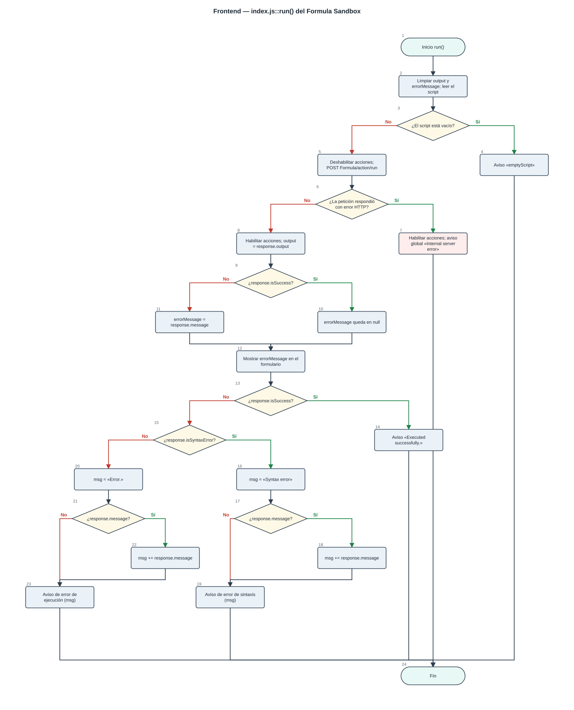

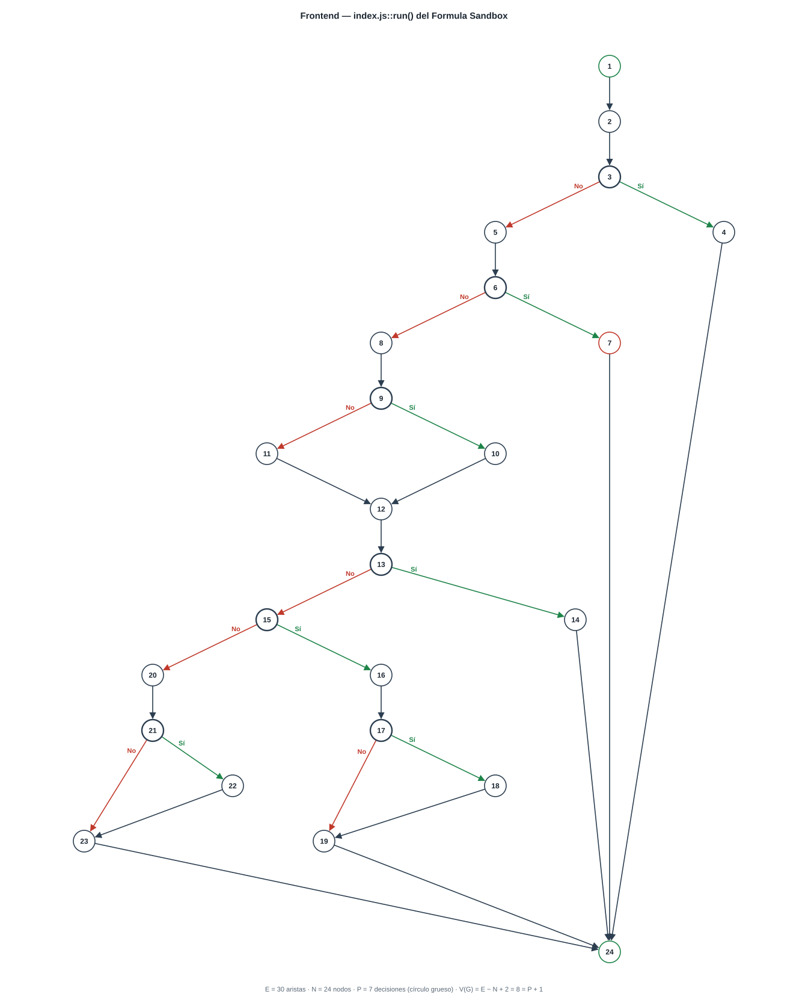

| Nodo | Tipo | Líneas | Descripción |
| :--- | :--- | :--- | :--- |
| 1 | Inicio | 166 | Inicio run() |
| 2 | Proceso | 167-172 | Limpiar output y errorMessage; leer el script |
| 3 | Decisión | 174 | ¿El script está vacío? |
| 4 | Proceso | 175-181 | Aviso «emptyScript» |
| 5 | Proceso | 185-195 | Deshabilitar acciones; POST Formula/action/run |
| 6 | Decisión | 196 | ¿La petición respondió con error HTTP? |
| 7 | Salida de error | 197-199 | Habilitar acciones; aviso global «Internal server error» |
| 8 | Proceso | 202-204 | Habilitar acciones; output = response.output |
| 9 | Decisión | 208 | ¿response.isSuccess? |
| 10 | Proceso | 206 | errorMessage queda en null |
| 11 | Proceso | 209 | errorMessage = response.message |
| 12 | Proceso | 212 | Mostrar errorMessage en el formulario |
| 13 | Decisión | 214 | ¿response.isSuccess? |
| 14 | Proceso | 215-219 | Aviso «Executed successfully.» |
| 15 | Decisión | 222 | ¿response.isSyntaxError? |
| 16 | Proceso | 223 | msg = «Syntax error» |
| 17 | Decisión | 225 | ¿response.message? |
| 18 | Proceso | 226 | msg += response.message |
| 19 | Proceso | 229-231 | Aviso de error de sintaxis (msg) |
| 20 | Proceso | 234 | msg = «Error.» |
| 21 | Decisión | 236 | ¿response.message? |
| 22 | Proceso | 237 | msg += response.message |
| 23 | Proceso | 240 | Aviso de error de ejecución (msg) |
| 24 | Fin | 241 | Fin |

**Complejidad ciclomática**

| Método | Cálculo | V(G) |
| :--- | :--- | :--- |
| Aristas y nodos | E − N + 2 = 30 − 24 + 2 | 8 |
| Nodos de decisión | P + 1 = 7 + 1 (nodos 3, 6, 9, 13, 15, 17, 21) | 8 |
| Regiones | Regiones del grafo plano, incluida la exterior | 8 |

**Caminos independientes**

| Camino | Secuencia de nodos | Qué recorre | Escenario y casos que lo cubren |
| :--- | :--- | :--- | :--- |
| C1 | 1-2-3-4-24 | Script vacío: aviso «emptyScript». | Ninguno (caso nuevo CB-CUR-F1-FE-01) |
| C2 | 1-2-3-5-6-7-24 | El servidor responde con error HTTP (500). | ESC-CUR-F1-04 (CN-CUR-F1-11, 12, 13) y ESC-CUR-F1-05 (CN-CUR-F1-17) |
| C3 | 1-2-3-5-6-8-9-10-12-13-14-24 | Conversión exitosa. | ESC-CUR-F1-01, 02 y 03 (CN-CUR-F1-01 a 10) |
| C4 | 1-2-3-5-6-8-9-11-12-13-15-16-17-18-19-24 | Error de sintaxis con mensaje. | Ninguno (caso nuevo CB-CUR-F1-FE-02) |
| C5 | 1-2-3-5-6-8-9-11-12-13-15-16-17-19-24 | Error de sintaxis sin mensaje. | Ninguno: solo ocurre si la excepción de sintaxis llega sin texto (RunResult copia su mensaje); ninguna fórmula de CUR-F1 lo produce |
| C6 | 1-2-3-5-6-8-9-11-12-13-15-20-21-22-23-24 | Error de ejecución de la fórmula con mensaje. | ESC-CUR-F1-05 (CN-CUR-F1-14, 15 y 16) |
| C7 | 1-2-3-5-6-8-9-11-12-13-15-20-21-23-24 | Error de ejecución sin mensaje. | Ninguno: solo ocurre si el error de fórmula llega sin texto; las excepciones de ConvertType siempre traen mensaje |
| C8 | 1-2-3-5-6-8-9-11-12-13-14-24 | isSuccess falso en el nodo 9 y verdadero en el 13. | No factible: los nodos 9 y 13 evalúan la misma condición (decisiones correlacionadas) |

<details><summary>Fuente Mermaid</summary>

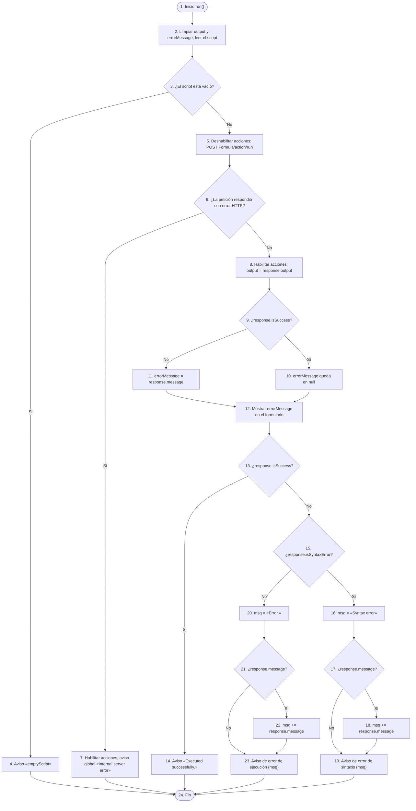

</details>


---

## 2. Backend

### Backend — ConvertType::process() (función de fórmula ext\currency\convert)

Archivo: `application/Espo/Core/Formula/Functions/ExtGroup/CurrencyGroup/ConvertType.php`.

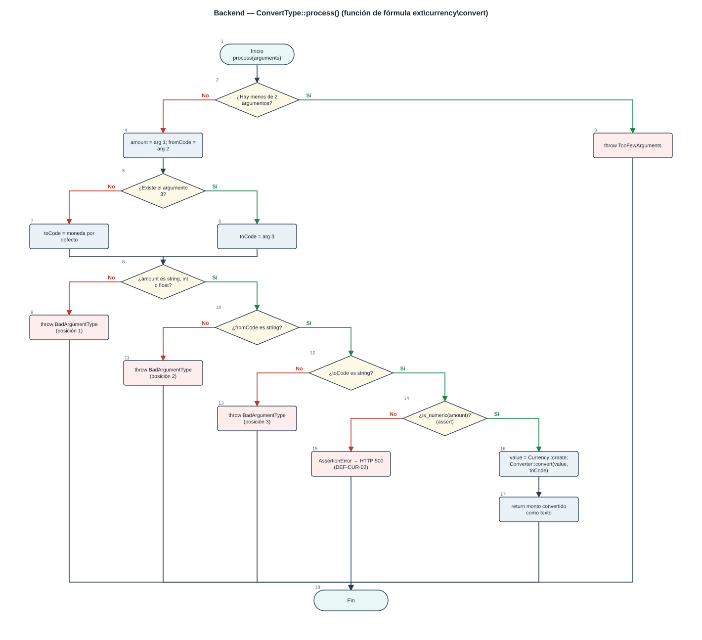

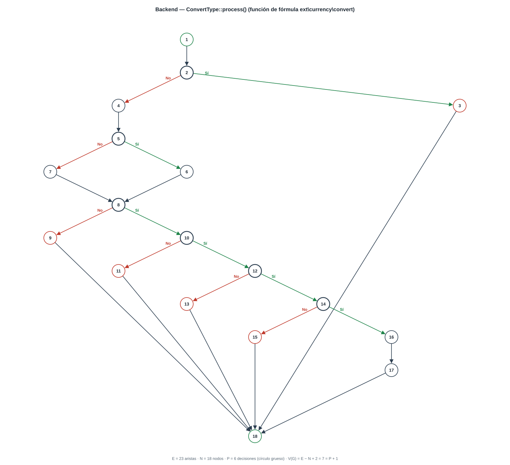

| Nodo | Tipo | Líneas | Descripción |
| :--- | :--- | :--- | :--- |
| 1 | Inicio | 46 | Inicio process(arguments) |
| 2 | Decisión | 49 | ¿Hay menos de 2 argumentos? |
| 3 | Salida de error | 50 | throw TooFewArguments |
| 4 | Proceso | 53-54 | amount = arg 1; fromCode = arg 2 |
| 5 | Decisión | 55 (??) | ¿Existe el argumento 3? |
| 6 | Proceso | 55 | toCode = arg 3 |
| 7 | Proceso | 55 | toCode = moneda por defecto |
| 8 | Decisión | 57-61 | ¿amount es string, int o float? |
| 9 | Salida de error | 62 | throw BadArgumentType (posición 1) |
| 10 | Decisión | 65 | ¿fromCode es string? |
| 11 | Salida de error | 66 | throw BadArgumentType (posición 2) |
| 12 | Decisión | 69 | ¿toCode es string? |
| 13 | Salida de error | 70 | throw BadArgumentType (posición 3) |
| 14 | Decisión | 73 | ¿is_numeric(amount)? (assert) |
| 15 | Salida de error | 73 | AssertionError → HTTP 500 (DEF-CUR-02) |
| 16 | Proceso | 75-77 | value = Currency::create; Converter::convert(value, toCode) |
| 17 | Proceso | 79 | return monto convertido como texto |
| 18 | Fin | 80 | Fin |

**Complejidad ciclomática**

| Método | Cálculo | V(G) |
| :--- | :--- | :--- |
| Aristas y nodos | E − N + 2 = 23 − 18 + 2 | 7 |
| Nodos de decisión | P + 1 = 6 + 1 (nodos 2, 5, 8, 10, 12, 14) | 7 |
| Regiones | Regiones del grafo plano, incluida la exterior | 7 |

**Caminos independientes**

| Camino | Secuencia de nodos | Qué recorre | Escenario y casos que lo cubren |
| :--- | :--- | :--- | :--- |
| C1 | 1-2-3-18 | Menos de 2 argumentos. | CN-CUR-F1-14 |
| C2 | 1-2-4-5-6-8-9-18 | Monto de tipo no admitido (booleano). | CN-CUR-F1-15 |
| C3 | 1-2-4-5-7-8-10-12-14-16-17-18 | Dos argumentos: se usa la moneda por defecto. | CN-CUR-F1-04 |
| C4 | 1-2-4-5-6-8-10-11-18 | Moneda origen que no es texto. | CN-CUR-F1-16 |
| C5 | 1-2-4-5-6-8-10-12-13-18 | Moneda destino que no es texto. | Ninguno (caso nuevo CB-CUR-F1-BE-01) |
| C6 | 1-2-4-5-6-8-10-12-14-15-18 | Monto de texto no numérico. | CN-CUR-F1-17 (Fallido, DEF-CUR-02) |
| C7 | 1-2-4-5-6-8-10-12-14-16-17-18 | Tres argumentos válidos. | CN-CUR-F1-01 a 03 y 05 a 10; también CN-CUR-F1-11 a 13, que fallan después dentro de Converter |

<details><summary>Fuente Mermaid</summary>

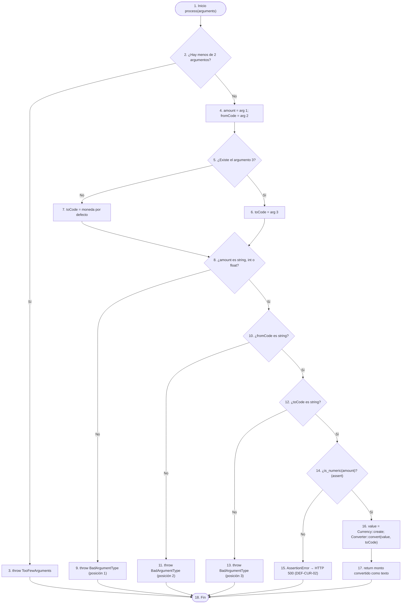

</details>

### Backend — Converter::convert()

Archivo: `application/Espo/Core/Currency/Converter.php`.

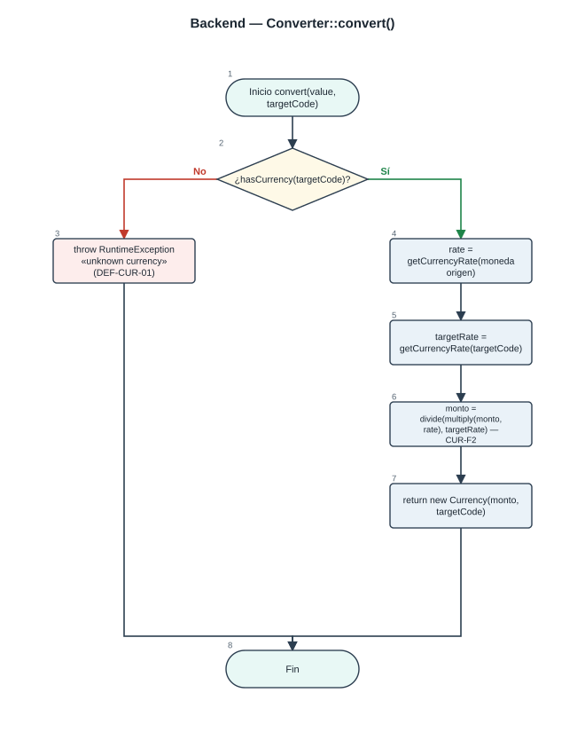

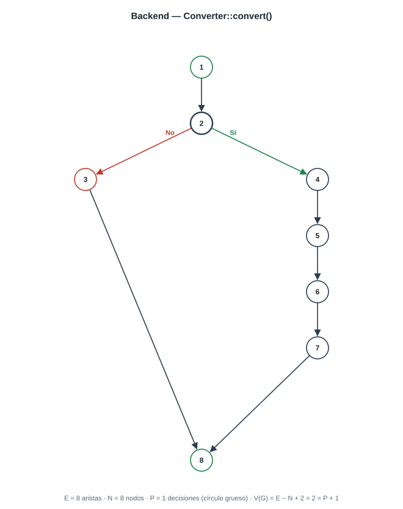

| Nodo | Tipo | Líneas | Descripción |
| :--- | :--- | :--- | :--- |
| 1 | Inicio | 53 | Inicio convert(value, targetCode) |
| 2 | Decisión | 55 | ¿hasCurrency(targetCode)? |
| 3 | Salida de error | 56 | throw RuntimeException «unknown currency» (DEF-CUR-01) |
| 4 | Proceso | 59 | rate = getCurrencyRate(moneda origen) |
| 5 | Proceso | 60 | targetRate = getCurrencyRate(targetCode) |
| 6 | Proceso | 62 | monto = divide(multiply(monto, rate), targetRate) — CUR-F2 |
| 7 | Proceso | 64 | return new Currency(monto, targetCode) |
| 8 | Fin | 65 | Fin |

**Complejidad ciclomática**

| Método | Cálculo | V(G) |
| :--- | :--- | :--- |
| Aristas y nodos | E − N + 2 = 8 − 8 + 2 | 2 |
| Nodos de decisión | P + 1 = 1 + 1 (nodos 2) | 2 |
| Regiones | Regiones del grafo plano, incluida la exterior | 2 |

**Caminos independientes**

| Camino | Secuencia de nodos | Qué recorre | Escenario y casos que lo cubren |
| :--- | :--- | :--- | :--- |
| C1 | 1-2-3-8 | Moneda destino no configurada. | CN-CUR-F1-11 y CN-CUR-F1-13 (Fallidos, DEF-CUR-01) |
| C2 | 1-2-4-5-6-7-8 | Moneda destino configurada. | CN-CUR-F1-01 a 10; también CN-CUR-F1-12, que falla dentro de getCurrencyRate |

<details><summary>Fuente Mermaid</summary>

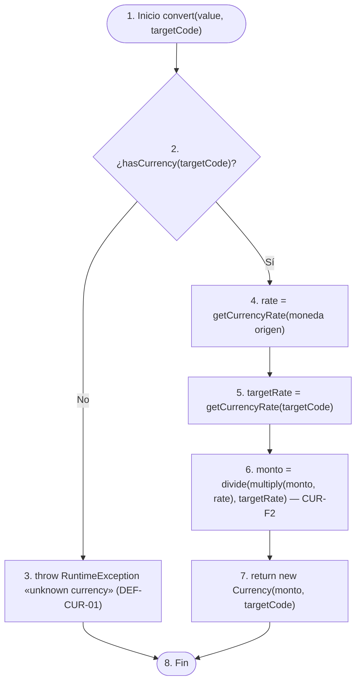

</details>

### Backend — ConfigDataProvider::getCurrencyRate()

Archivo: `application/Espo/Core/Currency/ConfigDataProvider.php`.

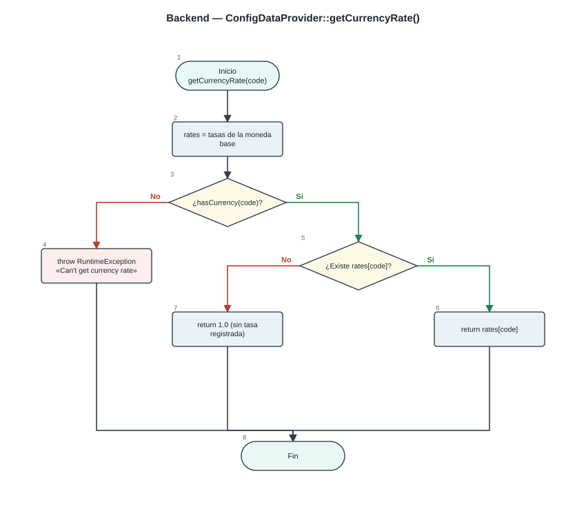

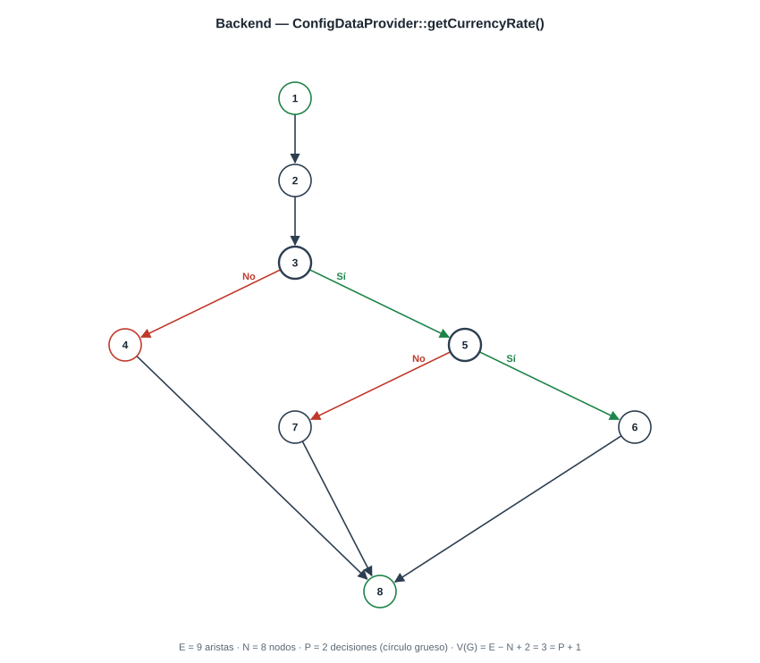

| Nodo | Tipo | Líneas | Descripción |
| :--- | :--- | :--- | :--- |
| 1 | Inicio | 89 | Inicio getCurrencyRate(code) |
| 2 | Proceso | 91 | rates = tasas de la moneda base |
| 3 | Decisión | 93 | ¿hasCurrency(code)? |
| 4 | Salida de error | 94 | throw RuntimeException «Can't get currency rate» |
| 5 | Decisión | 97 (??) | ¿Existe rates[code]? |
| 6 | Proceso | 97 | return rates[code] |
| 7 | Proceso | 97 | return 1.0 (sin tasa registrada) |
| 8 | Fin | 98 | Fin |

**Complejidad ciclomática**

| Método | Cálculo | V(G) |
| :--- | :--- | :--- |
| Aristas y nodos | E − N + 2 = 9 − 8 + 2 | 3 |
| Nodos de decisión | P + 1 = 2 + 1 (nodos 3, 5) | 3 |
| Regiones | Regiones del grafo plano, incluida la exterior | 3 |

**Caminos independientes**

| Camino | Secuencia de nodos | Qué recorre | Escenario y casos que lo cubren |
| :--- | :--- | :--- | :--- |
| C1 | 1-2-3-4-8 | Moneda origen no configurada. | CN-CUR-F1-12 (Fallido, DEF-CUR-01) |
| C2 | 1-2-3-5-6-8 | Moneda configurada con tasa registrada. | CN-CUR-F1-01 a 10 |
| C3 | 1-2-3-5-7-8 | Moneda configurada sin tasa en la configuración: vale 1. | Ninguno de CUR-F1 (caso nuevo CB-CUR-F1-BE-02); relacionado con DEF-CUR-05 |

<details><summary>Fuente Mermaid</summary>

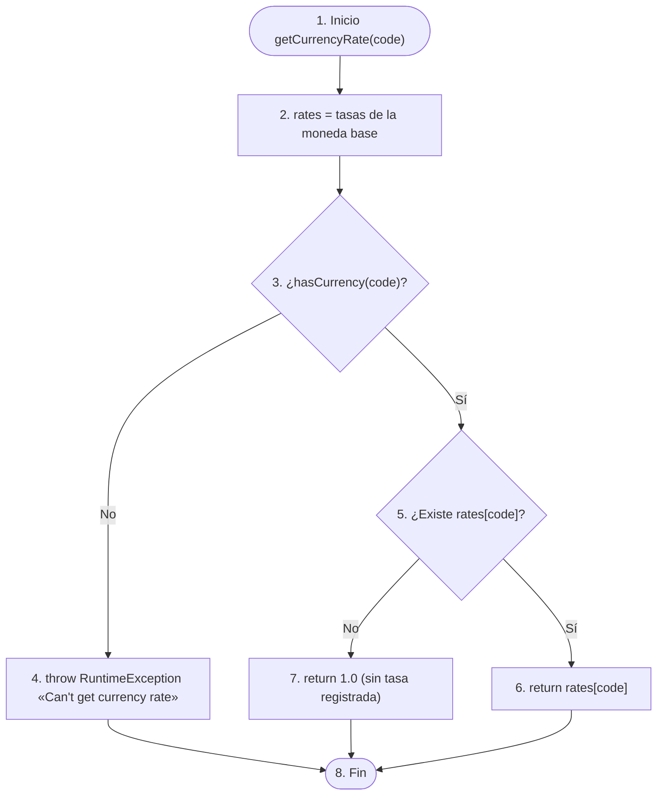

</details>


---

## 3. Integración (un diagrama por escenario)

### ESC-CUR-F1-01

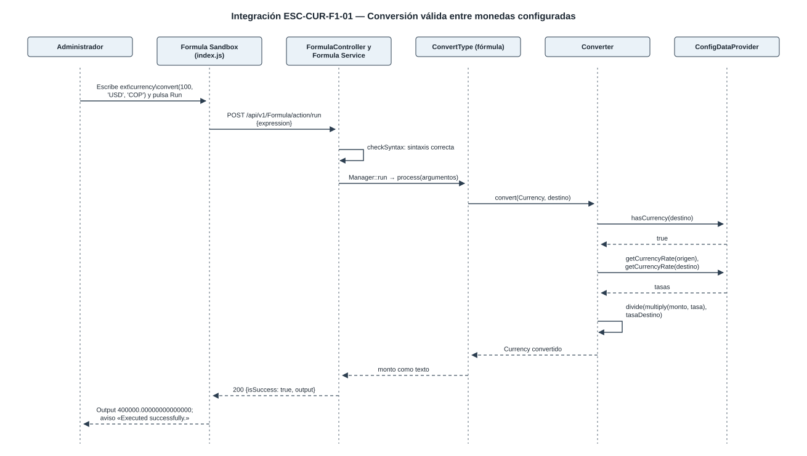

Recorre FE C3, ConvertType C7, Converter C2 y getCurrencyRate C2. Casos CN-CUR-F1-01 y 02.

<details><summary>Fuente Mermaid</summary>

```mermaid
sequenceDiagram
    participant U as Administrador
    participant FE as Formula Sandbox (index.js)
    participant API as FormulaController y Formula Service
    participant CT as ConvertType (fórmula)
    participant CV as Converter
    participant CFG as ConfigDataProvider
    U->>FE: Escribe ext\currency\convert(100, 'USD', 'COP') y pulsa Run
    FE->>API: POST /api/v1/Formula/action/run {expression}
    API->>API: checkSyntax: sintaxis correcta
    API->>CT: Manager::run → process(argumentos)
    CT->>CV: convert(Currency, destino)
    CV->>CFG: hasCurrency(destino)
    CFG-->>CV: true
    CV->>CFG: getCurrencyRate(origen), getCurrencyRate(destino)
    CFG-->>CV: tasas
    CV->>CV: divide(multiply(monto, tasa), tasaDestino)
    CV-->>CT: Currency convertido
    CT-->>API: monto como texto
    API-->>FE: 200 {isSuccess: true, output}
    FE-->>U: Output 400000.00000000000000; aviso «Executed successfully.»
```

</details>

### ESC-CUR-F1-02

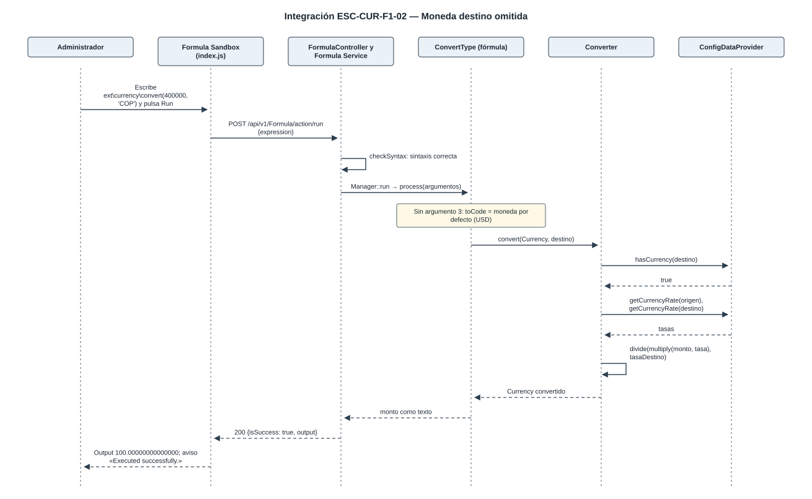

Recorre ConvertType C3 (rama No del nodo 5). Casos CN-CUR-F1-03, 04 y 05.

<details><summary>Fuente Mermaid</summary>

```mermaid
sequenceDiagram
    participant U as Administrador
    participant FE as Formula Sandbox (index.js)
    participant API as FormulaController y Formula Service
    participant CT as ConvertType (fórmula)
    participant CV as Converter
    participant CFG as ConfigDataProvider
    U->>FE: Escribe ext\currency\convert(400000, 'COP') y pulsa Run
    FE->>API: POST /api/v1/Formula/action/run {expression}
    API->>API: checkSyntax: sintaxis correcta
    API->>CT: Manager::run → process(argumentos)
    Note over CT: Sin argumento 3: toCode = moneda por defecto (USD)
    CT->>CV: convert(Currency, destino)
    CV->>CFG: hasCurrency(destino)
    CFG-->>CV: true
    CV->>CFG: getCurrencyRate(origen), getCurrencyRate(destino)
    CFG-->>CV: tasas
    CV->>CV: divide(multiply(monto, tasa), tasaDestino)
    CV-->>CT: Currency convertido
    CT-->>API: monto como texto
    API-->>FE: 200 {isSuccess: true, output}
    FE-->>U: Output 100.00000000000000; aviso «Executed successfully.»
```

</details>

### ESC-CUR-F1-03

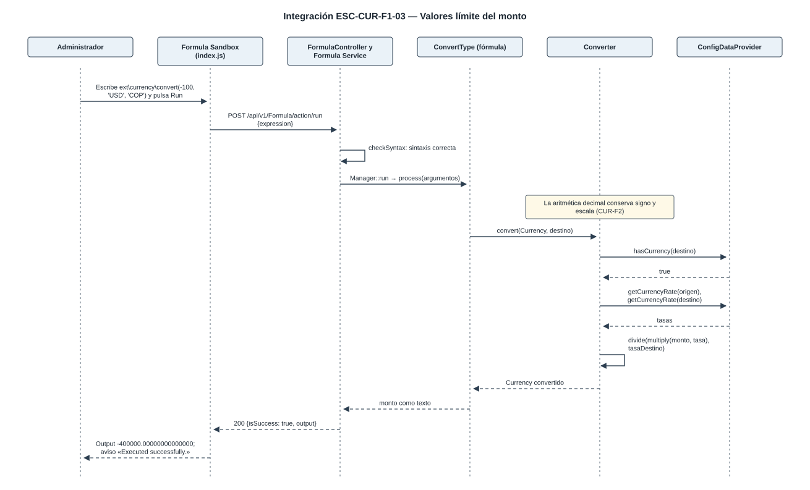

Mismo recorrido que ESC-CUR-F1-01; cambia el valor. Casos CN-CUR-F1-06 a 10.

<details><summary>Fuente Mermaid</summary>

```mermaid
sequenceDiagram
    participant U as Administrador
    participant FE as Formula Sandbox (index.js)
    participant API as FormulaController y Formula Service
    participant CT as ConvertType (fórmula)
    participant CV as Converter
    participant CFG as ConfigDataProvider
    U->>FE: Escribe ext\currency\convert(-100, 'USD', 'COP') y pulsa Run
    FE->>API: POST /api/v1/Formula/action/run {expression}
    API->>API: checkSyntax: sintaxis correcta
    API->>CT: Manager::run → process(argumentos)
    Note over CV: La aritmética decimal conserva signo y escala (CUR-F2)
    CT->>CV: convert(Currency, destino)
    CV->>CFG: hasCurrency(destino)
    CFG-->>CV: true
    CV->>CFG: getCurrencyRate(origen), getCurrencyRate(destino)
    CFG-->>CV: tasas
    CV->>CV: divide(multiply(monto, tasa), tasaDestino)
    CV-->>CT: Currency convertido
    CT-->>API: monto como texto
    API-->>FE: 200 {isSuccess: true, output}
    FE-->>U: Output -400000.00000000000000; aviso «Executed successfully.»
```

</details>

### ESC-CUR-F1-04

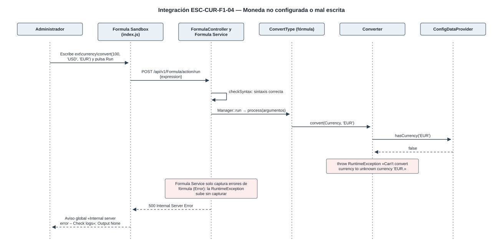

Recorre FE C2, ConvertType C7 hasta el nodo 16 y Converter C1 (o getCurrencyRate C1 si la moneda inválida es el origen). Casos CN-CUR-F1-11, 12 y 13: Fallidos, DEF-CUR-01.

<details><summary>Fuente Mermaid</summary>

```mermaid
sequenceDiagram
    participant U as Administrador
    participant FE as Formula Sandbox (index.js)
    participant API as FormulaController y Formula Service
    participant CT as ConvertType (fórmula)
    participant CV as Converter
    participant CFG as ConfigDataProvider
    U->>FE: Escribe ext\currency\convert(100, 'USD', 'EUR') y pulsa Run
    FE->>API: POST /api/v1/Formula/action/run {expression}
    API->>API: checkSyntax: sintaxis correcta
    API->>CT: Manager::run → process(argumentos)
    CT->>CV: convert(Currency, 'EUR')
    CV->>CFG: hasCurrency('EUR')
    CFG-->>CV: false
    Note over CV: throw RuntimeException «Can't convert currency to unknown currency 'EUR.»
    Note over API: Formula Service solo captura errores de fórmula (Error): la RuntimeException sube sin capturar
    API-->>FE: 500 Internal Server Error
    FE-->>U: Aviso global «Internal server error – Check logs»; Output None
```

</details>

### ESC-CUR-F1-05

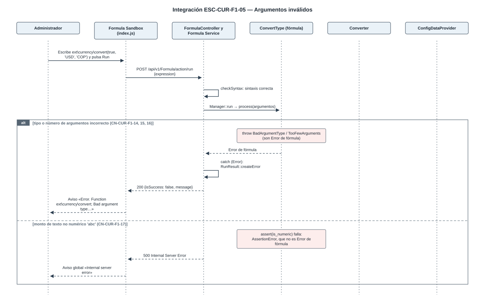

La primera rama recorre FE C6 y ConvertType C1, C2 o C4; la segunda recorre FE C2 y ConvertType C6 (DEF-CUR-02).

<details><summary>Fuente Mermaid</summary>

```mermaid
sequenceDiagram
    participant U as Administrador
    participant FE as Formula Sandbox (index.js)
    participant API as FormulaController y Formula Service
    participant CT as ConvertType (fórmula)
    participant CV as Converter
    participant CFG as ConfigDataProvider
    U->>FE: Escribe ext\currency\convert(true, 'USD', 'COP') y pulsa Run
    FE->>API: POST /api/v1/Formula/action/run {expression}
    API->>API: checkSyntax: sintaxis correcta
    API->>CT: Manager::run → process(argumentos)
    alt tipo o número de argumentos incorrecto (CN-CUR-F1-14, 15, 16)
    Note over CT: throw BadArgumentType / TooFewArguments (son Error de fórmula)
    CT-->>API: Error de fórmula
    API->>API: catch (Error): RunResult::createError
    API-->>FE: 200 {isSuccess: false, message}
    FE-->>U: Aviso «Error. Function ext\currency\convert; Bad argument type…»
    else monto de texto no numérico 'abc' (CN-CUR-F1-17)
    Note over CT: assert(is_numeric) falla: AssertionError, que no es Error de fórmula
    API-->>FE: 500 Internal Server Error
    FE-->>U: Aviso global «Internal server error»
    end
```

</details>


---

## 4. Cobertura por escenario

| Escenario | Frontend | ConvertType | Converter | getCurrencyRate |
| :--- | :--- | :--- | :--- | :--- |
| ESC-CUR-F1-01 Conversión válida | C3 | C7 | C2 | C2 |
| ESC-CUR-F1-02 Argumentos opcionales o variantes | C3 | C3, C7 | C2 | C2 |
| ESC-CUR-F1-03 Valores límite del monto | C3 | C7 | C2 | C2 |
| ESC-CUR-F1-04 Moneda no configurada | C2 | C7 (hasta el nodo 16) | C1, C2 | C1 |
| ESC-CUR-F1-05 Argumentos inválidos | C2, C6 | C1, C2, C4, C6 | — | — |

| Grafo | V(G) | Caminos factibles | Cubiertos por la caja negra | Cobertura de caminos |
| :--- | :--- | :--- | :--- | :--- |
| Frontend `run()` | 8 | 5 (C8 no es factible; C5 y C7 no se pueden provocar desde CUR-F1) | 3 (C2, C3, C6) | 60 % |
| `ConvertType::process()` | 7 | 7 | 6 | 86 % |
| `Converter::convert()` | 2 | 2 | 2 | 100 % |
| `getCurrencyRate()` | 3 | 3 | 2 | 67 % |

## 5. Casos de prueba de caja blanca nuevos

| ID | Grafo y camino | Entrada | Resultado esperado | Estado |
| :--- | :--- | :--- | :--- | :--- |
| CB-CUR-F1-FE-01 | Frontend C1 | Script vacío y pulsar Run | Aviso «emptyScript» sin petición al servidor | Pendiente de ejecutar |
| CB-CUR-F1-FE-02 | Frontend C4 | `output\print(ext\currency\convert(100, 'USD', 'COP')` (falta un paréntesis) | Aviso «Syntax error» con el detalle del servidor | Pendiente de ejecutar |
| CB-CUR-F1-BE-01 | ConvertType C5 | `ext\currency\convert(100, 'USD', 1)` | Error de fórmula «Bad argument type at position 3, must be string.» | Pendiente de ejecutar |
| CB-CUR-F1-BE-02 | getCurrencyRate C3 | Moneda en la lista pero sin entrada en `currencyRates` | Devuelve 1.0 (comportamiento actual; ver DEF-CUR-05) | Pendiente; se cubrirá con prueba unitaria y un doble de la configuración |

Los demás caminos factibles ya quedaron ejecutados en la caja negra (columna «Escenario y casos que lo cubren»). Los cuatro casos nuevos están pendientes porque los servicios Docker están detenidos; se ejecutarán como pruebas unitarias en el criterio 6.

## 6. Hallazgos del análisis de código

- **DEF-CUR-01:** `Converter::convert()` (nodo 3) y `getCurrencyRate()` (nodo 4) lanzan `RuntimeException`, que el servicio de fórmulas no captura porque solo captura `Error` de fórmula. Por eso la pantalla muestra «Internal server error» en vez de un mensaje sobre la moneda. Los mensajes de las líneas 56, 78 y 82 de `Converter.php` además no cierran la comilla.
- **DEF-CUR-02:** el nodo 14 de `ConvertType` es un `assert`. Con las aserciones activas, un monto de texto no numérico produce `AssertionError` (HTTP 500) en lugar del `BadArgumentType` que sí recibe un booleano en el nodo 8.
- **Decisiones correlacionadas en el frontend:** los nodos 9 y 13 evalúan `response.isSuccess`, así que el camino C8 no es factible. Fusionar ambas decisiones bajaría V(G) de 8 a 7 sin cambiar el comportamiento.
- **Tasa por defecto:** el nodo 7 de `getCurrencyRate()` devuelve 1.0 cuando una moneda configurada no tiene tasa. Es la misma raíz que DEF-CUR-05 (CUR-F5).
