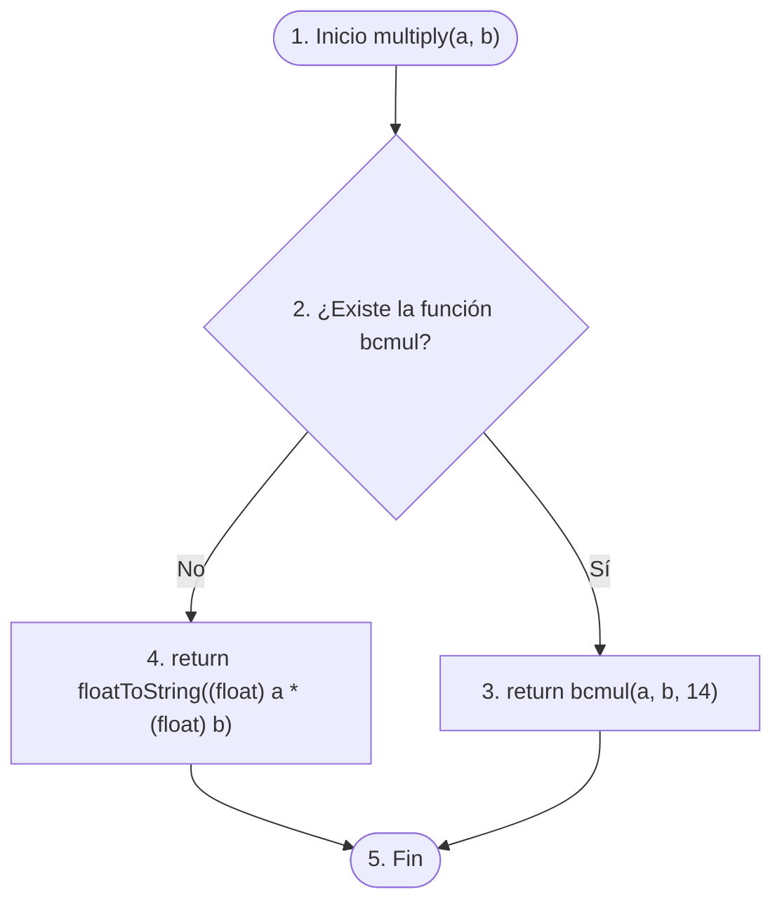
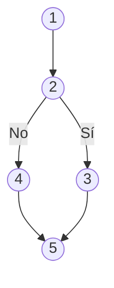
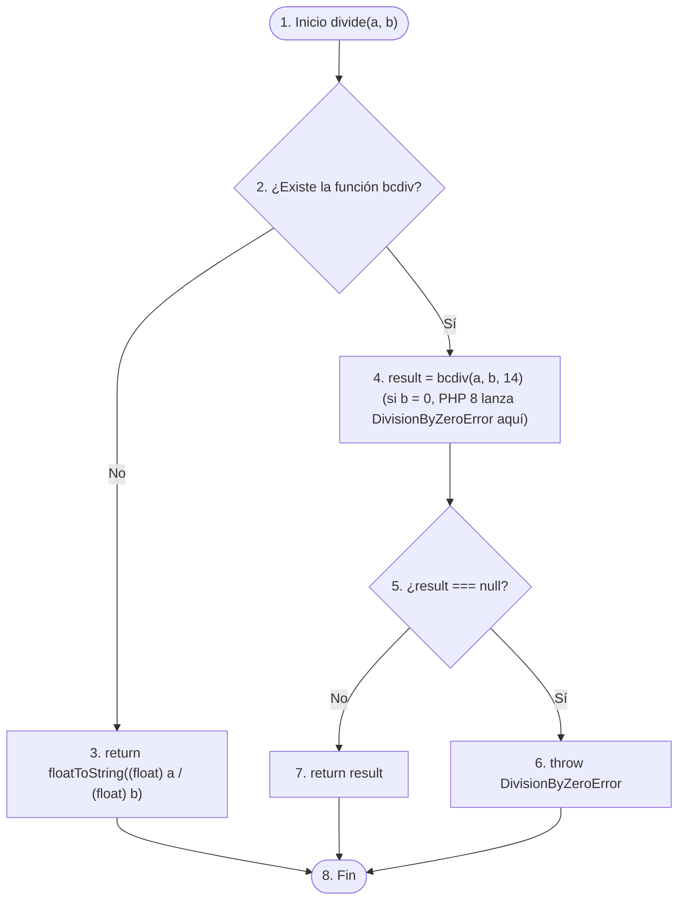
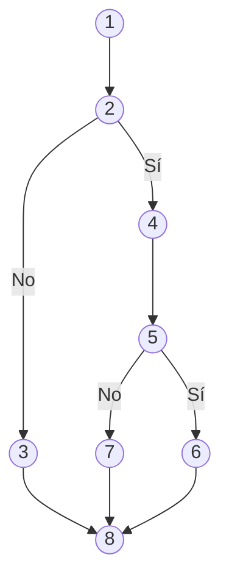
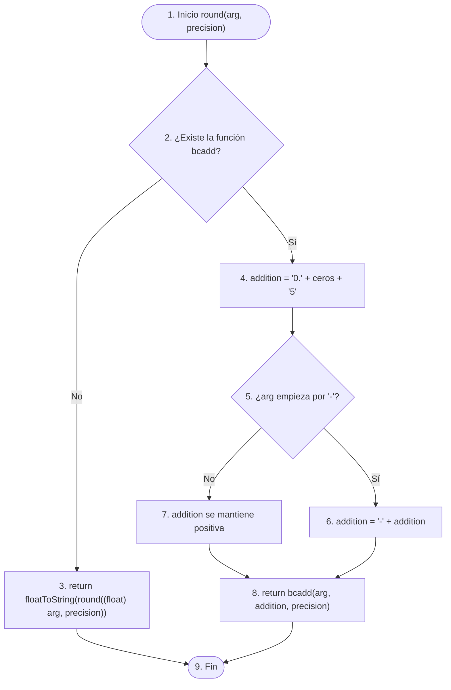
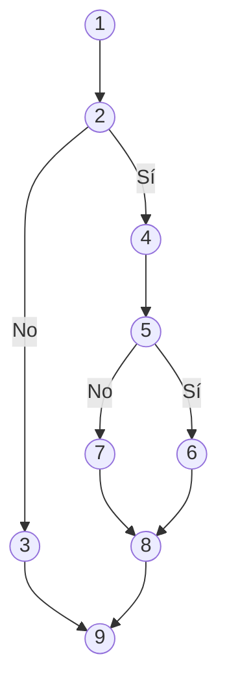
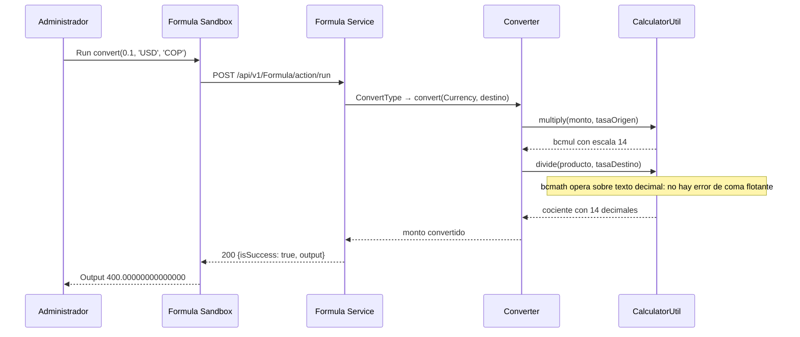
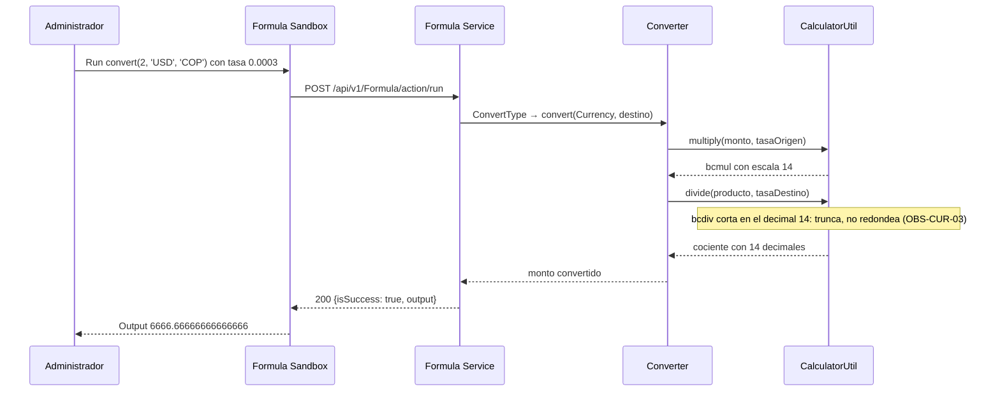
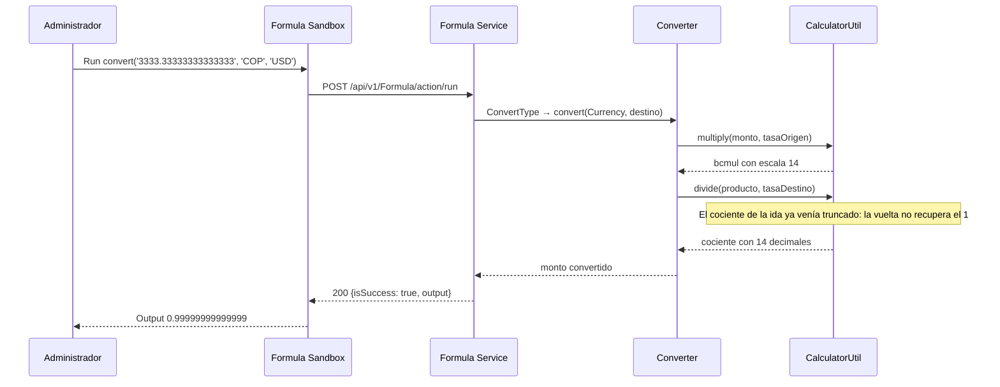

# CUR-F2 — Pruebas de caja blanca: aritmética decimal exacta de montos

**Funcionalidad:** `CalculatorUtil` hace la aritmética de montos con la extensión bcmath sobre texto decimal y escala fija de 14 decimales. La conversión de CUR-F1 la usa en `Converter::convertAmount()` (multiplica por la tasa de origen y divide por la de destino).

**Versión analizada:** EspoCRM 10.1.1. **Fecha:** 15 de noviembre de 2026.

**Convenciones.** Rama **Sí** a la derecha y rama **No** a la izquierda en todas las decisiones; en Mermaid la arista No se declara primero para que quede a la izquierda. Un grafo por método; la tabla de caminos indica qué escenario y casos de la caja negra recorren cada camino. Los documentos se generan con `docs/CUR/herramientas/generar_cur_f2_f5.py`, que valida la orientación de las ramas y que E − N + 2 = P + 1.

---

## 1. Frontend

La capa de pantalla de CUR-F2 es el Formula Sandbox, igual que en CUR-F1. Su grafo, su V(G) = 8 y sus caminos están en [CUR-F1 §1](../CUR-F1/caja-blanca.md#1-frontend); no se repiten aquí.

| Escenario | Camino del frontend `run()` |
| :--- | :--- |
| ESC-CUR-F2-01, 02 y 03 | C3 (ejecución exitosa) |

---

## 2. Backend

### Backend — CalculatorUtil::multiply() (misma estructura: add, subtract, compare)

Archivo: `application/Espo/Core/Currency/CalculatorUtil.php`. `add` (líneas 43-50), `subtract` (57-64) y `compare` (131-138) tienen exactamente el mismo grafo, con V(G) = 2.

**Diagrama de flujo**



**Grafo de control de flujo**



| Nodo | Tipo | Líneas | Descripción |
| :--- | :--- | :--- | :--- |
| 1 | Inicio | 73 | Inicio multiply(a, b) |
| 2 | Decisión | 75 | ¿Existe la función bcmul? |
| 3 | Proceso | 79 | return bcmul(a, b, 14) |
| 4 | Proceso | 76 | return floatToString((float) a * (float) b) |
| 5 | Fin | 80 | Fin |

| Método | Cálculo | V(G) |
| :--- | :--- | :--- |
| Aristas y nodos | E − N + 2 = 5 − 5 + 2 | 2 |
| Nodos de decisión | P + 1 = 1 + 1 (nodos 2) | 2 |
| Regiones | Regiones del grafo plano, incluida la exterior | 2 |

| Camino | Secuencia de nodos | Qué recorre | Escenario y casos que lo cubren |
| :--- | :--- | :--- | :--- |
| C1 | 1-2-3-5 | bcmath disponible. | CN-CUR-F2-01 a 08 (todas las conversiones) |
| C2 | 1-2-4-5 | Sin bcmath: cálculo en coma flotante. | No factible por la interfaz (el contenedor trae bcmath). Cubierto con `php -n`: CB-CUR-F2-03 |

### Backend — CalculatorUtil::divide()

Archivo: `application/Espo/Core/Currency/CalculatorUtil.php`.

**Diagrama de flujo**



**Grafo de control de flujo**



| Nodo | Tipo | Líneas | Descripción |
| :--- | :--- | :--- | :--- |
| 1 | Inicio | 89 | Inicio divide(a, b) |
| 2 | Decisión | 91 | ¿Existe la función bcdiv? |
| 3 | Proceso | 92 | return floatToString((float) a / (float) b) |
| 4 | Proceso | 95 | result = bcdiv(a, b, 14) (si b = 0, PHP 8 lanza DivisionByZeroError aquí) |
| 5 | Decisión | 97 | ¿result === null? |
| 6 | Salida de error | 98 | throw DivisionByZeroError |
| 7 | Proceso | 101 | return result |
| 8 | Fin | 102 | Fin |

| Método | Cálculo | V(G) |
| :--- | :--- | :--- |
| Aristas y nodos | E − N + 2 = 9 − 8 + 2 | 3 |
| Nodos de decisión | P + 1 = 2 + 1 (nodos 2, 5) | 3 |
| Regiones | Regiones del grafo plano, incluida la exterior | 3 |

| Camino | Secuencia de nodos | Qué recorre | Escenario y casos que lo cubren |
| :--- | :--- | :--- | :--- |
| C1 | 1-2-3-8 | Sin bcmath. | Solo con `php -n`: CB-CUR-F2-03 |
| C2 | 1-2-4-5-7-8 | Divisor distinto de cero. | CN-CUR-F2-01 a 08 |
| C3 | 1-2-4-5-6-8 | bcdiv devuelve null. | No factible: en PHP 8 bcdiv lanza DivisionByZeroError en el nodo 4 y nunca devuelve null (código muerto). El registro de CN-CUR-F4-07 confirma que el error sale de la línea 95 |

### Backend — CalculatorUtil::round()

Archivo: `application/Espo/Core/Currency/CalculatorUtil.php`.

**Diagrama de flujo**



**Grafo de control de flujo**



| Nodo | Tipo | Líneas | Descripción |
| :--- | :--- | :--- | :--- |
| 1 | Inicio | 108 | Inicio round(arg, precision) |
| 2 | Decisión | 110 | ¿Existe la función bcadd? |
| 3 | Proceso | 111-113 | return floatToString(round((float) arg, precision)) |
| 4 | Proceso | 116 | addition = '0.' + ceros + '5' |
| 5 | Decisión | 118 | ¿arg empieza por '-'? |
| 6 | Proceso | 119 | addition = '-' + addition |
| 7 | Proceso | 118 | addition se mantiene positiva |
| 8 | Proceso | 124 | return bcadd(arg, addition, precision) |
| 9 | Fin | 125 | Fin |

| Método | Cálculo | V(G) |
| :--- | :--- | :--- |
| Aristas y nodos | E − N + 2 = 10 − 9 + 2 | 3 |
| Nodos de decisión | P + 1 = 2 + 1 (nodos 2, 5) | 3 |
| Regiones | Regiones del grafo plano, incluida la exterior | 3 |

| Camino | Secuencia de nodos | Qué recorre | Escenario y casos que lo cubren |
| :--- | :--- | :--- | :--- |
| C1 | 1-2-3-9 | Sin bcmath. | Solo con `php -n`: CB-CUR-F2-03 |
| C2 | 1-2-4-5-7-8-9 | Monto positivo. | CB-CUR-F2-01 (prueba unitaria); la conversión no redondea |
| C3 | 1-2-4-5-6-8-9 | Monto negativo. | CB-CUR-F2-02 (prueba unitaria) |


---

## 3. Integración (un diagrama por escenario)

### ESC-CUR-F2-01



Recorre multiply C1 y divide C2. Casos CN-CUR-F2-01, 02 y 03.

### ESC-CUR-F2-02



Recorre multiply C1 y divide C2. Casos CN-CUR-F2-04 a 07; el 04 y el 06 son observaciones.

### ESC-CUR-F2-03



Dos ejecuciones encadenadas por el mismo camino. Caso CN-CUR-F2-08 (OBS-CUR-03).


---

## 4. Cobertura por escenario

| Escenario | Frontend | multiply | divide | round |
| :--- | :--- | :--- | :--- | :--- |
| ESC-CUR-F2-01 Exactitud decimal | C3 | C1 | C2 | — |
| ESC-CUR-F2-02 Escala y redondeo | C3 | C1 | C2 | — |
| ESC-CUR-F2-03 Ida y vuelta | C3 | C1 | C2 | — |

| Grafo | V(G) | Caminos factibles en el entorno | Cubiertos por la caja negra |
| :--- | :--- | :--- | :--- |
| `multiply` (y `add`, `subtract`, `compare`) | 2 | 1 | 1 (100 %) |
| `divide` | 3 | 1 | 1 (100 %) |
| `round` | 3 | 2 | 0 (0 %) |

## 5. Casos de prueba de caja blanca nuevos

| ID | Grafo y camino | Entrada | Resultado esperado | Estado |
| :--- | :--- | :--- | :--- | :--- |
| CB-CUR-F2-01 | round C2 | `round('2.345', 2)` | `2.35` (redondeo hacia arriba en el medio) | Pasó: `CalculatorUtilTest::testRoundPositivoEnElPuntoMedio` |
| CB-CUR-F2-02 | round C3 | `round('-2.345', 2)` | `-2.35` (simétrico) | Pasó: `CalculatorUtilTest::testRoundNegativoEsSimetrico` |
| CB-CUR-F2-03 | multiply C2, divide C1 | Las mismas operaciones con bcmath deshabilitado | Mismo resultado salvo error de coma flotante | Pasó con `php -n`: `CalculatorUtilSinBcmathTest` (7 pruebas) |
| CB-CUR-F2-04 | divide (nodo 4) | `divide('1', '0')` | `DivisionByZeroError` | Pasó: `CalculatorUtilTest::testDivideEntreCeroLanzaDivisionByZeroError` |

## 6. Hallazgos del análisis de código

- **Código muerto:** la rama `result === null` de `divide()` (nodos 5 y 6) no se alcanza en PHP 8, porque `bcdiv` ya lanza `DivisionByZeroError`. Igual las ramas sin bcmath, porque la extensión está instalada.
- **Truncamiento:** la escala fija de 14 decimales de `bcmul` y `bcdiv` trunca en lugar de redondear. Explica OBS-CUR-02 (el monto de 15 decimales se recorta antes de multiplicar) y OBS-CUR-03 (6666.66666666666666 y la ida y vuelta 0.99999999999999).
- **`round()` no se usa en la conversión:** existe para otros consumidores; su cobertura queda para las pruebas unitarias.

## 7. Ejecución de las pruebas unitarias

Las pruebas están en `tests/unit/Espo/VyV/Currency/` y se ejecutaron el 15 de noviembre de 2026 en el contenedor `espocrm` (PHPUnit 11.5.58, PHP 8.4.27). El código de las seis clases probadas es idéntico en la imagen y en el repositorio (comparado por MD5). Las dependencias se reemplazan por dobles de prueba de PHPUnit, así que no se toca la base de datos.

```bash
docker exec espocrm sh -c "cd /var/www/html && phpunit tests/unit/Espo/VyV/Currency --no-coverage --testdox"
```

```bash
docker exec espocrm sh -c "cd /var/www/html && php -n /usr/local/bin/phpunit tests/unit/Espo/VyV/Currency/CalculatorUtilSinBcmathTest.php --no-coverage"
```

**Resultado del conjunto:** 57 pruebas y 151 aserciones; todas pasan y 7 se omiten. Las 7 omitidas son las de `CalculatorUtilSinBcmathTest`, que solo corren sin bcmath; con `php -n` pasan las 7 (10 aserciones).

**Cobertura de líneas medida con Xdebug:**

| Clase | Métodos | Líneas |
| :--- | :--- | :--- |
| `CurrencyType` | 5/5 | 44/44 (100 %) |
| `RateService` | 6/6 | 32/32 (100 %) |
| `SyncManager` | 11/11 | 55/55 (100 %) |
| `AfterSave` / `AfterDelete` | 2/2 cada uno | 7/7 cada uno (100 %) |
| `CalculatorUtil` | — | 18/28 (64 %) con bcmath. Nueve de las diez líneas restantes son las ramas sin bcmath, que se ejecutan con `php -n` (sin Xdebug, así que no se miden). La décima es la línea 98, código muerto |

Estos números son del 15-nov-2026, antes del [ciclo TDD sobre `RateService`](../tdd/README.md). Después del TDD la suite del módulo tiene 66 pruebas y 199 aserciones, todas pasan (7 omitidas), y `RateService` sigue al 100 % (38/38 líneas). Desde entonces se ejecuta con `phpunit -c tests/unit/Espo/VyV/Currency/phpunit-cur.xml`.

| Prueba | Pruebas | Caminos que recorre |
| :--- | :--- | :--- |
| `CalculatorUtilTest` | 10 | multiply/add/subtract/compare C1, divide C2 y nodo 4 (divisor cero), round C2 y C3 |
| `CalculatorUtilSinBcmathTest` (`php -n`) | 7 | multiply/add/subtract/compare C2, divide C1, round C1 |

**Cobertura de caminos tras las pruebas unitarias:** `multiply` 2/2, `divide` 2/3 (C3 es código muerto), `round` 3/3. Sin bcmath, `add('0.1', '0.2')` devuelve `'0.3'`: `floatToString` oculta el error de coma flotante al cortar en 14 decimales. En cambio `divide('2', '0.0003')` ya no coincide con el resultado exacto de bcdiv.
