# CUR-F3 — Pruebas de caja blanca: validación de campos de moneda

**Funcionalidad:** el campo de moneda (aquí `Campaign.budget`) se valida en la pantalla (`currency.ts` con la máscara AutoNumeric) y en el servidor (`CurrencyType`: formato, rango permitido y código de moneda válido).

**Versión analizada:** EspoCRM 10.1.1. **Fecha:** 15 de noviembre de 2026.

**Convenciones.** Rama **Sí** a la derecha y rama **No** a la izquierda en todas las decisiones; en Mermaid la arista No se declara primero para que quede a la izquierda. Un grafo por método; la tabla de caminos indica qué escenario y casos de la caja negra recorren cada camino. Los documentos se generan con `docs/CUR/herramientas/generar_cur_f2_f5.py`, que valida la orientación de las ramas y que E − N + 2 = P + 1.

---

## 1. Frontend

### Frontend — currency.ts::fetch() y parse() del campo Budget

Archivo: `client/src/views/fields/currency.ts`. Las dos condiciones `if (this.params.decimal)` consecutivas de `parse()` se representan como una sola decisión (nodo 6), porque no hay código entre ellas. La máscara AutoNumeric (biblioteca externa) filtra la entrada antes de este método.

**Diagrama de flujo**

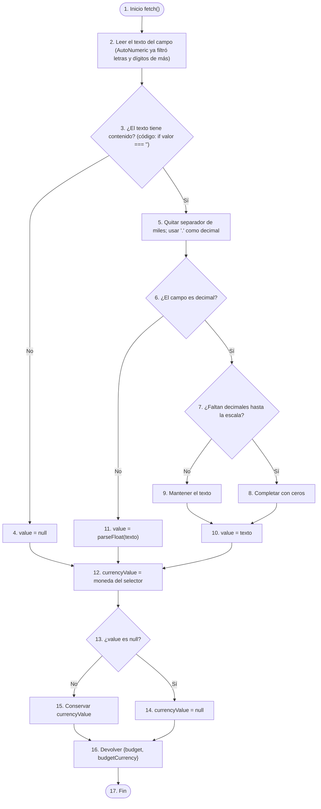

**Grafo de control de flujo**

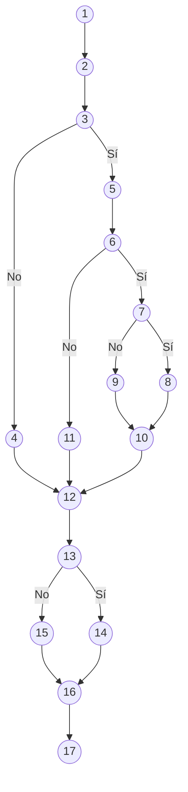

| Nodo | Tipo | Líneas | Descripción |
| :--- | :--- | :--- | :--- |
| 1 | Inicio | 352 | Inicio fetch() |
| 2 | Proceso | 353 | Leer el texto del campo (AutoNumeric ya filtró letras y dígitos de más) |
| 3 | Decisión | 280 | ¿El texto tiene contenido? (código: if valor === '') |
| 4 | Proceso | 282-283 | value = null |
| 5 | Proceso | 286-287 | Quitar separador de miles; usar '.' como decimal |
| 6 | Decisión | 289 | ¿El campo es decimal? |
| 7 | Decisión | 296 | ¿Faltan decimales hasta la escala? |
| 8 | Proceso | 297 | Completar con ceros |
| 9 | Proceso | 296 | Mantener el texto |
| 10 | Proceso | 301-303 | value = texto |
| 11 | Proceso | 305 | value = parseFloat(texto) |
| 12 | Proceso | 361-363 | currencyValue = moneda del selector |
| 13 | Decisión | 365 | ¿value es null? |
| 14 | Proceso | 366 | currencyValue = null |
| 15 | Proceso | 365 | Conservar currencyValue |
| 16 | Proceso | 369-372 | Devolver {budget, budgetCurrency} |
| 17 | Fin | 373 | Fin |

| Método | Cálculo | V(G) |
| :--- | :--- | :--- |
| Aristas y nodos | E − N + 2 = 20 − 17 + 2 | 5 |
| Nodos de decisión | P + 1 = 4 + 1 (nodos 3, 6, 7, 13) | 5 |
| Regiones | Regiones del grafo plano, incluida la exterior | 5 |

| Camino | Secuencia de nodos | Qué recorre | Escenario y casos que lo cubren |
| :--- | :--- | :--- | :--- |
| C1 | 1-2-3-4-12-13-14-16-17 | Campo vacío. | CN-CUR-F3-09 (AutoNumeric vació el '12abc') |
| C2 | 1-2-3-5-6-11-12-13-15-16-17 | Campo no decimal con monto. | CN-CUR-F3-01, 02, 04, 05, 06 y 07 (Budget no es decimal) |
| C3 | 1-2-3-5-6-7-8-10-12-13-15-16-17 | Campo decimal con menos decimales que la escala. | Ninguno: Budget no es decimal (caso nuevo CB-CUR-F3-01) |
| C4 | 1-2-3-5-6-7-9-10-12-13-15-16-17 | Campo decimal con la escala completa. | Ninguno (caso nuevo CB-CUR-F3-02) |
| C5 | 1-2-3-5-6-11-12-13-14-16-17 | Texto no vacío que termina en value null. | No factible: parseFloat nunca devuelve null |


---

## 2. Backend

### Backend — CurrencyType::checkValid()

Archivo: `application/Espo/Classes/FieldValidators/CurrencyType.php`. `isNotEmpty` (líneas 44-50) es una condición compuesta de cinco partes.

**Diagrama de flujo**

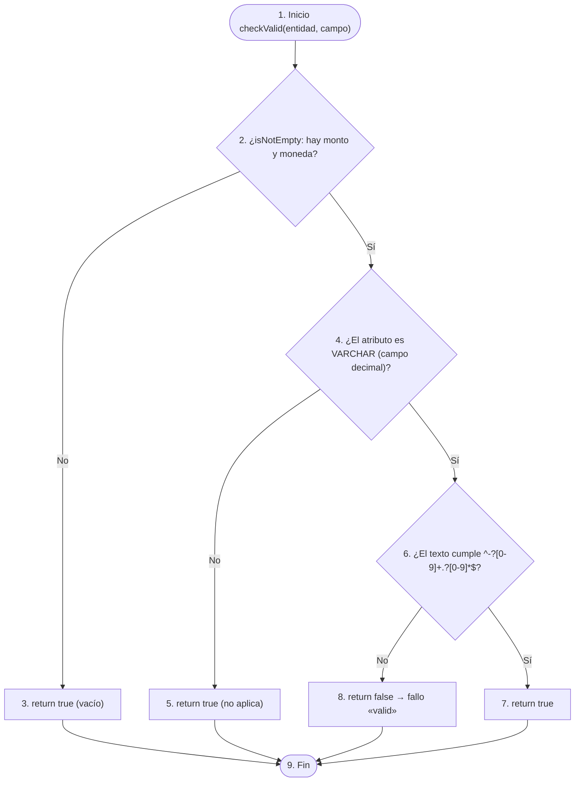

**Grafo de control de flujo**

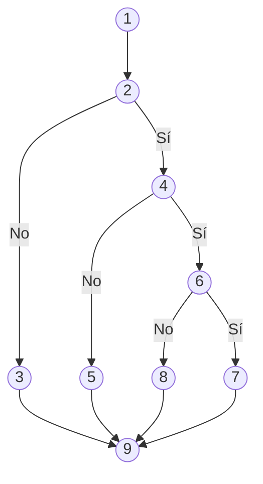

| Nodo | Tipo | Líneas | Descripción |
| :--- | :--- | :--- | :--- |
| 1 | Inicio | 52 | Inicio checkValid(entidad, campo) |
| 2 | Decisión | 54 | ¿isNotEmpty: hay monto y moneda? |
| 3 | Proceso | 55 | return true (vacío) |
| 4 | Decisión | 58 | ¿El atributo es VARCHAR (campo decimal)? |
| 5 | Proceso | 59 | return true (no aplica) |
| 6 | Decisión | 65 | ¿El texto cumple ^-?[0-9]+.?[0-9]*$? |
| 7 | Proceso | 66 | return true |
| 8 | Salida de error | 69 | return false → fallo «valid» |
| 9 | Fin | 70 | Fin |

| Método | Cálculo | V(G) |
| :--- | :--- | :--- |
| Aristas y nodos | E − N + 2 = 11 − 9 + 2 | 4 |
| Nodos de decisión | P + 1 = 3 + 1 (nodos 2, 4, 6) | 4 |
| Regiones | Regiones del grafo plano, incluida la exterior | 4 |

| Camino | Secuencia de nodos | Qué recorre | Escenario y casos que lo cubren |
| :--- | :--- | :--- | :--- |
| C1 | 1-2-3-9 | Sin monto o sin moneda. | CN-CUR-F3-18 |
| C2 | 1-2-4-5-9 | Atributo no VARCHAR (float). | CN-CUR-F3-01 a 17: Budget es float |
| C3 | 1-2-4-6-7-9 | Campo decimal con formato válido. | Ninguno (caso nuevo CB-CUR-F3-03) |
| C4 | 1-2-4-6-8-9 | Campo decimal con formato inválido. | Ninguno (caso nuevo CB-CUR-F3-04) |

### Backend — CurrencyType::checkInPermittedRange()

Archivo: `application/Espo/Classes/FieldValidators/CurrencyType.php`.

**Diagrama de flujo**

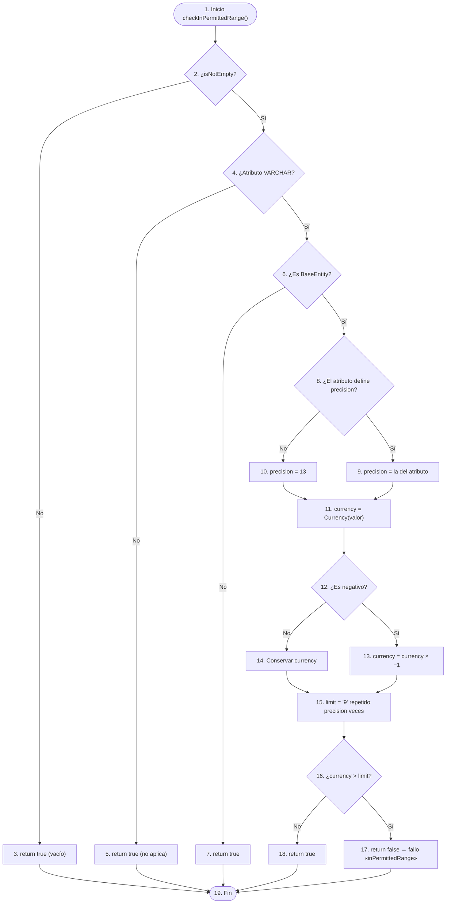

**Grafo de control de flujo**

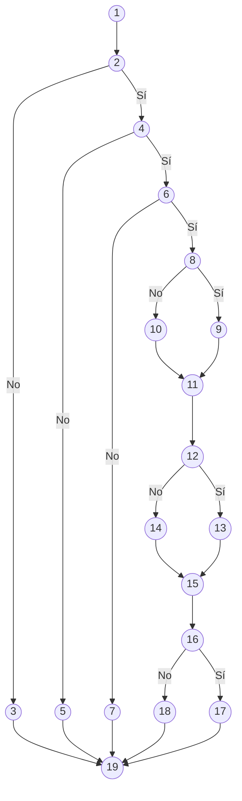

| Nodo | Tipo | Líneas | Descripción |
| :--- | :--- | :--- | :--- |
| 1 | Inicio | 72 | Inicio checkInPermittedRange() |
| 2 | Decisión | 74 | ¿isNotEmpty? |
| 3 | Proceso | 75 | return true (vacío) |
| 4 | Decisión | 78 | ¿Atributo VARCHAR? |
| 5 | Proceso | 79 | return true (no aplica) |
| 6 | Decisión | 82 | ¿Es BaseEntity? |
| 7 | Proceso | 83 | return true |
| 8 | Decisión | 87 (??) | ¿El atributo define precision? |
| 9 | Proceso | 87 | precision = la del atributo |
| 10 | Proceso | 87 | precision = 13 |
| 11 | Proceso | 89-91 | currency = Currency(valor) |
| 12 | Decisión | 93 | ¿Es negativo? |
| 13 | Proceso | 94 | currency = currency × −1 |
| 14 | Proceso | 93 | Conservar currency |
| 15 | Proceso | 97-101 | limit = '9' repetido precision veces |
| 16 | Decisión | 103 | ¿currency > limit? |
| 17 | Salida de error | 104 | return false → fallo «inPermittedRange» |
| 18 | Proceso | 107 | return true |
| 19 | Fin | 108 | Fin |

| Método | Cálculo | V(G) |
| :--- | :--- | :--- |
| Aristas y nodos | E − N + 2 = 24 − 19 + 2 | 7 |
| Nodos de decisión | P + 1 = 6 + 1 (nodos 2, 4, 6, 8, 12, 16) | 7 |
| Regiones | Regiones del grafo plano, incluida la exterior | 7 |

| Camino | Secuencia de nodos | Qué recorre | Escenario y casos que lo cubren |
| :--- | :--- | :--- | :--- |
| C1 | 1-2-3-19 | Vacío. | CN-CUR-F3-18 |
| C2 | 1-2-4-5-19 | Atributo float: el límite no se comprueba. | CN-CUR-F3-01 a 17; explica que CN-CUR-F3-08 acepte 14 dígitos (OBS-CUR-04) |
| C3 | 1-2-4-6-7-19 | Entidad que no es BaseEntity. | No factible por la interfaz (todas las entidades son BaseEntity); cubierto con un doble en `testRangoEntidadQueNoEsBaseEntity` |
| C4 | 1-2-4-6-8-9-11-12-14-15-16-18-19 | Decimal con precision propia, positivo, en rango. | Ninguno (caso nuevo CB-CUR-F3-05) |
| C5 | 1-2-4-6-8-10-11-12-14-15-16-18-19 | Decimal sin precision (13), en rango. | Ninguno (caso nuevo CB-CUR-F3-06) |
| C6 | 1-2-4-6-8-9-11-12-13-15-16-18-19 | Decimal negativo en rango. | Ninguno (caso nuevo CB-CUR-F3-07) |
| C7 | 1-2-4-6-8-9-11-12-14-15-16-17-19 | Decimal fuera de rango. | Ninguno (caso nuevo CB-CUR-F3-08) |

### Backend — CurrencyType::checkValidCurrency()

Archivo: `application/Espo/Classes/FieldValidators/CurrencyType.php`. Las decisiones 8 y 10 son compuestas de tres condiciones cada una.

**Diagrama de flujo**

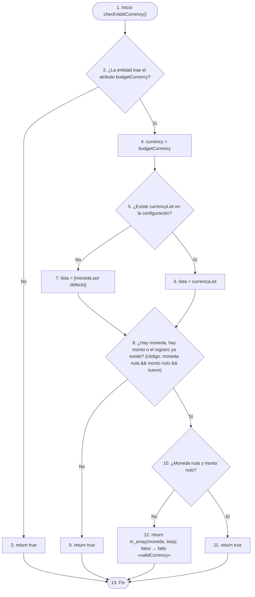

**Grafo de control de flujo**

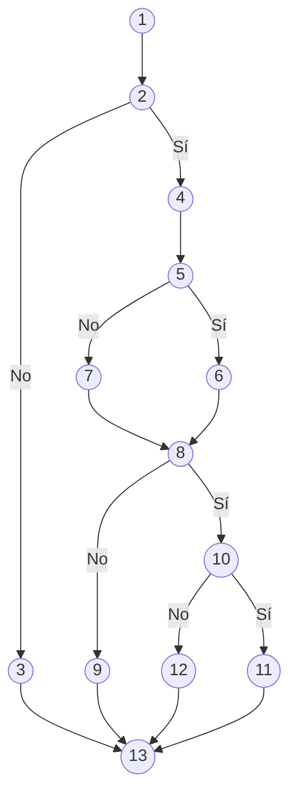

| Nodo | Tipo | Líneas | Descripción |
| :--- | :--- | :--- | :--- |
| 1 | Inicio | 110 | Inicio checkValidCurrency() |
| 2 | Decisión | 114 | ¿La entidad trae el atributo budgetCurrency? |
| 3 | Proceso | 115 | return true |
| 4 | Proceso | 118 | currency = budgetCurrency |
| 5 | Decisión | 119 (??) | ¿Existe currencyList en la configuración? |
| 6 | Proceso | 119 | lista = currencyList |
| 7 | Proceso | 119 | lista = [moneda por defecto] |
| 8 | Decisión | 121-125 | ¿Hay moneda, hay monto o el registro ya existe? (código: moneda nula && monto nulo && nuevo) |
| 9 | Proceso | 126 | return true |
| 10 | Decisión | 129-133 | ¿Moneda nula y monto nulo? |
| 11 | Proceso | 134 | return true |
| 12 | Proceso | 137 | return in_array(moneda, lista); falso → fallo «validCurrency» |
| 13 | Fin | 138 | Fin |

| Método | Cálculo | V(G) |
| :--- | :--- | :--- |
| Aristas y nodos | E − N + 2 = 16 − 13 + 2 | 5 |
| Nodos de decisión | P + 1 = 4 + 1 (nodos 2, 5, 8, 10) | 5 |
| Regiones | Regiones del grafo plano, incluida la exterior | 5 |

| Camino | Secuencia de nodos | Qué recorre | Escenario y casos que lo cubren |
| :--- | :--- | :--- | :--- |
| C1 | 1-2-3-13 | La petición no trae el atributo de moneda. | Ninguno (caso nuevo CB-CUR-F3-09) |
| C2 | 1-2-4-5-6-8-9-13 | Registro nuevo sin monto ni moneda. | Ninguno (caso nuevo CB-CUR-F3-10) |
| C3 | 1-2-4-5-6-8-10-11-13 | Monto y moneda nulos. | CN-CUR-F3-18 |
| C4 | 1-2-4-5-6-8-10-12-13 | Moneda con valor: se busca en la lista. | Verdadero: CN-CUR-F3-01 a 03, 16, 17. Falso: CN-CUR-F3-13, 14, 15 |
| C5 | 1-2-4-5-7-8-10-12-13 | Sin currencyList en la configuración. | No factible en esta instancia (currencyList siempre está definida); cubierto con un doble en `testMonedaSinCurrencyListUsaLaMonedaPorDefecto` |


---

## 3. Integración (un diagrama por escenario)

### ESC-CUR-F3-01

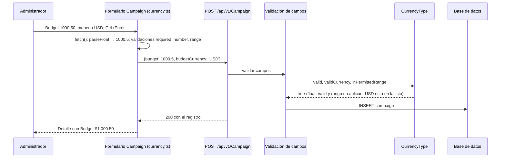

Frontend C2, checkValid C2, checkInPermittedRange C2, checkValidCurrency C4.

### ESC-CUR-F3-02

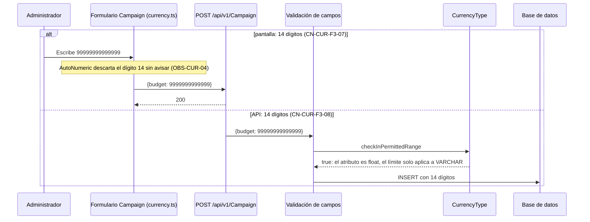

Frontend C2; en el servidor checkInPermittedRange C2, por eso el límite de 13 dígitos solo existe en la pantalla.

### ESC-CUR-F3-03

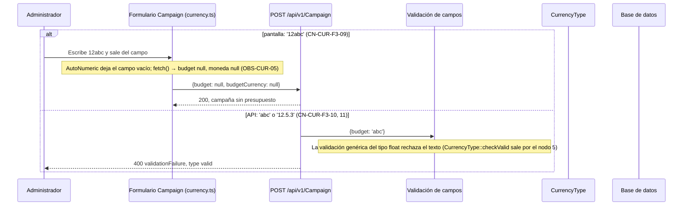

Frontend C1 en la pantalla; en la API el rechazo no viene de CurrencyType (checkValid C2).

### ESC-CUR-F3-04

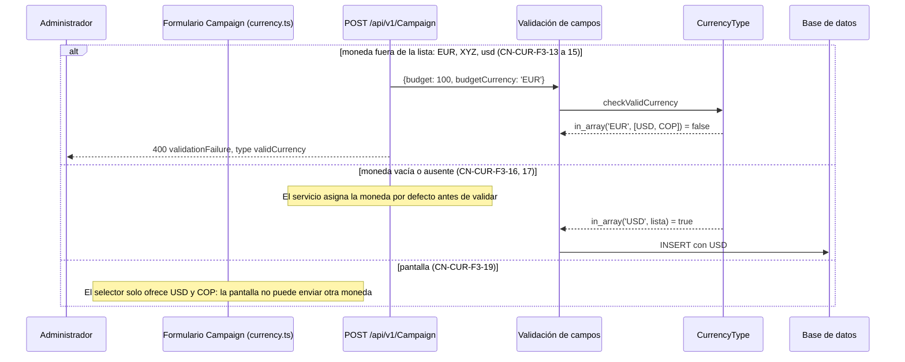

checkValidCurrency C4 con resultado falso o verdadero.


---

## 4. Cobertura por escenario

| Escenario | Frontend | checkValid | checkInPermittedRange | checkValidCurrency |
| :--- | :--- | :--- | :--- | :--- |
| ESC-CUR-F3-01 Válidos | C2 | C2 | C2 | C4 |
| ESC-CUR-F3-02 Límites | C2 | C2 | C2 | C4 |
| ESC-CUR-F3-03 Formato inválido | C1 | C2 | C2 | C4 |
| ESC-CUR-F3-04 Moneda inválida | C2 | C2 | C2 | C3, C4 |

| Grafo | V(G) | Caminos factibles | Cubiertos | Cobertura |
| :--- | :--- | :--- | :--- | :--- |
| Frontend `fetch()` | 5 | 4 | 2 | 50 % |
| `checkValid` | 4 | 4 | 2 | 50 % |
| `checkInPermittedRange` | 7 | 6 | 2 | 33 % |
| `checkValidCurrency` | 5 | 4 | 2 | 50 % |

La cobertura es baja porque `Campaign.budget` no es un campo decimal: las ramas de formato y rango de `CurrencyType` solo se ejecutan con campos de moneda decimales.

## 5. Casos de prueba de caja blanca nuevos

| ID | Grafo y camino | Entrada | Resultado esperado | Estado |
| :--- | :--- | :--- | :--- | :--- |
| CB-CUR-F3-01 / 02 | Frontend C3 y C4 | Campo de moneda decimal (escala 4) con `12.5` y con `12.5000` | `'12.5000'` en ambos | Pendiente: prueba del frontend (hay que compilar el cliente) |
| CB-CUR-F3-03 / 04 | checkValid C3 y C4 | Atributo VARCHAR con `'12.50'` y con `'12a'` | `true` y `false` | Pasó: `CurrencyTypeTest::testCheckValidDecimalConFormatoValido` y `…Invalido` |
| CB-CUR-F3-05 a 08 | checkInPermittedRange C4 a C7 | VARCHAR con precision 5 y `'99999'`; sin precision y `'1'`; `'-99999'`; `'100000'` | `true`, `true`, `true`, `false` | Pasó: `CurrencyTypeTest::testRangoConPrecisionEnElLimite`, `…SinPrecisionUsaTreceDigitos`, `…NegativoEnElLimite`, `…FueraDelLimite` |
| CB-CUR-F3-09 / 10 | checkValidCurrency C1 y C2 | Entidad sin `budgetCurrency`; entidad nueva sin monto ni moneda | `true` y `true` | Pasó: `CurrencyTypeTest::testMonedaSinAtributo` y `testMonedaNulaEnRegistroNuevoSinMonto` |

## 6. Hallazgos del análisis de código

- **El límite de 13 dígitos solo vive en la pantalla (OBS-CUR-04):** `checkInPermittedRange` sale por el nodo 5 en los campos float, así que la API acepta 14 dígitos que la pantalla no deja escribir.
- **El rechazo de `'abc'` por API no lo hace `CurrencyType`:** `checkValid` también sale por el nodo 5; el fallo `valid` lo produce la validación genérica del tipo float. No se localizó esa clase en este análisis.
- **Pérdida silenciosa en la pantalla (OBS-CUR-05):** la máscara AutoNumeric descarta caracteres no numéricos y deja el campo vacío; `fetch()` envía entonces monto y moneda nulos sin avisar.
- **Formato permisivo:** la expresión regular de `checkValid` acepta `'12.'` (punto sin decimales); `testCheckValidDecimalConFormatoValido` lo deja registrado.

## 7. Ejecución de las pruebas unitarias

Las pruebas están en `tests/unit/Espo/VyV/Currency/` y se ejecutaron el 15 de noviembre de 2026 en el contenedor `espocrm` (PHPUnit 11.5.58, PHP 8.4.27). El código de las seis clases probadas es idéntico en la imagen y en el repositorio (comparado por MD5). Las dependencias se reemplazan por dobles de prueba de PHPUnit, así que no se toca la base de datos.

```bash
docker exec espocrm sh -c "cd /var/www/html && phpunit tests/unit/Espo/VyV/Currency --no-coverage --testdox"
```

```bash
docker exec espocrm sh -c "cd /var/www/html && php -n /usr/local/bin/phpunit tests/unit/Espo/VyV/Currency/CalculatorUtilSinBcmathTest.php --no-coverage"
```

**Resultado del conjunto:** 57 pruebas y 151 aserciones; todas pasan y 7 se omiten. Las 7 omitidas son las de `CalculatorUtilSinBcmathTest`, que solo corren sin bcmath; con `php -n` pasan las 7 (10 aserciones).

**Cobertura de líneas medida con Xdebug:**

| Clase | Métodos | Líneas |
| :--- | :--- | :--- |
| `CurrencyType` | 5/5 | 44/44 (100 %) |
| `RateService` | 6/6 | 32/32 (100 %) |
| `SyncManager` | 11/11 | 55/55 (100 %) |
| `AfterSave` / `AfterDelete` | 2/2 cada uno | 7/7 cada uno (100 %) |
| `CalculatorUtil` | — | 18/28 (64 %) con bcmath. Nueve de las diez líneas restantes son las ramas sin bcmath, que se ejecutan con `php -n` (sin Xdebug, así que no se miden). La décima es la línea 98, código muerto |

| Prueba | Pruebas | Caminos que recorre |
| :--- | :--- | :--- |
| `CurrencyTypeTest` | 17 | checkValid C1 a C4; checkInPermittedRange C1 a C7 (C3 con un doble de `Entity`); checkValidCurrency C1 a C5 (C5 con una configuración sin `currencyList`) |

**Cobertura de caminos tras las pruebas unitarias:** `checkValid` 4/4, `checkInPermittedRange` 7/7 y `checkValidCurrency` 5/5. El frontend (`fetch()`) sigue en 2 de 4: las pruebas CB-CUR-F3-01 y 02 son de JavaScript y requieren compilar el cliente (`frontend/test`, Jasmine).
