# CUR-F4 — Pruebas de caja blanca: consulta y actualización de tasas (API)

**Funcionalidad:** `GET` y `PUT /api/v1/CurrencyRate` leen y escriben las tasas vigentes con control de permisos. La pantalla web no usa esta ruta, así que, como se acordó, la capa de «frontend» es la entrada de la API que ve el cliente.

**Versión analizada:** EspoCRM 10.1.1. **Fecha:** 15 de noviembre de 2026.

**Convenciones.** Rama **Sí** a la derecha y rama **No** a la izquierda en todas las decisiones; en Mermaid la arista No se declara primero para que quede a la izquierda. Un grafo por método; la tabla de caminos indica qué escenario y casos de la caja negra recorren cada camino. Los documentos se generan con `docs/CUR/herramientas/generar_cur_f2_f5.py`, que valida la orientación de las ramas y que E − N + 2 = P + 1.

---

## 1. Frontend

### Capa de entrada (equivale al frontend) — /api/v1/CurrencyRate

Archivo: `application/Espo/Tools/Currency/Api/Get.php y PutUpdate.php`.

**Diagrama de flujo**

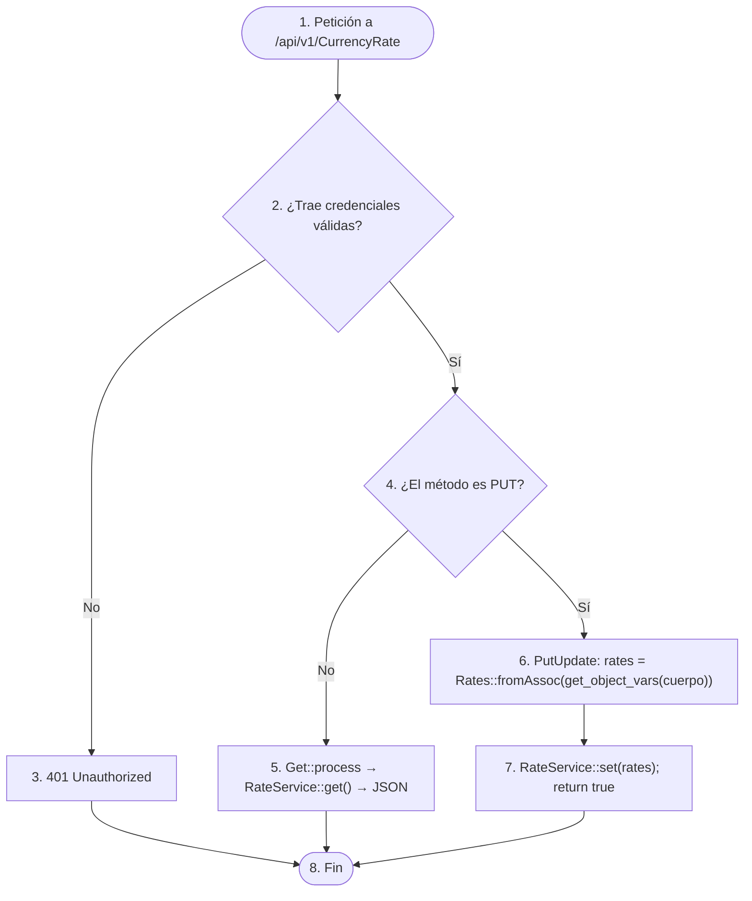

**Grafo de control de flujo**

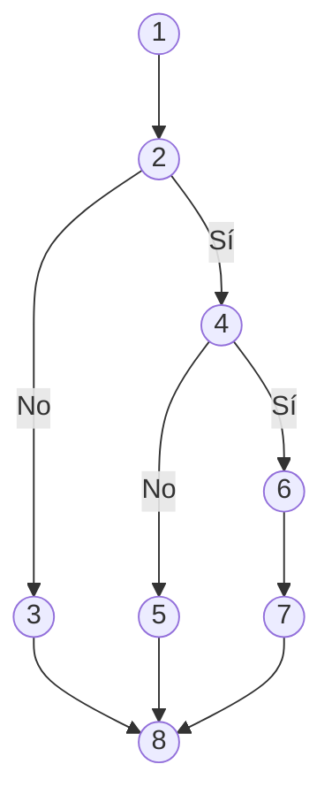

| Nodo | Tipo | Líneas | Descripción |
| :--- | :--- | :--- | :--- |
| 1 | Inicio |  | Petición a /api/v1/CurrencyRate |
| 2 | Decisión | (autenticación del núcleo) | ¿Trae credenciales válidas? |
| 3 | Salida de error |  | 401 Unauthorized |
| 4 | Decisión |  | ¿El método es PUT? |
| 5 | Proceso | Get.php 48-50 | Get::process → RateService::get() → JSON |
| 6 | Proceso | PutUpdate.php 49-51 | PutUpdate: rates = Rates::fromAssoc(get_object_vars(cuerpo)) |
| 7 | Proceso | PutUpdate.php 53-55 | RateService::set(rates); return true |
| 8 | Fin |  | Fin |

| Método | Cálculo | V(G) |
| :--- | :--- | :--- |
| Aristas y nodos | E − N + 2 = 9 − 8 + 2 | 3 |
| Nodos de decisión | P + 1 = 2 + 1 (nodos 2, 4) | 3 |
| Regiones | Regiones del grafo plano, incluida la exterior | 3 |

| Camino | Secuencia de nodos | Qué recorre | Escenario y casos que lo cubren |
| :--- | :--- | :--- | :--- |
| C1 | 1-2-3-8 | Sin credenciales. | CN-CUR-F4-03 y 13 |
| C2 | 1-2-4-5-8 | GET. | CN-CUR-F4-01 y 02 |
| C3 | 1-2-4-6-7-8 | PUT. | CN-CUR-F4-04 a 12 |


---

## 2. Backend

### Backend — RateService::checkReadAccess() y checkEditAccess()

Archivo: `application/Espo/Tools/Currency/RateService.php`. Los dos métodos tienen el mismo grafo; cambia solo la acción consultada (lectura o edición).

**Diagrama de flujo**

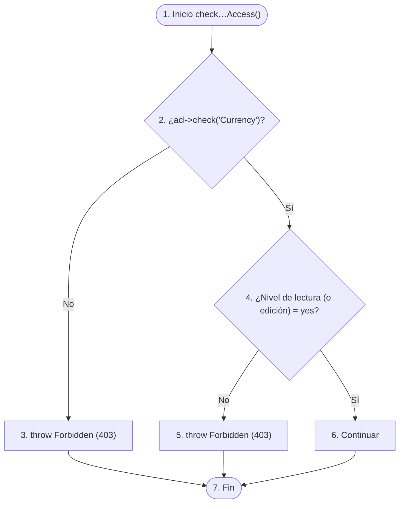

**Grafo de control de flujo**

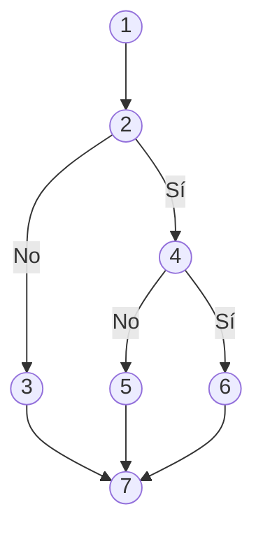

| Nodo | Tipo | Líneas | Descripción |
| :--- | :--- | :--- | :--- |
| 1 | Inicio | 119 / 133 | Inicio check…Access() |
| 2 | Decisión | 121 / 135 | ¿acl->check('Currency')? |
| 3 | Salida de error | 122 / 136 | throw Forbidden (403) |
| 4 | Decisión | 125 / 139 | ¿Nivel de lectura (o edición) = yes? |
| 5 | Salida de error | 126 / 140 | throw Forbidden (403) |
| 6 | Proceso | 128 / 142 | Continuar |
| 7 | Fin | 128 / 142 | Fin |

| Método | Cálculo | V(G) |
| :--- | :--- | :--- |
| Aristas y nodos | E − N + 2 = 8 − 7 + 2 | 3 |
| Nodos de decisión | P + 1 = 2 + 1 (nodos 2, 4) | 3 |
| Regiones | Regiones del grafo plano, incluida la exterior | 3 |

| Camino | Secuencia de nodos | Qué recorre | Escenario y casos que lo cubren |
| :--- | :--- | :--- | :--- |
| C1 | 1-2-3-7 | Sin acceso al ámbito Currency. | CN-CUR-F4-02 y 12 recorren C1 o C2: la respuesta 403 no permite distinguirlos |
| C2 | 1-2-4-5-7 | Acceso al ámbito sin nivel suficiente. | Ver C1 (caso nuevo CB-CUR-F4-01 para separarlos) |
| C3 | 1-2-4-6-7 | Administrador. | CN-CUR-F4-01 y 04 a 11 |

### Backend — RateService::get()

Archivo: `application/Espo/Tools/Currency/RateService.php`.

**Diagrama de flujo**

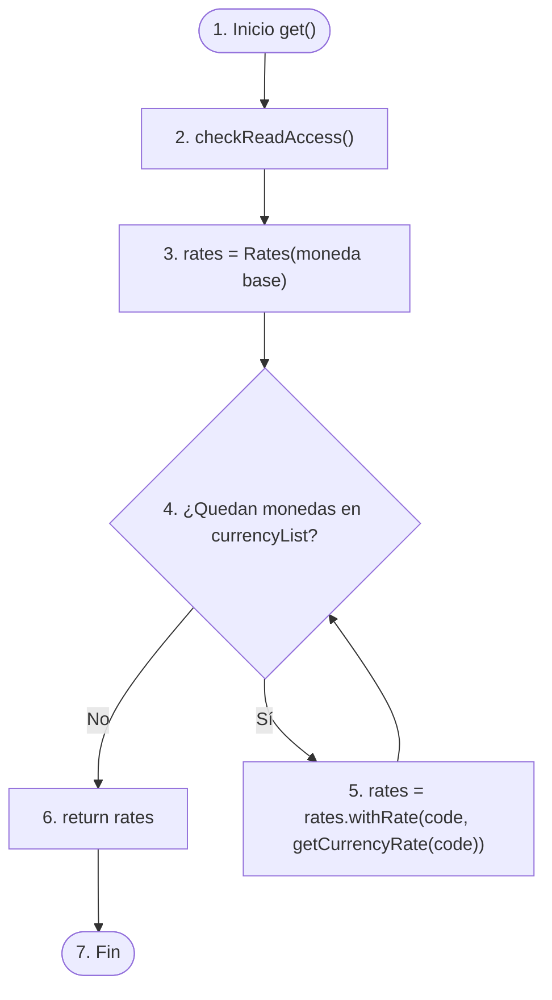

**Grafo de control de flujo**

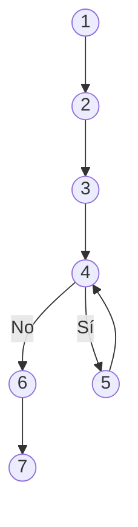

| Nodo | Tipo | Líneas | Descripción |
| :--- | :--- | :--- | :--- |
| 1 | Inicio | 60 | Inicio get() |
| 2 | Proceso | 62 | checkReadAccess() |
| 3 | Proceso | 64 | rates = Rates(moneda base) |
| 4 | Decisión | 66 | ¿Quedan monedas en currencyList? |
| 5 | Proceso | 67 | rates = rates.withRate(code, getCurrencyRate(code)) |
| 6 | Proceso | 70 | return rates |
| 7 | Fin | 71 | Fin |

| Método | Cálculo | V(G) |
| :--- | :--- | :--- |
| Aristas y nodos | E − N + 2 = 7 − 7 + 2 | 2 |
| Nodos de decisión | P + 1 = 1 + 1 (nodos 4) | 2 |
| Regiones | Regiones del grafo plano, incluida la exterior | 2 |

| Camino | Secuencia de nodos | Qué recorre | Escenario y casos que lo cubren |
| :--- | :--- | :--- | :--- |
| C1 | 1-2-3-4-6-7 | Lista de monedas vacía. | No factible: siempre está al menos la moneda base |
| C2 | 1-2-3-4-5-4-6-7 | Una o más monedas. | CN-CUR-F4-01 |

### Backend — RateService::set()

Archivo: `application/Espo/Tools/Currency/RateService.php`. La decisión 7 es compuesta (`!in_array || code === base`).

**Diagrama de flujo**

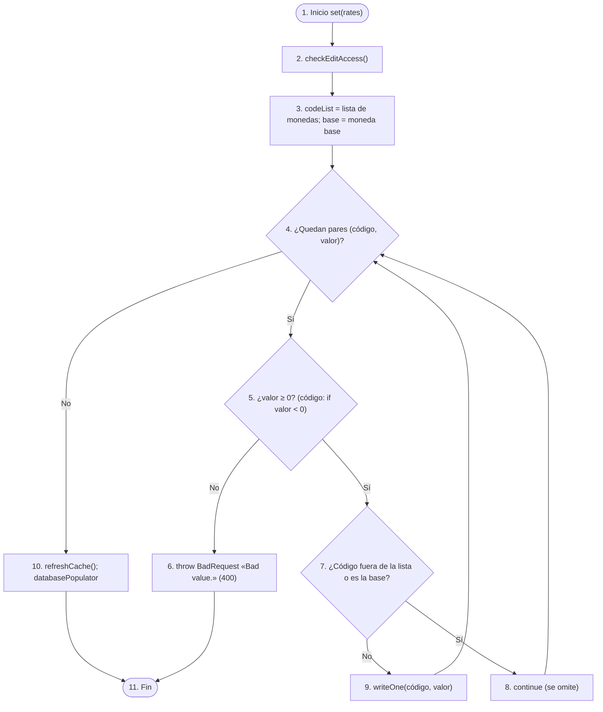

**Grafo de control de flujo**

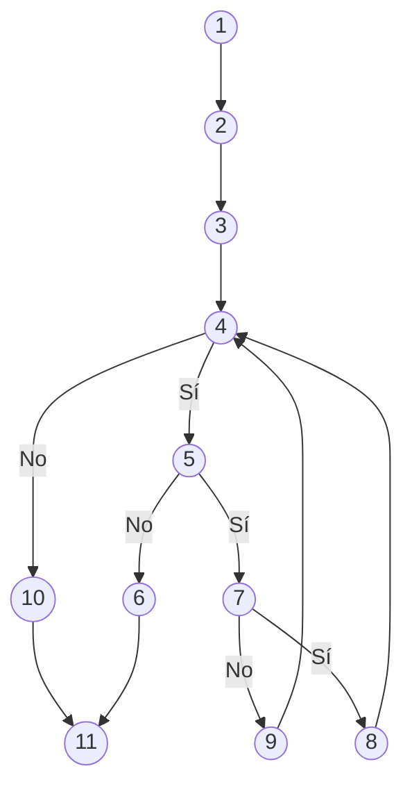

| Nodo | Tipo | Líneas | Descripción |
| :--- | :--- | :--- | :--- |
| 1 | Inicio | 77 | Inicio set(rates) |
| 2 | Proceso | 79 | checkEditAccess() |
| 3 | Proceso | 81-82 | codeList = lista de monedas; base = moneda base |
| 4 | Decisión | 84 | ¿Quedan pares (código, valor)? |
| 5 | Decisión | 85 | ¿valor ≥ 0? (código: if valor < 0) |
| 6 | Salida de error | 86 | throw BadRequest «Bad value.» (400) |
| 7 | Decisión | 89 | ¿Código fuera de la lista o es la base? |
| 8 | Proceso | 90 | continue (se omite) |
| 9 | Proceso | 93 | writeOne(código, valor) |
| 10 | Proceso | 96-97 | refreshCache(); databasePopulator |
| 11 | Fin | 98 | Fin |

| Método | Cálculo | V(G) |
| :--- | :--- | :--- |
| Aristas y nodos | E − N + 2 = 13 − 11 + 2 | 4 |
| Nodos de decisión | P + 1 = 3 + 1 (nodos 4, 5, 7) | 4 |
| Regiones | Regiones del grafo plano, incluida la exterior | 4 |

| Camino | Secuencia de nodos | Qué recorre | Escenario y casos que lo cubren |
| :--- | :--- | :--- | :--- |
| C1 | 1-2-3-4-10-11 | Sin pares en el cuerpo. | No factible: `PutUpdate` arma las tasas con la base ficticia '___' y `toAssoc()` siempre la agrega, así que el bucle da al menos una vuelta (`testElCuerpoVacioIgualRecorreLaBase`) |
| C2 | 1-2-3-4-5-6-11 | Valor negativo. | CN-CUR-F4-06 |
| C3 | 1-2-3-4-5-7-8-4-10-11 | Código omitido. | CN-CUR-F4-09, 10 y 11 (en el 11 solo se recorre la base ficticia '___') |
| C4 | 1-2-3-4-5-7-9-4-10-11 | Código escrito. | CN-CUR-F4-04, 05 y 07 (el 0 pasa el nodo 5: DEF-CUR-04); CN-CUR-F4-08 llega al nodo 9 y falla en writeOne (DEF-CUR-03) |

### Backend — RateService::writeOne()

Archivo: `application/Espo/Tools/Currency/RateService.php`. Con `'abc'` el `TypeError` ocurre al llamar el método (firma `float`), antes del nodo 1.

**Diagrama de flujo**

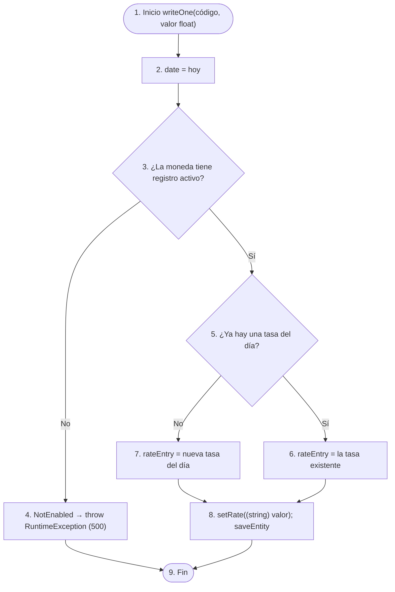

**Grafo de control de flujo**

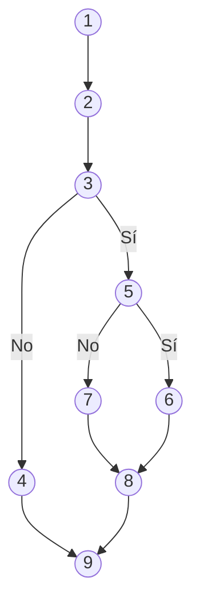

| Nodo | Tipo | Líneas | Descripción |
| :--- | :--- | :--- | :--- |
| 1 | Inicio | 100 | Inicio writeOne(código, valor float) |
| 2 | Proceso | 102 | date = hoy |
| 3 | Decisión | 105 (NotEnabled) | ¿La moneda tiene registro activo? |
| 4 | Salida de error | 107-108 | NotEnabled → throw RuntimeException (500) |
| 5 | Decisión | 105 (??) | ¿Ya hay una tasa del día? |
| 6 | Proceso | 105 | rateEntry = la tasa existente |
| 7 | Proceso | 106 | rateEntry = nueva tasa del día |
| 8 | Proceso | 111-113 | setRate((string) valor); saveEntity |
| 9 | Fin | 114 | Fin |

| Método | Cálculo | V(G) |
| :--- | :--- | :--- |
| Aristas y nodos | E − N + 2 = 10 − 9 + 2 | 3 |
| Nodos de decisión | P + 1 = 2 + 1 (nodos 3, 5) | 3 |
| Regiones | Regiones del grafo plano, incluida la exterior | 3 |

| Camino | Secuencia de nodos | Qué recorre | Escenario y casos que lo cubren |
| :--- | :--- | :--- | :--- |
| C1 | 1-2-3-4-9 | Moneda sin registro activo. | No factible desde la API: set() ya omite los códigos fuera de la lista |
| C2 | 1-2-3-5-6-8-9 | Ya existe la tasa del día. | CN-CUR-F4-04, 05 y 07 (la tasa de hoy ya se había creado desde la pantalla) |
| C3 | 1-2-3-5-7-8-9 | Primera tasa del día. | Ninguno (caso nuevo CB-CUR-F4-02) |


---

## 3. Integración (un diagrama por escenario)

### ESC-CUR-F4-01

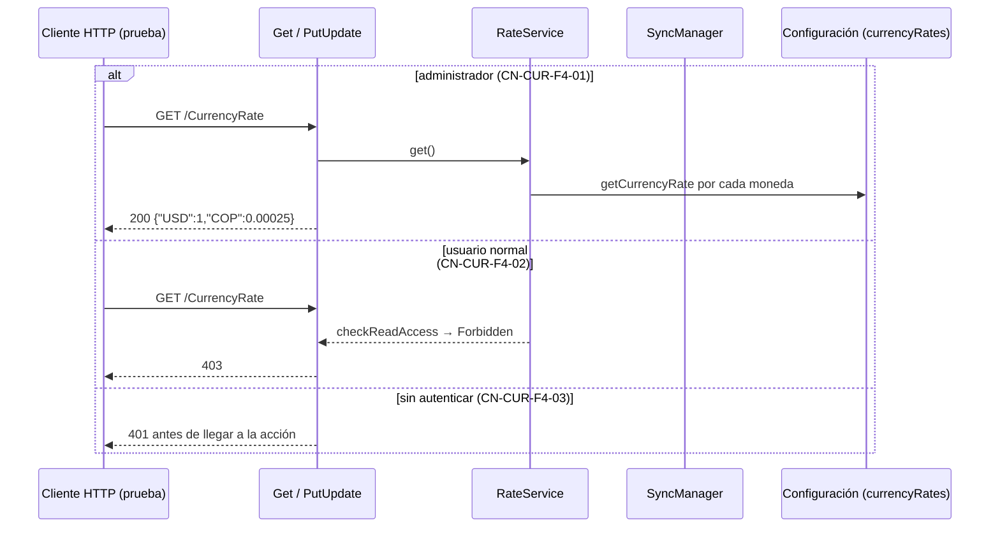

Entrada C1 y C2; checkReadAccess C1/C2 y C3; get C2.

### ESC-CUR-F4-02

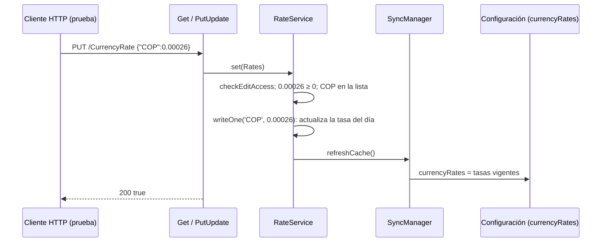

Entrada C3; checkEditAccess C3; set C4; writeOne C2.

### ESC-CUR-F4-03

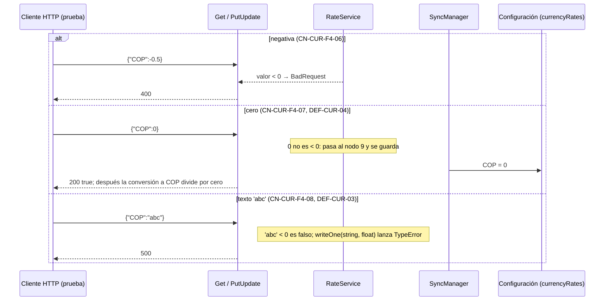

set C2 (negativa) y C4 (cero y texto).

### ESC-CUR-F4-04

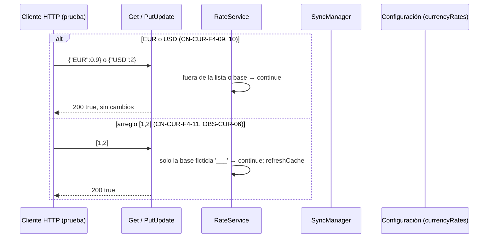

set C3 en los tres casos.

### ESC-CUR-F4-05

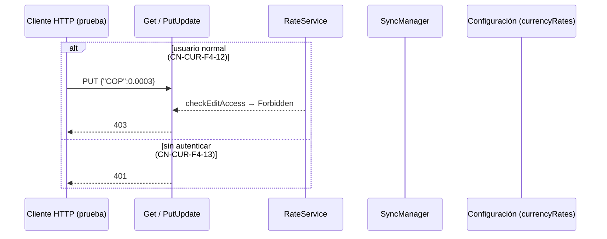

Entrada C1; checkEditAccess C1/C2.


---

## 4. Cobertura por escenario

| Escenario | Entrada | Permisos | get | set | writeOne |
| :--- | :--- | :--- | :--- | :--- | :--- |
| ESC-CUR-F4-01 Consulta | C1, C2 | C1/C2, C3 | C2 | — | — |
| ESC-CUR-F4-02 Actualización válida | C3 | C3 | — | C4 | C2 |
| ESC-CUR-F4-03 Valor inválido | C3 | C3 | — | C2, C4 | C2 |
| ESC-CUR-F4-04 No aplicables | C3 | C3 | — | C3 | — |
| ESC-CUR-F4-05 Sin permisos | C1, C3 | C1/C2 | — | — | — |

| Grafo | V(G) | Caminos factibles | Cubiertos | Cobertura |
| :--- | :--- | :--- | :--- | :--- |
| Entrada | 3 | 3 | 3 | 100 % |
| `check…Access` | 3 | 3 | 2 o 3 | 67–100 % |
| `get` | 2 | 1 | 1 | 100 % |
| `set` | 4 | 3 | 3 | 100 % |
| `writeOne` | 3 | 2 | 1 | 50 % |

## 5. Casos de prueba de caja blanca nuevos

| ID | Grafo y camino | Entrada | Resultado esperado | Estado |
| :--- | :--- | :--- | :--- | :--- |
| CB-CUR-F4-01 | check…Access C1 y C2 | Doble de `Acl`: `check()` falso; `check()` verdadero con nivel `no` | `Forbidden` en ambos, desde nodos distintos | Pasó: `RateServiceTest::testSinAccesoAlAmbitoEsForbidden` y `testNivelDeEdicionNoEsForbidden` |
| CB-CUR-F4-02 | writeOne C3 | PUT de COP en un día sin tasa | Se crea una tasa nueva con fecha de hoy | Pasó: `RateServiceTest::testCreaLaTasaDelDiaSiNoExiste` |
| CB-CUR-F4-03 | set nodo 5 (límite) | `{"COP":0}` | 400 (comportamiento esperado tras corregir DEF-CUR-04) | Pasó tras el ciclo TDD: `RateServiceTest::testTasaPorDebajoDelMinimoEsBadRequest` ([docs/CUR/tdd](../tdd/README.md)) |

## 6. Hallazgos del análisis de código

- **DEF-CUR-04 (corregido en el [ciclo TDD](../tdd/README.md)):** el nodo 5 de `set()` solo rechaza `valor < 0`; el cero pasa, aunque el formulario de tasas exige como mínimo 0.0001. Corregirlo a `valor < 0.0001` (o `<= 0`) alinea la API con la pantalla.
- **DEF-CUR-03 (corregido en el [ciclo TDD](../tdd/README.md)):** `set()` no comprueba que el valor sea numérico antes de llamar `writeOne(string, float)`; el `TypeError` resultante sale como 500.
- **OBS-CUR-06:** un cuerpo que no es objeto llega a `set()` solo con la base ficticia `'___'` y devuelve `true`; la entrada debería responder 400.

## 7. Ejecución de las pruebas unitarias

Las pruebas están en `tests/unit/Espo/VyV/Currency/` y se ejecutaron el 15 de noviembre de 2026 en el contenedor `espocrm` (PHPUnit 11.5.58, PHP 8.4.27). El código de las seis clases probadas es idéntico en la imagen y en el repositorio (comparado por MD5). Las dependencias se reemplazan por dobles de prueba de PHPUnit, así que no se toca la base de datos.

```bash
docker exec espocrm sh -c "cd /var/www/html && phpunit tests/unit/Espo/VyV/Currency --no-coverage --testdox"
```

```bash
docker exec espocrm sh -c "cd /var/www/html && php -n /usr/local/bin/phpunit tests/unit/Espo/VyV/Currency/CalculatorUtilSinBcmathTest.php --no-coverage"
```

**Resultado del conjunto:** 57 pruebas y 151 aserciones; todas pasan y 7 se omiten. Las 7 omitidas son las de `CalculatorUtilSinBcmathTest`, que solo corren sin bcmath; con `php -n` pasan las 7 (10 aserciones).

**Cobertura de líneas medida con Xdebug:**

| Clase | Métodos | Líneas |
| :--- | :--- | :--- |
| `CurrencyType` | 5/5 | 44/44 (100 %) |
| `RateService` | 6/6 | 32/32 (100 %) |
| `SyncManager` | 11/11 | 55/55 (100 %) |
| `AfterSave` / `AfterDelete` | 2/2 cada uno | 7/7 cada uno (100 %) |
| `CalculatorUtil` | — | 18/28 (64 %) con bcmath. Nueve de las diez líneas restantes son las ramas sin bcmath, que se ejecutan con `php -n` (sin Xdebug, así que no se miden). La décima es la línea 98, código muerto |

Estos números son del 15-nov-2026, antes del [ciclo TDD sobre `RateService`](../tdd/README.md). Después del TDD la suite del módulo tiene 66 pruebas y 199 aserciones, todas pasan (7 omitidas), y `RateService` sigue al 100 % (38/38 líneas). Desde entonces se ejecuta con `phpunit -c tests/unit/Espo/VyV/Currency/phpunit-cur.xml`.

| Prueba | Pruebas | Caminos que recorre |
| :--- | :--- | :--- |
| `RateServiceTest` | 13 | checkEditAccess C1 y C2 por separado; checkReadAccess C1, C2 y C3; get C2; set C2, C3 y C4; writeOne C1, C2 y C3; DEF-CUR-03 y DEF-CUR-04 documentados |

**Cobertura de caminos tras las pruebas unitarias:** permisos 3/3 (ahora se distingue C1 de C2), `get` 1/1 factible, `set` 3/3 factibles y `writeOne` 3/3 (C1 con un doble que lanza `NotEnabled`). En el [ciclo TDD](../tdd/README.md) las pruebas `testDefCur03…` y `testDefCur04…`, que describían el comportamiento defectuoso, se reemplazaron por pruebas que esperan `BadRequest`. Fallaron (rojo), pasaron tras corregir `set()` (verde) y la validación se refactorizó: ahora son 22 pruebas.
