# CUR-F5 — Pruebas de caja blanca: sincronización de tasas vigentes hacia la configuración

**Funcionalidad:** al crear, editar o borrar una tasa en *Currencies › COP › Rates*, los hooks del registro llaman `SyncManager::updateCode()`, que escribe en la configuración (`currencyRates`) la tasa vigente. Al cambiar la lista de monedas, `SyncManager::sync()` crea o activa los registros de moneda.

**Versión analizada:** EspoCRM 10.1.1. **Fecha:** 15 de noviembre de 2026.

**Convenciones.** Rama **Sí** a la derecha y rama **No** a la izquierda en todas las decisiones; en Mermaid la arista No se declara primero para que quede a la izquierda. Un grafo por método; la tabla de caminos indica qué escenario y casos de la caja negra recorren cada camino. Los documentos se generan con `docs/CUR/herramientas/generar_cur_f2_f5.py`, que valida la orientación de las ramas y que E − N + 2 = P + 1.

---

## 1. Frontend

### Frontend — decimal.ts::validateRange() del campo Rate

Archivo: `client/src/views/fields/decimal.ts`. El campo Rate define `min: 0.0001` en `entityDefs/CurrencyRecordRate.json`; los caminos con `max` se cubren con otro campo decimal en las pruebas unitarias.

**Diagrama de flujo**

```mermaid
flowchart TD
    N1(["1. Inicio validateRange()"])
    N2{"2. ¿value es null?"}
    N4["4. Leer min y max del campo"]
    N3["3. return false (no aplica)"]
    N5{"5. ¿Hay min y max?"}
    N9{"9. ¿Hay min?"}
    N6{"6. ¿value < min o value > max?"}
    N13{"13. ¿Hay max?"}
    N10{"10. ¿value < min?"}
    N8["8. return false"]
    N7["7. Mensaje «entre min y max»; return true"]
    N17["17. return false"]
    N14{"14. ¿value > max?"}
    N12["12. return false"]
    N11["11. Mensaje «Rate shouldn't be less than 0.0001»; return true"]
    N16["16. return false"]
    N15["15. Mensaje «no mayor que max»; return true"]
    N18(["18. Fin"])
    N1 --> N2
    N2 -->|No| N4
    N2 -->|Sí| N3
    N4 --> N5
    N3 --> N18
    N5 -->|No| N9
    N5 -->|Sí| N6
    N9 -->|No| N13
    N9 -->|Sí| N10
    N6 -->|No| N8
    N6 -->|Sí| N7
    N13 -->|No| N17
    N13 -->|Sí| N14
    N10 -->|No| N12
    N10 -->|Sí| N11
    N8 --> N18
    N7 --> N18
    N17 --> N18
    N14 -->|No| N16
    N14 -->|Sí| N15
    N12 --> N18
    N11 --> N18
    N16 --> N18
    N15 --> N18
```

**Grafo de control de flujo**

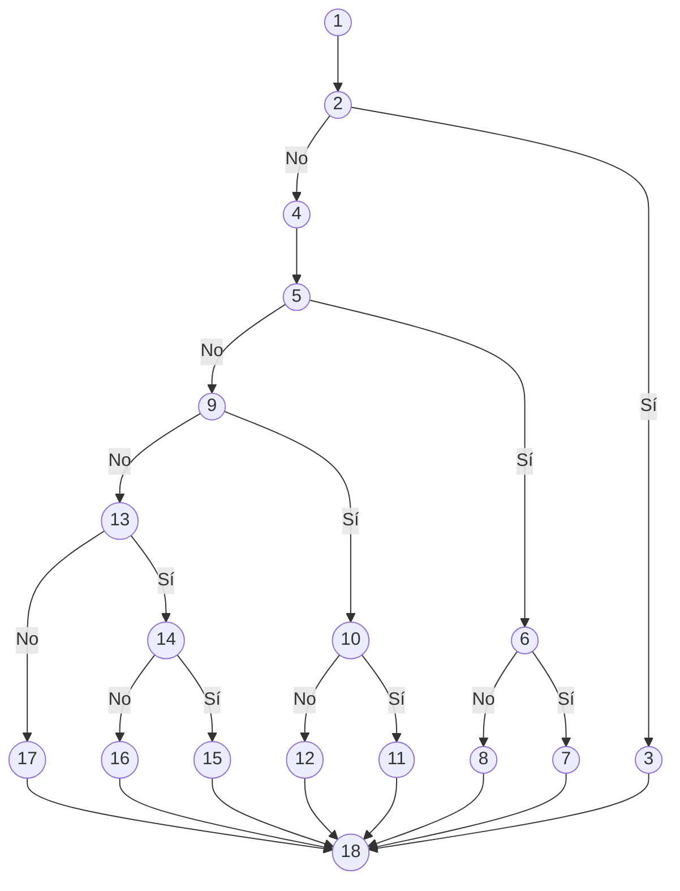

| Nodo | Tipo | Líneas | Descripción |
| :--- | :--- | :--- | :--- |
| 1 | Inicio | 200 | Inicio validateRange() |
| 2 | Decisión | 203 | ¿value es null? |
| 3 | Proceso | 204 | return false (no aplica) |
| 4 | Proceso | 207-208 | Leer min y max del campo |
| 5 | Decisión | 210 | ¿Hay min y max? |
| 6 | Decisión | 211 | ¿value < min o value > max? |
| 7 | Salida de error | 212-219 | Mensaje «entre min y max»; return true |
| 8 | Proceso | 222 | return false |
| 9 | Decisión | 225 | ¿Hay min? |
| 10 | Decisión | 226 | ¿value < min? |
| 11 | Salida de error | 227-233 | Mensaje «Rate shouldn't be less than 0.0001»; return true |
| 12 | Proceso | 246 | return false |
| 13 | Decisión | 235 | ¿Hay max? |
| 14 | Decisión | 236 | ¿value > max? |
| 15 | Salida de error | 237-243 | Mensaje «no mayor que max»; return true |
| 16 | Proceso | 246 | return false |
| 17 | Proceso | 246 | return false |
| 18 | Fin | 247 | Fin |

| Método | Cálculo | V(G) |
| :--- | :--- | :--- |
| Aristas y nodos | E − N + 2 = 24 − 18 + 2 | 8 |
| Nodos de decisión | P + 1 = 7 + 1 (nodos 2, 5, 6, 9, 10, 13, 14) | 8 |
| Regiones | Regiones del grafo plano, incluida la exterior | 8 |

| Camino | Secuencia de nodos | Qué recorre | Escenario y casos que lo cubren |
| :--- | :--- | :--- | :--- |
| C1 | 1-2-3-18 | Valor nulo. | Ninguno: el campo es requerido y lo frena la validación required |
| C2 | 1-2-4-5-6-7-18 | Con min y max, fuera de rango. | No aplica al campo Rate (solo tiene min) |
| C3 | 1-2-4-5-6-8-18 | Con min y max, en rango. | No aplica al campo Rate |
| C4 | 1-2-4-5-9-10-11-18 | Menor que el mínimo. | CN-CUR-F5-08, 09 y 10 |
| C5 | 1-2-4-5-9-10-12-18 | Mayor o igual que el mínimo. | CN-CUR-F5-02 a 05 y 11 |
| C6 | 1-2-4-5-9-13-14-15-18 | Solo max, superado. | No aplica al campo Rate |
| C7 | 1-2-4-5-9-13-14-16-18 | Solo max, en rango. | No aplica al campo Rate |
| C8 | 1-2-4-5-9-13-17-18 | Sin límites. | No aplica al campo Rate |


---

## 2. Backend

### Backend — RecordHooks CurrencyRecordRate AfterSave / AfterDelete::process()

Archivo: `application/Espo/Classes/RecordHooks/CurrencyRecordRate/AfterSave.php y AfterDelete.php`. AfterSave y AfterDelete tienen el mismo cuerpo.

**Diagrama de flujo**

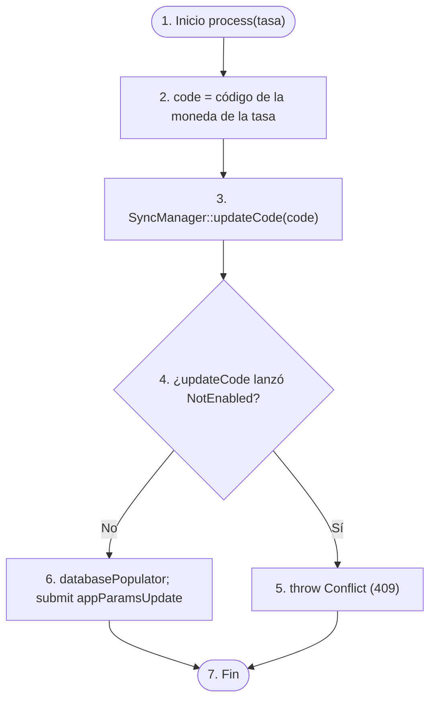

**Grafo de control de flujo**

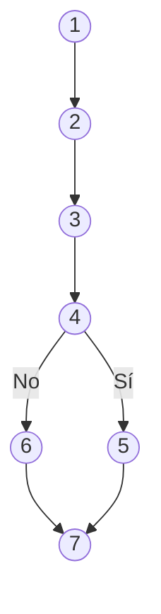

| Nodo | Tipo | Líneas | Descripción |
| :--- | :--- | :--- | :--- |
| 1 | Inicio |  | Inicio process(tasa) |
| 2 | Proceso |  | code = código de la moneda de la tasa |
| 3 | Proceso |  | SyncManager::updateCode(code) |
| 4 | Decisión |  | ¿updateCode lanzó NotEnabled? |
| 5 | Salida de error |  | throw Conflict (409) |
| 6 | Proceso |  | databasePopulator; submit appParamsUpdate |
| 7 | Fin |  | Fin |

| Método | Cálculo | V(G) |
| :--- | :--- | :--- |
| Aristas y nodos | E − N + 2 = 7 − 7 + 2 | 2 |
| Nodos de decisión | P + 1 = 1 + 1 (nodos 4) | 2 |
| Regiones | Regiones del grafo plano, incluida la exterior | 2 |

| Camino | Secuencia de nodos | Qué recorre | Escenario y casos que lo cubren |
| :--- | :--- | :--- | :--- |
| C1 | 1-2-3-4-5-7 | Moneda no habilitada. | Ninguno (caso nuevo CB-CUR-F5-01) |
| C2 | 1-2-3-4-6-7 | Moneda habilitada. | CN-CUR-F5-02 a 07 y 11 |

### Backend — SyncManager::updateCode()

Archivo: `application/Espo/Tools/Currency/SyncManager.php`. `getRate()` toma la tasa más reciente con fecha menor o igual a hoy; por eso las fechas pasadas y futuras de CN-CUR-F5-04 y 05 no cambian la configuración.

**Diagrama de flujo**

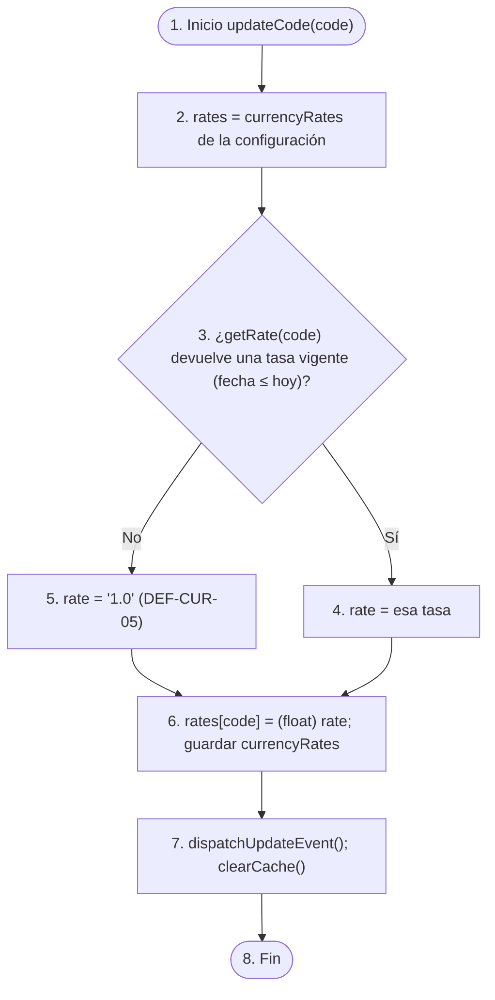

**Grafo de control de flujo**

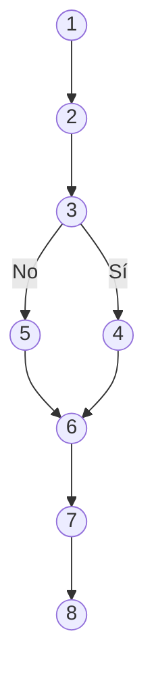

| Nodo | Tipo | Líneas | Descripción |
| :--- | :--- | :--- | :--- |
| 1 | Inicio | 150 | Inicio updateCode(code) |
| 2 | Proceso | 152 | rates = currencyRates de la configuración |
| 3 | Decisión | 154 (??) | ¿getRate(code) devuelve una tasa vigente (fecha ≤ hoy)? |
| 4 | Proceso | 154 | rate = esa tasa |
| 5 | Proceso | 154 | rate = '1.0' (DEF-CUR-05) |
| 6 | Proceso | 156-159 | rates[code] = (float) rate; guardar currencyRates |
| 7 | Proceso | 161-162 | dispatchUpdateEvent(); clearCache() |
| 8 | Fin | 163 | Fin |

| Método | Cálculo | V(G) |
| :--- | :--- | :--- |
| Aristas y nodos | E − N + 2 = 8 − 8 + 2 | 2 |
| Nodos de decisión | P + 1 = 1 + 1 (nodos 3) | 2 |
| Regiones | Regiones del grafo plano, incluida la exterior | 2 |

| Camino | Secuencia de nodos | Qué recorre | Escenario y casos que lo cubren |
| :--- | :--- | :--- | :--- |
| C1 | 1-2-3-4-6-7-8 | Hay tasa vigente. | CN-CUR-F5-02 a 06 y 11 |
| C2 | 1-2-3-5-6-7-8 | No hay tasa vigente. | CN-CUR-F5-07 (Fallido, DEF-CUR-05) |

### Backend — SyncManager::syncCode() (alta de monedas desde Administration › Currency)

Archivo: `application/Espo/Tools/Currency/SyncManager.php`.

**Diagrama de flujo**

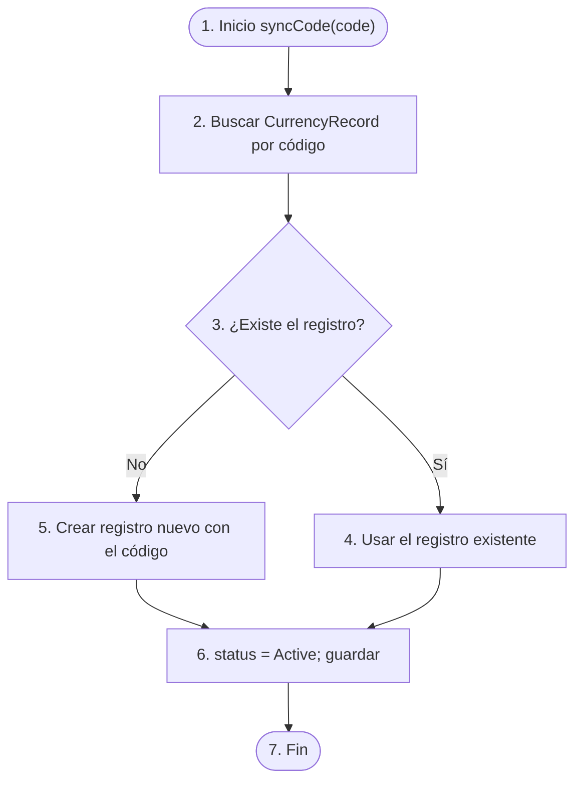

**Grafo de control de flujo**

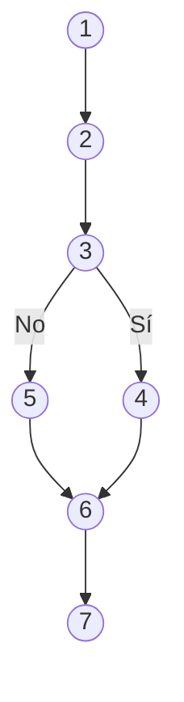

| Nodo | Tipo | Líneas | Descripción |
| :--- | :--- | :--- | :--- |
| 1 | Inicio | 82 | Inicio syncCode(code) |
| 2 | Proceso | 84-87 | Buscar CurrencyRecord por código |
| 3 | Decisión | 89 | ¿Existe el registro? |
| 4 | Proceso | 89 | Usar el registro existente |
| 5 | Proceso | 90-92 | Crear registro nuevo con el código |
| 6 | Proceso | 95-97 | status = Active; guardar |
| 7 | Fin | 98 | Fin |

| Método | Cálculo | V(G) |
| :--- | :--- | :--- |
| Aristas y nodos | E − N + 2 = 7 − 7 + 2 | 2 |
| Nodos de decisión | P + 1 = 1 + 1 (nodos 3) | 2 |
| Regiones | Regiones del grafo plano, incluida la exterior | 2 |

| Camino | Secuencia de nodos | Qué recorre | Escenario y casos que lo cubren |
| :--- | :--- | :--- | :--- |
| C1 | 1-2-3-4-6-7 | La moneda ya tiene registro. | CN-CUR-F5-01 (USD) |
| C2 | 1-2-3-5-6-7 | Moneda nueva. | CN-CUR-F5-01 (COP) |


---

## 3. Integración (un diagrama por escenario)

### ESC-CUR-F5-01

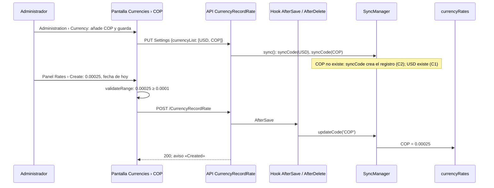

syncCode C1 y C2; validateRange C5; hook C2; updateCode C1.

### ESC-CUR-F5-02

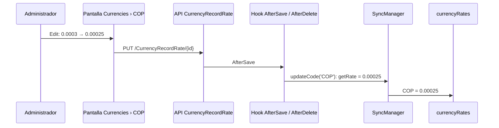

Hook C2; updateCode C1.

### ESC-CUR-F5-03

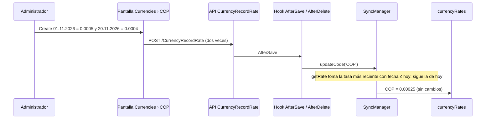

Hook C2; updateCode C1 sin cambio de valor.

### ESC-CUR-F5-04

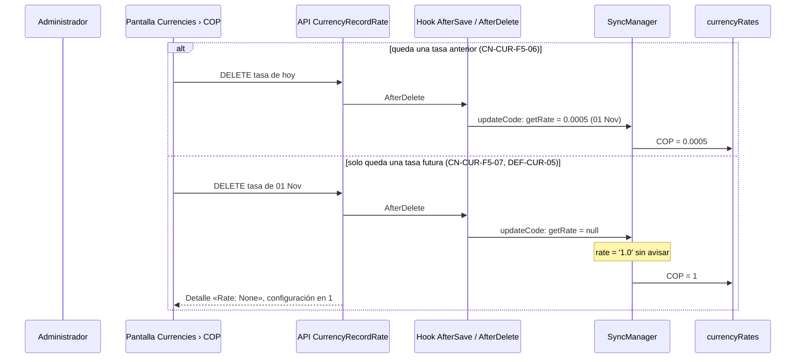

updateCode C1 y luego C2 (DEF-CUR-05).

### ESC-CUR-F5-05

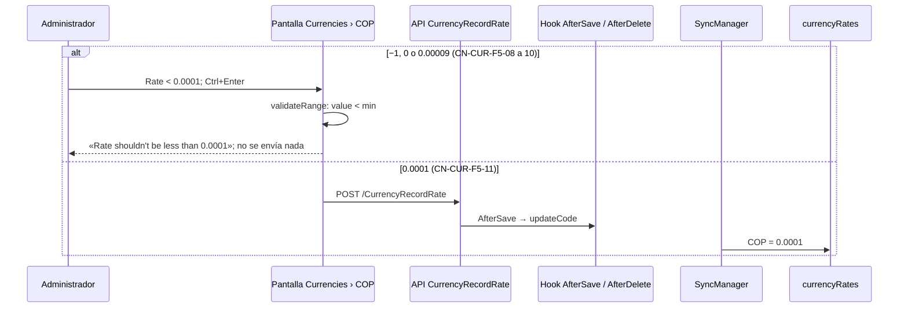

validateRange C4 y C5.

### ESC-CUR-F5-06

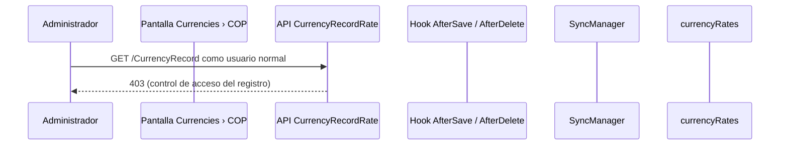

No llega al módulo: lo frena el control de acceso del registro.


---

## 4. Cobertura por escenario

| Escenario | Frontend | Hook | updateCode | syncCode |
| :--- | :--- | :--- | :--- | :--- |
| ESC-CUR-F5-01 Alta y creación | C5 | C2 | C1 | C1, C2 |
| ESC-CUR-F5-02 Edición | C5 | C2 | C1 | — |
| ESC-CUR-F5-03 Fechas pasada y futura | C5 | C2 | C1 | — |
| ESC-CUR-F5-04 Eliminación | — | C2 | C1, C2 | — |
| ESC-CUR-F5-05 Validación del formulario | C4, C5 | C2 | C1 | — |
| ESC-CUR-F5-06 Sin privilegios | — | — | — | — |

| Grafo | V(G) | Caminos que aplican al campo Rate o al flujo | Cubiertos | Cobertura |
| :--- | :--- | :--- | :--- | :--- |
| Frontend `validateRange` | 8 | 2 (C4, C5) | 2 | 100 % de los aplicables; 25 % del total |
| Hook | 2 | 2 | 1 | 50 % |
| `updateCode` | 2 | 2 | 2 | 100 % |
| `syncCode` | 2 | 2 | 2 | 100 % |

## 5. Casos de prueba de caja blanca nuevos

| ID | Grafo y camino | Entrada | Resultado esperado | Estado |
| :--- | :--- | :--- | :--- | :--- |
| CB-CUR-F5-01 | Hook C1 | Guardar una tasa de una moneda con registro inactivo | 409 Conflict | Pasó: `RateSyncTest::testAfterSaveConMonedaNoHabilitadaEsConflict` y la de AfterDelete |
| CB-CUR-F5-02 | validateRange C2, C3, C6 a C8 | Campo decimal de prueba con min y max | Mensajes «entre», «no mayor que» y sin mensaje | Pendiente: prueba del frontend (hay que compilar el cliente) |
| CB-CUR-F5-03 | updateCode C2 | Doble de RateEntryProvider que devuelve null | Hoy: tasa 1.0. Esperado tras corregir DEF-CUR-05: conservar la última o avisar | Candidato para el ciclo TDD; hoy `RateSyncTest::testDefCur05SinTasaVigenteEscribeUno` documenta el defecto |

## 6. Hallazgos del análisis de código

- **DEF-CUR-05 en el código:** el nodo 5 de `updateCode()` (`?? '1.0'`) escribe 1 en la configuración cuando no hay tasa vigente. Es el mismo valor por defecto que `getCurrencyRate()` de CUR-F1 (nodo 7).
- **Validación solo en la pantalla:** el mínimo de 0.0001 lo aplica `validateRange()` en el navegador y la definición del campo; `RateService::set()` (CUR-F4) no lo comprueba, por eso la API acepta 0 (DEF-CUR-04).
- **Hooks de registro y no de entidad:** `writeOne()` de CUR-F4 guarda con `EntityManager` y no dispara estos hooks; por eso `set()` llama `refreshCache()` aparte.

## 7. Ejecución de las pruebas unitarias

Las pruebas están en `tests/unit/Espo/VyV/Currency/` y se ejecutaron el 15 de noviembre de 2026 en el contenedor `espocrm` (PHPUnit 11.5.58, PHP 8.4.27). El código de las seis clases probadas es idéntico en la imagen y en el repositorio (comparado por MD5). Las dependencias se reemplazan por dobles de prueba de PHPUnit, así que no se toca la base de datos.

```bash
docker exec espocrm sh -c "cd /var/www/html && phpunit tests/unit/Espo/VyV/Currency --no-coverage --testdox"
```

```bash
docker exec espocrm sh -c "cd /var/www/html && php -n /usr/local/bin/phpunit tests/unit/Espo/VyV/Currency/CalculatorUtilSinBcmathTest.php --no-coverage"
```

**Resultado del conjunto:** 57 pruebas y 151 aserciones; todas pasan y 7 se omiten. Las 7 omitidas son las de `CalculatorUtilSinBcmathTest`, que solo corren sin bcmath; con `php -n` pasan las 7 (10 aserciones).

**Cobertura de líneas medida con Xdebug:**

| Clase | Métodos | Líneas |
| :--- | :--- | :--- |
| `CurrencyType` | 5/5 | 44/44 (100 %) |
| `RateService` | 6/6 | 32/32 (100 %) |
| `SyncManager` | 11/11 | 55/55 (100 %) |
| `AfterSave` / `AfterDelete` | 2/2 cada uno | 7/7 cada uno (100 %) |
| `CalculatorUtil` | — | 18/28 (64 %) con bcmath. Nueve de las diez líneas restantes son las ramas sin bcmath, que se ejecutan con `php -n` (sin Xdebug, así que no se miden). La décima es la línea 98, código muerto |

Estos números son del 15-nov-2026, antes del [ciclo TDD sobre `RateService`](../tdd/README.md). Después del TDD la suite del módulo tiene 66 pruebas y 199 aserciones, todas pasan (7 omitidas), y `RateService` sigue al 100 % (38/38 líneas). Desde entonces se ejecuta con `phpunit -c tests/unit/Espo/VyV/Currency/phpunit-cur.xml`.

| Prueba | Pruebas | Caminos que recorre |
| :--- | :--- | :--- |
| `RateSyncTest` | 10 | Hooks AfterSave y AfterDelete C1 y C2; updateCode C1 y C2; clearCache con y sin caché; syncCode C1 y C2 dentro de `sync()`; refreshCache |

**Cobertura de caminos tras las pruebas unitarias:** hooks 2/2, `updateCode` 2/2, `syncCode` 2/2 y las dos ramas de `clearCache`. El frontend (`validateRange`) sigue en los 2 caminos que aplican al campo Rate: CB-CUR-F5-02 es una prueba de JavaScript pendiente. `testDefCur05SinTasaVigenteEscribeUno` documenta DEF-CUR-05 y es el punto de partida del ciclo TDD.
