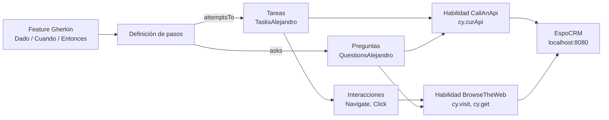

# CUR — Gherkin, BDD, E2E y Screenplay

**Criterio de la rúbrica:** 8 (Gherkin, BDD, E2E y Screenplay). **Fecha:** 16 de noviembre de 2026.
**Resultado:** 37 escenarios ejecutables en dos corridas completas seguidas, todos pasan las dos veces ([`ejecucion-1.txt`](ejecucion-1.txt), [`ejecucion-2.txt`](ejecucion-2.txt)).
**Herramientas:** Cucumber para Cypress (`@badeball/cypress-cucumber-preprocessor`, ya configurado en el proyecto) y el patrón Screenplay del equipo (`tests_bdd_screenplay/screenplay`).

## 1. Archivos

| Capa | Archivo | Contenido |
| :--- | :--- | :--- |
| Gherkin | `tests_bdd_screenplay/features/alejandro/CUR-F1_conversion.feature` … `CUR-F5_sincronizacion.feature` | 5 características en español (`# language: es`), con Antecedentes, Escenarios y Esquemas con Ejemplos |
| Pasos | `tests_bdd_screenplay/step_definitions/alejandro/step_definitions_alejandro.js` | Dado / Cuando / Entonces. Solo hablan con el actor, mediante tareas y preguntas |
| Actor y habilidades | `screenplay/actor/Actor.js`, `abilities/BrowseTheWeb.js` y `CallAnApi.js` | Los del equipo, sin cambios. El actor **Alejandro** usa las dos habilidades |
| Tareas | `tests_bdd_screenplay/screenplay/tasks/TasksAlejandro.js` | `FijarTasaDeCop`, `ConvertirMonto`, `ConvertirEnElSandbox`, `GuardarCampaniaEnPantalla`, `CrearCampaniaPorApi`, `ActualizarTasas`, `ConsultarTasas`, `UsarPerfil`, `EditarTasaVigente`, `RegistrarTasaConFecha`, `IntentarGuardarTasaEnPantalla`… |
| Interacciones | `screenplay/interactions/Interactions.js` | Las del equipo (`Navigate`, `Click`), reutilizadas por las tareas de interfaz |
| Preguntas | `tests_bdd_screenplay/screenplay/questions/QuestionsAlejandro.js` | `CodigoDeRespuesta`, `MotivoDelError`, `ResultadoDeLaConversion`, `SalidaDelSandbox`, `TasaConfigurada`, `MonedasDelSelector`, `PresupuestoMostrado`, `PeticionesDeCreacionDeTasa` |

Las tareas usan los comandos de `cypress/support/cur.js`, compartidos con las pruebas Cypress de CUR, y las credenciales de la configuración existente de Cypress.

## 2. Cómo se relacionan las capas



Ejemplo de un escenario (CUR-F4):

```gherkin
Esquema del escenario: Tasas inválidas rechazadas tras la corrección del TDD (<caso>)
  Cuando Alejandro actualiza las tasas con '<cuerpo>'
  Entonces la API responde 400
  Y el motivo del error contiene "<motivo>"
  Y la tasa configurada de "COP" es 0.00025
```

```js
When('Alejandro actualiza las tasas con {string}', (cuerpo) => {
  alejandro.attemptsTo(ActualizarTasas.con(JSON.parse(cuerpo)));          // tarea
});

Then('la tasa configurada de {string} es {float}', (moneda, tasa) => {
  alejandro.asks(TasaConfigurada.de(moneda)).should('eq', tasa);          // pregunta
});
```

## 3. Escenarios

| Característica | Escenarios ejecutables | Exitosos | Alternativos | Error | Interfaz | Casos del Excel |
| :--- | :---: | :---: | :---: | :---: | :---: | :--- |
| CUR-F1 Conversión | 7 | 4 | — | 3 | 1 | CN-CUR-F1-01, 02, 03, 11, 13, 17 |
| CUR-F2 Aritmética | 4 | 3 | 1 | — | — | CN-CUR-F2-01, 02, 05, 08 |
| CUR-F3 Validación de moneda | 7 | 2 | 1 | 4 | 2 | CN-CUR-F3-01, 08, 10, 11, 13, 15, 19 |
| CUR-F4 API de tasas | 13 | 1 | 2 | 10 | — | CN-CUR-F4-02 a 04, 06 a 13, valor límite y `true` |
| CUR-F5 Sincronización | 6 | 1 | 2 | 3 | 3 | CN-CUR-F5-03 a 05, 08 a 10 |
| **Total** | **37** | **11** | **6** | **20** | **6** | |

Cada fila de *Ejemplos* es un escenario ejecutable. Las etiquetas permiten filtrar las ejecuciones:
- por funcionalidad: `@CUR`, `@CUR-F1` … `@CUR-F5`;
- por tipo: `@exitoso`, `@alternativo`, `@error`, `@seguridad`, `@interfaz`;
- por caso, defecto u observación: `@CN-CUR-F1-01`, `@DEF-CUR-01`, `@OBS-CUR-03`, etc.

## 4. Cómo ejecutarlas

```bash
npx cypress run --spec "tests_bdd_screenplay/features/alejandro/*.feature" --config trashAssetsBeforeRuns=false
```

Para filtrar por etiqueta, por ejemplo solo los escenarios de error:

```bash
npx cypress run --spec "tests_bdd_screenplay/features/alejandro/*.feature" --env tags=@error --config trashAssetsBeforeRuns=false
```

Los requisitos son los mismos de [docs/CUR/cypress](../cypress/README.md#2-cómo-ejecutarlas): contenedores levantados, `npm ci --ignore-scripts` y `npx cypress install`.

## 5. Decisiones de diseño

- **Convivencia con el equipo.** El preprocesador carga las definiciones de pasos de todos los integrantes en cada feature. Por eso:
  - las frases de CUR empiezan con «Alejandro…» o son exclusivas del módulo;
  - los hooks `Before` y `After` se limitan a la etiqueta `@CUR`;
  - no se modificó ningún archivo de Tomás ni de Andrés.
- **Independencia y repetibilidad.** Las features fijan la tasa de COP en los Antecedentes y el `After` la restablece a 0.00025. También borra las campañas y tasas creadas y el usuario normal temporal.
- **Defectos abiertos visibles.** Los escenarios de DEF-CUR-01 y 02 (`@DEF-CUR-01 @DEF-CUR-02`) describen el comportamiento actual (500). Cuando se corrijan, basta cambiar el paso Entonces.

## 6. Resultados

| Característica | Corrida 1 | Corrida 2 |
| :--- | :---: | :---: |
| CUR-F1 Conversión | 7 / 7 | 7 / 7 |
| CUR-F2 Aritmética | 4 / 4 | 4 / 4 |
| CUR-F3 Validación de moneda | 7 / 7 | 7 / 7 |
| CUR-F4 API de tasas | 13 / 13 | 13 / 13 |
| CUR-F5 Sincronización | 6 / 6 | 6 / 6 |
| **Total** | **37 / 37** (3 min 09 s) | **37 / 37** (3 min 00 s) |

**Problemas durante la puesta a punto, para ser transparentes:**
- La primera corrida, antes de las dos de la tabla, dio 32 de 37.
- **Dos fallos eran un error en la tarea `UsarPerfil`.** El perfil anónimo se guardaba como `null` y se leía con `?? 'admin'`, que trata `null` como «sin valor». El anónimo terminaba llamando como administrador. Se corrigió con la función `perfilDe()`.
- **Otros tres fallos no se volvieron a ver.** Fueron el primer ejemplo de CUR-F2, CN-CUR-F4-06 y uno de CUR-F1, y no aparecieron en ninguna de las tres corridas siguientes. No se capturó su mensaje de error, así que no se puede afirmar su causa. Queda anotado como posible inestabilidad a vigilar en próximas ejecuciones.
