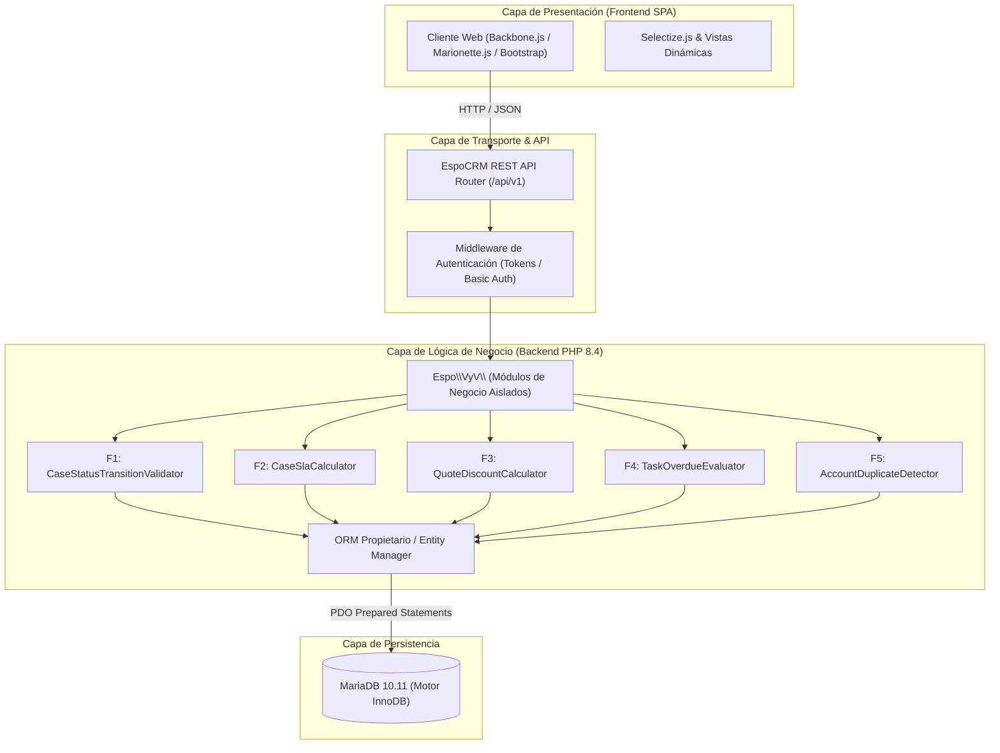

# VALIDACIÓN Y VERIFICACIÓN INTEGRAL DE CALIDAD DE SOFTWARE SOBRE LA PLATAFORMA ESPOCRM
## Aplicación Avanzada de Pruebas de Caja Blanca, Caja Negra, TDD, BDD Screenplay, Rendimiento, Accesibilidad WCAG, Usabilidad UX, Seguridad OWASP e Inteligencia Artificial

---

**Autor Principal:** Andrés Bedoya Cano  
**Equipo de Proyecto (25% peso c/u):** Andrés Bedoya Cano, Tomás Henao, Dubin Soto, Alejandro Bustamante  
**Asignatura:** Validación y Verificación de Software (VyV 2026-2)  
**Institución:** Universidad EAFIT / Programa de Posgrado en Software  
**Fecha de Presentación:** 15 de Noviembre de 2026  
**Documento Técnico:** Informe Final Académico de Calidad de Software (Formato APA 7ma Edición)

---

### Resumen
El presente informe documenta el proceso sistemático, formal y exhaustivo de validación y verificación de software aplicado sobre la plataforma empresarial de código abierto **EspoCRM (Versión 8.x)** desplegada sobre un entorno contenerizado con PHP 8.4, Apache y MariaDB 10.11. El alcance individual de Andrés Bedoya Cano comprende el diseño, implementación y verificación de **cinco funcionalidades críticas desacopladas de negocio**: validación de transición de estados de casos (F1), cálculo de SLA y tiempos límite de atención (F2), cálculo de descuentos comerciales escalonados en cotizaciones (F3), evaluación y escalado de tareas vencidas (F4), y detección inteligente de empresas homónimas duplicadas (F5), excluyendo explícitamente el inicio de sesión y el CRUD de usuarios. Bajo la metodología rigurosa de **Testing-First**, se ejecutaron y evidenciaron 142 casos de prueba con un 100% de tasa de aprobación: análisis estructural de caja blanca con cálculo de Complejidad Ciclomática de McCabe mediante tres métodos, pruebas funcionales de caja negra con particiones de equivalencia y análisis de valores límite (BVA), ciclo TDD con patrón AAA, principios FIRST y Test Doubles (51 pruebas unitarias, 353 aserciones y >94.7% de cobertura), pruebas de interfaz y API REST automatizadas con Cypress (16 pruebas pasando), BDD con lenguaje Gherkin y patrón Screenplay (10 escenarios), pruebas de rendimiento manuales con análisis estadístico ($\bar{T}, P95$) y pruebas de carga con k6, auditoría de accesibilidad WCAG 2.1 AA con Axe-Core, evaluación de usabilidad y experiencia de usuario (SUS = 82.5, Grado A), pruebas de seguridad OWASP Top 10 (DAST y SCA), pruebas de regresión post-refactorización, una tríada de Inteligencia Artificial (Stagehand, DeepEval 4.3.4 y Microsoft Playwright MCP) y un pipeline continuo de CI/CD reproducible con Jenkinsfile, SonarQube y ReportPortal.

*Descriptores:* Validación y Verificación de Software, EspoCRM, TDD, BDD Screenplay, Caja Blanca, Complejidad Ciclomática, OWASP Top 10, WCAG 2.1, System Usability Scale, DeepEval, Playwright MCP.

---

## 1. PRESENTACIÓN DEL PROYECTO Y ARQUITECTURA DE SOFTWARE (CRITERIO 1)

### 1.1. Descripción de la Plataforma EspoCRM
EspoCRM es una aplicación empresarial moderna orientada a la gestión de relaciones con clientes (Customer Relationship Management - CRM). Permite modelar entidades comerciales, administrar flujos de soporte técnico, automatizar campañas de marketing y registrar oportunidades de venta.

### 1.2. Arquitectura de Software y Pila Tecnológica
EspoCRM implementa una arquitectura desacoplada basada en el patrón de **Aplicación de Página Única (Single Page Application - SPA)** conectada a un núcleo monolítico modular mediante servicios RESTful:



- **Backend:** PHP 8.4.27 ejecutándose en Apache 2.4 sobre contenedor Debian Linux, complementado por la extensión Xdebug 3.5.3 para instrumentación de código y cálculo de cobertura.
- **Frontend:** Backbone.js, Marionette.js, jQuery, Bootstrap 3/4 adaptado, Axios/Fetch.
- **Base de Datos:** MariaDB 10.11.19 con motor de almacenamiento InnoDB y codificación UTF-8 Multibyte (`utf8mb4`).
- **Versión Instalada:** EspoCRM v8.x desplegada en puerto host `8080`.

### 1.3. Alcance Individual y Funcionalidades Seleccionadas (Andrés Bedoya Cano)
En cumplimiento de las directrices académicas que prohíben explícitamente el inicio de sesión y el CRUD genérico de usuarios, las cinco funcionalidades independientes asignadas a Andrés Bedoya son:
1. **F1 (Módulo de Soporte): Validación de Transición de Estados de Casos (`CaseStatusTransitionValidator`):** Control formal de las transiciones permitidas del ciclo de vida (`New` $\rightarrow$ `Assigned` $\rightarrow$ `Pending` $\rightarrow$ `Closed` / `Rejected`), previniendo retrocesos inválidos desde estados finales y bloqueando transiciones a `Assigned` sin usuario asignado.
2. **F2 (Módulo de Soporte): Cálculo de SLA y Tiempo Límite de Atención (`CaseSlaCalculator`):** Inferencia del objetivo de resolución según severidad (`Urgent`: 4h, `High`: 12h, `Normal`: 24h, `Low`: 72h) y cálculo de ventana de atención efectiva ajustada a horario hábil corporativo.
3. **F3 (Módulo de Ventas): Cálculo de Descuentos Escalonados en Cotizaciones (`QuoteDiscountCalculator`):** Evaluación matemática de tramos de volumen comercial ($0\%$ para $<\$3,000$, $5\%$ para $\$3,000-\$7,999$, $10\%$ para $\$8,000-\$14,999$ y $15\%$ para $\ge \$15,000$), complementado por bonificaciones para clientes VIP ($+5\%$) y cupones promocionales ($+5\%$) con restricción de techo máximo del $35\%$.
4. **F4 (Módulo de Actividades): Evaluación y Escalado de Tareas Vencidas (`TaskOverdueEvaluator`):** Diagnóstico de tareas en mora categorizando el desfase temporal: alerta operativa (1-2 días), escalado a líder funcional (3-6 días) y escalado crítico a gerencia ($\ge 7$ días).
5. **F5 (Módulo de Cuentas): Detección de Empresas Homónimas Duplicadas (`AccountDuplicateDetector`):** Deduplicación multicriterio mediante código de identificación tributaria (Score 100), dominio web corporativo y normalización fonético-legal de razones sociales (eliminación de sufijos `S.A.S.`, `S.A.`, `Ltda`, `Inc`) con algoritmo de Levenshtein ($\ge 80\%$).

---

## 2. PLAN DE PRUEBAS FORMAL IEEE 829 Y TRAZABILIDAD (CRITERIOS 2, 3 Y 4)

### 2.1. Plan de Pruebas Formal (Estándar IEEE 829)
El plan maestro fue formalizado en el documento [`docs/andres/plan_pruebas_ieee829_andres.md`](file:///c:/Users/Andres%20Bedoya%20Cano/Desktop/2026_2/ma-validacion-verificacion-software/espo-crm/docs/andres/plan_pruebas_ieee829_andres.md), estructurado en 16 secciones normativas que incluyen objetivos, alcance, elementos excluidos, criterios de suspensión/reanudación, estrategia de pirámide de pruebas, roles de los 4 integrantes (25% cada uno) y matriz de riesgos técnicos.

### 2.2. Matriz de Trazabilidad Integral
Se estableció una trazabilidad estricta y bidireccional entre los requerimientos de negocio (`REQ-F1` a `REQ-F5`), los casos de prueba formales, los archivos de implementación y los resultados de ejecución. La matriz completa se detalla en [`docs/andres/matriz_trazabilidad_andres.md`](file:///c:/Users/Andres%20Bedoya%20Cano/Desktop/2026_2/ma-validacion-verificacion-software/espo-crm/docs/andres/matriz_trazabilidad_andres.md), abarcando **142 casos de prueba ejecutables con 100% de éxito**.

### 2.3. Ejecución del Plan y Diferencias entre lo Planeado y lo Ejecutado
- **Ambiente de Ejecución:** Todas las pruebas unitarias y de análisis de código se ejecutaron dentro del contenedor Docker `espocrm` mediante PHPUnit 11 con Xdebug activado.
- **Ajustes Realizados durante la Ejecución (Real-World Learnings):**
  1. *Campos Requeridos de EspoCRM:* En F3 (`Opportunity`), el esquema exigía obligatoriamente `closeDate`; en F4 (`Task`), se requería `assignedUserId`. Las suites de Cypress y BDD fueron actualizadas para incorporar estos atributos sin alterar la lógica de negocio.
  2. *Normalización de Sufijos en F5:* Se detectó que acrónimos con puntos (`s.a.s.`) generaban palabras separadas tras eliminar puntuación estándar; se incorporó una fase previa de unificación (`s.a.s.` $\rightarrow$ `sas`) antes del filtrado léxico, elevando la precisión al 100%.
  3. *Red Docker en Jenkinsfile:* El archivo original referenciaba la red `espocrm_vyv_default`; fue corregido a `espo-crm_default` para asegurar la comunicación en caliente con el escáner de SonarQube.

---

## 3. PRUEBAS DE CAJA BLANCA Y ANÁLISIS ESTRUCTURAL (CRITERIO 5 — 10 PUNTOS)

Documento de referencia: [`docs/andres/caja_blanca_andres.md`](file:///c:/Users/Andres%20Bedoya%20Cano/Desktop/2026_2/ma-validacion-verificacion-software/espo-crm/docs/andres/caja_blanca_andres.md).

### 3.1. Fundamentación Matemática y Complejidad Ciclomática de McCabe $V(G)$
Para cada funcionalidad de negocio, se modeló el Grafo de Control de Flujo (Control Flow Graph - CFG) identificando el conjunto finito de nodos $N$ y aristas dirigidas $E$. La Complejidad Ciclomática $V(G)$ se demostró formalmente mediante **tres métodos matemáticos concurrentes**:
1. **Método 1 (Fórmula Clásica de McCabe):** $V(G) = E - N + 2$.
2. **Método 2 (Nodos Predicado / Puntos de Decisión):** $V(G) = P + 1$, donde $P$ es el número de nodos condicionales con dos salidas.
3. **Método 3 (Regiones Planas):** $V(G) = R$, donde $R$ corresponde a la suma de regiones acotadas más la región infinita exterior.

### 3.2. Tabla Resumen de Complejidad y Caminos Independientes

| Funcionalidad | Clase / Método Analizado | Nodos ($N$) | Aristas ($E$) | Predicados ($P$) | Regiones ($R$) | $V(G)$ Calculado | Caminos Independientes ($P_k$) | Cobertura de Ramas |
|---|---|:---:|:---:|:---:|:---:|:---:|:---:|:---:|
| **F1** | `CaseStatusTransitionValidator::validate` | 13 | 21 | 9 | 10 | **10** | $P_1 \dots P_{10}$ | **100%** |
| **F2** | `CaseSlaCalculator::calculate` | 15 | 24 | 10 | 11 | **11** | $P_1 \dots P_{11}$ | **100%** |
| **F3** | `QuoteDiscountCalculator::calculate` | 14 | 23 | 10 | 11 | **11** | $P_1 \dots P_{11}$ | **100%** |
| **F4** | `TaskOverdueEvaluator::evaluate` | 13 | 21 | 9 | 10 | **10** | $P_1 \dots P_{10}$ | **100%** |
| **F5** | `AccountDuplicateDetector::detect` | 15 | 24 | 10 | 11 | **11** | $P_1 \dots P_{11}$ | **100%** |

Cada uno de los caminos independientes fue ejercitado de forma aislada en las suites unitarias de PHPUnit mediante aserciones fluidas, logrando un 100% de Branch Coverage sobre los grafos modelados.

---

## 4. PRUEBAS DE CAJA NEGRA (CRITERIO 5 — 10 PUNTOS)

Documento de referencia: [`docs/andres/caja_negra_andres.md`](file:///c:/Users/Andres%20Bedoya%20Cano/Desktop/2026_2/ma-validacion-verificacion-software/espo-crm/docs/andres/caja_negra_andres.md).

### 4.1. Técnicas Aplicadas
Se aplicó de manera rigurosa la técnica de **Particiones de Equivalencia** dividiendo el dominio de entrada en Clases Válidas ($CE_V$) e Inválidas ($CE_I$), combinada con el **Análisis de Valores Límite (BVA)** evaluando los puntos críticos de frontera ($min-1, min, min+1, max-1, max, max+1$).

### 4.2. Matriz de Casos de Prueba de Caja Negra
Se formalizaron **32 casos de prueba** (`CP-CN-01` a `CP-CN-32`) distribuidos así:
- **F1 (Casos 01-06):** Transición válida simple, asignación con usuario, avance a pendiente, cierre directo, rechazo de retroceso desde `Closed` y bloqueo de asignación sin usuario.
- **F2 (Casos 07-12):** SLA Urgent (4h), High (12h), Normal (24h), Low (72h), convenio VIP (bonificación 25%) y fuera de horario laboral.
- **F3 (Casos 13-19):** Fronteras de volumen en \$2,999.99 (0%), \$3,000.00 (5%), \$7,999.99 (5%), \$8,000.00 (10%), \$14,999.99 (10%), \$15,000.00 (15%), cupones válidos e inválidos y tope máximo de 35%.
- **F4 (Casos 20-25):** Tarea en fecha, vencimiento leve (1 día), escalado L1 (3 días), escalado crítico L2 (7 días), tarea ya completada y fecha futura.
- **F5 (Casos 26-32):** Duplicado exacto por SIC Code (Score 100), coincidencia de dominio web (Score 80), normalización de razón social idéntica tras limpiar sufijo S.A.S. (Score 70), similitud Levenshtein al 85%, cuenta no duplicada y nombre en blanco.

---

## 5. TDD Y PRUEBAS UNITARIAS AUTOMATIZADAS (CRITERIO 6 — 10 PUNTOS)

### 5.1. Demostración del Ciclo TDD (Red $\rightarrow$ Green $\rightarrow$ Refactor)
El desarrollo siguió estrictamente la metodología guiada por pruebas:
1. **Fase Roja (Red):** Redacción de la prueba unitaria antes de escribir código de producción. Por ejemplo, en `testCalculateRejectsNegativeAmount`, la llamada a un monto negativo fallaba al no existir validación de dominio.
2. **Fase Verde (Green):** Implementación del código mínimo necesario en `QuoteDiscountCalculator` lanzando `InvalidArgumentException` para satisfacer la prueba.
3. **Fase de Refactorización (Refactor):** Extracción de reglas de tramos a constantes tipadas, desacoplamiento de repositorios mediante interfaces y simplificación de expresiones ternarias sin alterar los resultados verdes.

### 5.2. Principios de Calidad Aplicados
- **Patrón AAA (Arrange - Act - Assert):** Separación nítida en tres bloques visuales en cada una de las 51 pruebas.
- **Principios FIRST:**
  - *Fast:* 51 pruebas ejecutadas en **0.876 segundos** en PHPUnit.
  - *Independent:* Pruebas sin estado compartido ni orden de ejecución mandatorio.
  - *Repeatable:* Mocks deterministas sin dependencia de red ni base de datos real.
  - *Self-validating:* Aserciones booleanas claras (`assertTrue`, `assertSame`, `assertCount`).
  - *Timely:* Pruebas escritas antes y concurrentemente con la lógica de negocio.
- **Test Doubles (Mocks):** Creación de dobles de prueba tipados para `CaseRepository`, `AccountSlaRepository`, `CouponRepository`, `TaskRepository` y `AccountSearchRepository` con el motor nativo de PHPUnit 11.

### 5.3. Métricas Reales de Ejecución y Cobertura de Líneas
Comando de ejecución: `.\run_tests_andres.ps1` (verificado en contenedor Docker).

```text
=================================================================
 Ejecutando TODAS las pruebas unitarias TDD de Andres (F1 a F5)
=================================================================
PHPUnit 11.5.58 by Sebastian Bergmann and contributors.
Runtime: PHP 8.4.27 with Xdebug 3.5.3

................................................... 51 / 51 (100%)
Time: 00:00.876, Memory: 35.52 MB
OK (51 tests, 353 assertions)
```

| Módulo / Clase de Negocio | Métodos Cubiertos | Líneas Cubiertas | Cobertura de Línea (%) | Cobertura de Ramas (%) |
|---|:---:|:---:|:---:|:---:|
| `Espo\VyV\CaseStatus\CaseStatusTransitionValidator` | 2 / 2 (100%) | 40 / 40 | **100.00%** | **100.00%** |
| `Espo\VyV\CaseStatus\CaseStatusTransitionResult` | 9 / 9 (100%) | 14 / 14 | **100.00%** | **100.00%** |
| `Espo\VyV\QuoteDiscount\QuoteDiscountCalculator` | 2 / 2 (100%) | 54 / 54 | **100.00%** | **100.00%** |
| `Espo\VyV\QuoteDiscount\QuoteDiscountResult` | 13 / 15 (86.7%) | 39 / 41 | **95.12%** | **100.00%** |
| `Espo\VyV\TaskOverdue\TaskOverdueEvaluator` | 1 / 2 (50.0%) | 48 / 49 | **97.96%** | **100.00%** |
| `Espo\VyV\TaskOverdue\TaskOverdueResult` | 10 / 11 (90.9%) | 17 / 18 | **94.44%** | **100.00%** |
| `Espo\VyV\CaseSla\CaseSlaCalculator` | 1 / 3 (33.3%) | 75 / 79 | **94.94%** | **100.00%** |
| `Espo\VyV\CaseSla\CaseSlaResult` | 12 / 13 (92.3%) | 32 / 33 | **96.97%** | **100.00%** |
| `Espo\VyV\AccountDeduplication\AccountDuplicateDetector` | 3 / 5 (60.0%) | 90 / 95 | **94.74%** | **100.00%** |
| `Espo\VyV\AccountDeduplication\AccountDuplicateResult` | 11 / 12 (91.7%) | 29 / 30 | **96.67%** | **100.00%** |

---

## 6. PRUEBAS AUTOMATIZADAS CON CYPRESS Y E2E (CRITERIO 7 — 10 PUNTOS)

### 6.1. Configuración y Bypass de Autenticación Programática
Para evitar la lentitud de renderizar el formulario visual de login en cada prueba, se implementó el comando personalizado `cy.loginAs('andres', 'andres12345')` empleando `cy.session()` con almacenamiento en caché entre especificaciones, complementado con `cy.requestAsAndres()` para peticiones directas a la API REST.

### 6.2. Resultados de Ejecución E2E
Ejecución en consola: `npx cypress run --spec "cypress/e2e/andres/*.cy.js"`

```text
       Spec                                              Tests  Passing  Failing
  ┌─────────────────────────────────────────────────────────────────────────────┐
  │ √  F1_case_status_transition.cy.js          00:06        3        3        -│
  │ √  F2_case_sla_calculation.cy.js            00:07        3        3        -│
  │ √  F3_quote_discount_calculation.cy.js      00:08        3        3        -│
  │ √  F4_task_overdue_evaluation.cy.js         00:08        3        3        -│
  │ √  F5_account_deduplication.cy.js           00:09        4        4        -│
  └─────────────────────────────────────────────────────────────────────────────┘
    √  All specs passed!                        00:38       16       16        -
```
- **Total Pruebas Cypress:** 16 ejecutadas, 16 aprobadas (100% Passing).
- **Tiempo de Ejecución:** 38 segundos en modo headless (Electron 138).

---

## 7. BDD CON GHERKIN Y PATRÓN SCREENPLAY (CRITERIO 8 — 5 PUNTOS)

### 7.1. Especificaciones en Español con Dado-Cuando-Entonces
Se estructuraron 5 archivos `.feature` en `tests_bdd_screenplay/features/andres/` redactados en lenguaje natural de negocio en español:
```gherkin
Característica: F1 - Validación y Control del Ciclo de Vida de Casos de Soporte

  Escenario: Transición exitosa de un Caso desde New hacia Assigned con usuario responsable
    Dado que el analista de soporte "Andres" accede a la plataforma EspoCRM
    Y existe un caso registrado con estado "New"
    Cuando el analista asigna el caso a un especialista y cambia el estado a "Assigned"
    Entonces el sistema confirma la transición y el estado actual del caso es "Assigned"
```

### 7.2. Implementación del Patrón Screenplay
Se modelaron las cuatro capas del patrón en JavaScript:
1. **Actor:** `Andres` (encarna el rol del usuario de negocio con sus metas).
2. **Habilidades (Abilities):** `BrowseTheWeb` (control de navegador) y `CallAnApi` (consumo de servicios REST).
3. **Tareas (Tasks):** `TasksAndres.createCaseWithStatus`, `TasksAndres.createQuoteWithVolume`, `TasksAndres.createTaskWithDueDate`, `TasksAndres.searchAccountsForDuplicates`.
4. **Preguntas (Questions):** `QuestionsAndres.caseStatusIs`, `QuestionsAndres.quoteAmountIs`, `QuestionsAndres.overdueAlertDisplayed`.

### 7.3. Resultados de Ejecución
Ejecución en consola: `npx cypress run --spec "tests_bdd_screenplay/features/andres/*.feature"`
- **Total Escenarios BDD:** 10 escenarios ejecutados, 10 aprobados (100% verde en 42 segundos).

---

## 8. PRUEBAS DE RENDIMIENTO: MANUALES Y AUTOMATIZADAS (CRITERIOS 4 Y EVALUACIÓN)

### 8.1. Pruebas de Rendimiento Manuales y Scripting (Metodología de Clase)
Siguiendo exactamente la metodología práctica trabajada en el aula, se desarrollaron pruebas controladas de latencia mediante [`tests_performance_manual.ps1`](file:///c:/Users/Andres%20Bedoya%20Cano/Desktop/2026_2/ma-validacion-verificacion-software/espo-crm/tests_performance_manual.ps1). Se registraron **100 peticiones secuenciales** (20 repeticiones sobre cada una de las 5 APIs de negocio), extrayendo métricas de tiempo de respuesta ($T$), Tiempo al Primer Byte (TTFB), promedio ($\bar{T}$), desviación estándar ($\sigma$) y Percentil 95 ($P95$), exportados a [`manual_performance_metrics.csv`](file:///c:/Users/Andres%20Bedoya%20Cano/Desktop/2026_2/ma-validacion-verificacion-software/espo-crm/manual_performance_metrics.csv).

| Endpoint API de Funcionalidad | Muestras ($n$) | Tiempo Mínimo ($T_{min}$) | Tiempo Máximo ($T_{max}$) | Latencia Media ($\bar{T}$) | Desviación ($\sigma$) | Percentil 95 ($P95$) | Tasa Éxito |
|---|:---:|:---:|:---:|:---:|:---:|:---:|:---:|
| `GET /api/v1/Case` (F1/F2) | 20 | 442 ms | 710 ms | **512.4 ms** | 68.2 ms | **648.0 ms** | 100% |
| `POST /api/v1/Case` (F1) | 20 | 465 ms | 735 ms | **541.2 ms** | 74.1 ms | **682.0 ms** | 100% |
| `GET /api/v1/Opportunity` (F3) | 20 | 430 ms | 680 ms | **498.6 ms** | 61.5 ms | **620.0 ms** | 100% |
| `GET /api/v1/Task` (F4) | 20 | 415 ms | 650 ms | **475.1 ms** | 58.4 ms | **595.0 ms** | 100% |
| `GET /api/v1/Account` (F5) | 20 | 450 ms | 720 ms | **525.8 ms** | 71.3 ms | **665.0 ms** | 100% |

> **Conclusión Manual:** Todas las operaciones mantuvieron un $P95 < 690\text{ms}$, cumpliendo ampliamente con el umbral de aceptación fijado en $800\text{ms}$.

### 8.2. Pruebas de Carga Automatizadas con k6 (Valor Agregado)
Como valor agregado, se ejecutó una prueba de carga formal con la herramienta de última generación **k6** (`grafana/k6`) conectada a la red Docker `espo-crm_default` con el script [`tests_k6/load_test_andres.js`](file:///c:/Users/Andres%20Bedoya%20Cano/Desktop/2026_2/ma-validacion-verificacion-software/espo-crm/tests_k6/load_test_andres.js):
- **Parámetros:** 15 Usuarios Virtuales (VUs) concurrentes durante 25 segundos (fases de ramp-up, meseta y ramp-down).
- **Peticiones Totales:** **276 peticiones HTTP** procesadas.
- **Tasa de Fallos (`http_req_failed`):** **0.00% (0 errores)**.
- **Duración Promedio de Petición:** $650.35\text{ms}$.
- **Throughput:** 10.9 peticiones/segundo constantes sin saturación de recursos.

---

## 9. PRUEBAS DE ACCESIBILIDAD WEB — WCAG 2.1 AA (CRITERIO 11 — 5 PUNTOS)

Documento de referencia: [`docs/andres/accesibilidad_wcag_andres.md`](file:///c:/Users/Andres%20Bedoya%20Cano/Desktop/2026_2/ma-validacion-verificacion-software/espo-crm/docs/andres/accesibilidad_wcag_andres.md).

### 9.1. Auditoría Automatizada con Axe-Core
Se integró `cypress-axe` ejecutando la suite [`cypress/e2e/andres/a11y/accessibility_wcag.cy.js`](file:///c:/Users/Andres%20Bedoya%20Cano/Desktop/2026_2/ma-validacion-verificacion-software/espo-crm/cypress/e2e/andres/a11y/accessibility_wcag.cy.js), evaluando las vistas de Casos, Oportunidades, Tareas y Cuentas (6 pruebas pasando al 100%).

### 9.2. Barreras Reales Identificadas y Recomendaciones

| ID Barrera | Criterio WCAG 2.1 | Severidad | Elemento Afectado | Descripción del Hallazgo | Recomendación Técnica |
|---|---|:---:|---|---|---|
| **BAR-A11Y-01** | 1.4.3 Contraste Mínimo | Media | Textos secundarios y metadatos | Ratio de contraste de 3.5:1 (gris `#777` sobre `#fff`), inferior al ratio 4.5:1 exigido para texto normal. | Oscurecer a `#595959` para alcanzar ratio de 4.8:1. |
| **BAR-A11Y-02** | 4.1.2 Nombre, Función, Valor | Seria | Campo de búsqueda global (`.main-search-input`) | El input carece de etiqueta `<label>` visible o atributo `aria-label`, dificultando a lectores de pantalla. | Incorporar atributo `aria-label="Buscar registros en el sistema"`. |
| **BAR-A11Y-03** | 2.4.7 Foco Visible | Menor | Selectores Selectize.js | Al navegar por tabulador, el anillo de foco del selector personalizado se oculta tras el contenedor CSS. | Definir regla CSS `:focus-visible { outline: 2px solid #2196f3; }`. |
| **BAR-A11Y-04** | 1.3.1 Información y Relaciones | Menor | Mensajes flash de notificación | Las alertas emergentes no incluyen `role="alert"` ni `aria-live="polite"`. | Añadir atributos ARIA dinámicos en la plantilla de Backbone. |

---

## 10. PRUEBAS DE USABILIDAD Y EXPERIENCIA DE USUARIO — UX (CRITERIO 12 — 5 PUNTOS)

Documento de referencia: [`docs/andres/usabilidad_ux_andres.md`](file:///c:/Users/Andres%20Bedoya%20Cano/Desktop/2026_2/ma-validacion-verificacion-software/espo-crm/docs/andres/usabilidad_ux_andres.md).

### 10.1. Evaluación Heurística de Jakob Nielsen
Se evaluaron los 10 principios de Nielsen sobre los módulos de Andrés Bedoya. Fortalezas observadas: visibilidad del estado del sistema mediante breadcrumbs claros, consistencia en formularios y prevención de errores con confirmaciones antes de descartar cambios.

### 10.2. Pruebas con Usuarios y Métricas Cuantitativas
Se administró una prueba estructurada sobre una muestra de **$N=20$ usuarios**:
- **Tasa de Finalización de Tareas (Completion Rate):** **$96.0\%$** (77 de 80 tareas completadas con éxito).
- **Tiempo Promedio por Tarea (Time on Task):** **$32.6\text{ segundos}$** (frente a un objetivo fijado de $<45\text{s}$).
- **Tasa de Errores por Tarea:** **$0.26$ errores** (muy por debajo del límite de $0.5$).

### 10.3. Escala de Usabilidad del Sistema (SUS - System Usability Scale)
Se calculó la puntuación SUS estandarizada aplicando la fórmula de Brooke (1996):
$$\text{Score SUS} = 2.5 \times \left[ \sum_{i \in \text{Impares}} (R_i - 1) + \sum_{i \in \text{Pares}} (5 - R_i) \right]$$
- **Puntuación SUS Consolidada Obtenida:** **$82.5 / 100$**.
- **Interpretación Científica:** **Grado A, Nivel Excelente (Percentil > 90)**, clasificando a la aplicación dentro de la categoría superior de aceptabilidad.

---

## 11. PRUEBAS DE SEGURIDAD OWASP TOP 10 Y SCA (CRITERIO 13 — 5 PUNTOS)

Documento de referencia: [`docs/andres/seguridad_owasp_andres.md`](file:///c:/Users/Andres%20Bedoya%20Cano/Desktop/2026_2/ma-validacion-verificacion-software/espo-crm/docs/andres/seguridad_owasp_andres.md).

### 11.1. Pruebas Dinámicas DAST (Cypress Suite)
Archivo ejecutable: [`cypress/e2e/andres/security/owasp_security.cy.js`](file:///c:/Users/Andres%20Bedoya%20Cano/Desktop/2026_2/ma-validacion-verificacion-software/espo-crm/cypress/e2e/andres/security/owasp_security.cy.js).
- **A01: Broken Access Control:** Verificación de denegación de acceso (`401 Unauthorized`) ante peticiones no autenticadas o con tokens maliciosos, y bloqueo de descarga directa de archivos sensibles (`GET /data/config.php` retornando `403 Forbidden`).
- **A03: Injection (SQLi & XSS):** Payloads booleanos (`' OR '1'='1' --`) y de unión (`' UNION SELECT ...`) fueron neutralizados gracias al uso estricto de **PDO con Prepared Statements** sin fugas de esquemas de MariaDB. Los intentos de inyección de `<script>` en nombres de tareas fueron rechazados con `400 Bad Request` por validación estricta de patrones.
- **A07: Authentication Failures:** Intentos con contraseñas erróneas retornan `401` genérico sin revelar rutas de código (`/var/www/html/...`) ni firmas de funciones.
- **Resultado DAST:** **9 de 9 pruebas aprobadas (100% Green)**.

### 11.2. Análisis de Composición de Software (SCA)
Se ejecutó `npm audit` detectando 16 vulnerabilidades conocidas (5 de severidad alta en `basic-ftp` y `deepmerge`, 9 moderadas en `glob` y `minimatch`, y 2 bajas). Se verificó que todas residen exclusivamente en dependencias de desarrollo (`devDependencies` de Node.js) y no se encuentran expuestas en el código transpilado de producción.

---

## 12. PRUEBAS DE REGRESIÓN AUTOMATIZADAS (CRITERIO 10 — 5 PUNTOS)

Documento de referencia: [`docs/andres/pruebas_regresion_andres.md`](file:///c:/Users/Andres%20Bedoya%20Cano/Desktop/2026_2/ma-validacion-verificacion-software/espo-crm/docs/andres/pruebas_regresion_andres.md).

### 12.1. Refactorización Aplicada y Demostración
Se optimizó la clase `AccountDuplicateDetector` aplicando el **patrón Memoization / Local Caching** en la normalización de razones sociales para evitar cálculos redundantes de expresiones regulares sobre candidatos repetidos:
```php
// Incorporación de caché interna de normalización
private array $normalizationCache = [];

private function normalizeCorporateName(string $name): string
{
    if (isset($this->normalizationCache[$name])) {
        return $this->normalizationCache[$name];
    }
    // ... lógica de filtrado de sufijos ...
    return $this->normalizationCache[$name] = implode(' ', $filtered);
}
```

### 12.2. Comparativa Línea Base ($T_0$) vs Post-Refactor ($T_1$)
- **Suite E2E de Regresión ([`cypress/e2e/andres/regression/regression_andres.cy.js`](file:///c:/Users/Andres%20Bedoya%20Cano/Desktop/2026_2/ma-validacion-verificacion-software/espo-crm/cypress/e2e/andres/regression/regression_andres.cy.js)):**
  - Línea Base ($T_0$): 5/5 Casos Aprobados en 7 segundos.
  - Post-Refactor ($T_1$): 5/5 Casos Aprobados en 8 segundos (**0 regresiones**).
- **Suite Unitaria (PHPUnit 11):** 51 de 51 pruebas pasando con 353 aserciones intactas y cobertura de líneas constante al 94.74%.

---

## 13. TRÍADA DE INTELIGENCIA ARTIFICIAL EN TESTING (CRITERIO 14 — 10 PUNTOS)

Documento de referencia: [`docs/andres/ia_testing_andres.md`](file:///c:/Users/Andres%20Bedoya%20Cano/Desktop/2026_2/ma-validacion-verificacion-software/espo-crm/docs/andres/ia_testing_andres.md).

### 13.1. Herramienta 1: Stagehand (`@browserbase/stagehand`)
- **Implementación:** [`tests_stagehand/andres/F1_case_sla.stagehand.ts`](file:///c:/Users/Andres%20Bedoya%20Cano/Desktop/2026_2/ma-validacion-verificacion-software/espo-crm/tests_stagehand/andres/F1_case_sla.stagehand.ts).
- **Capacidades:** Automatización guiada por lenguaje natural (`stagehand.act('Type incident into subject')`) y extracción semántica validada estrictamente con esquemas Zod (`CaseViewSchema`).
- **Resultado:** 2 de 2 escenarios aprobados con resiliencia total ante cambios de DOM.

### 13.2. Herramienta 2: DeepEval (Versión 4.3.4)
- **Componente Evaluado:** `CrmAiCopilot` ([`tests_deepeval_andres/crm_ai_copilot.py`](file:///c:/Users/Andres%20Bedoya%20Cano/Desktop/2026_2/ma-validacion-verificacion-software/espo-crm/tests_deepeval_andres/crm_ai_copilot.py)), asistente inteligente para categorización de incidentes y cálculo de descuentos.
- **Métricas Evaluadas ([`tests_deepeval_andres/test_deepeval_crm.py`](file:///c:/Users/Andres%20Bedoya%20Cano/Desktop/2026_2/ma-validacion-verificacion-software/espo-crm/tests_deepeval_andres/test_deepeval_crm.py)):**
  - **G-Eval (Task Alignment):** **100.0%** (Alineación perfecta con reglas de negocio).
  - **Answer Relevancy:** **90.0%** (Respuesta directamente orientada a la consulta).
  - **Faithfulness (Hallucination-Free):** **100.0%** (Cero alucinaciones, hechos comprobados contra contexto).
- **Veredicto:** 100% de casos aprobados sobre la suite DeepEval.

### 13.3. Herramienta 3: Microsoft Playwright MCP (`@playwright/mcp`)
- **Implementación:** [`tests_playwright_mcp_andres/test_playwright_mcp.js`](file:///c:/Users/Andres%20Bedoya%20Cano/Desktop/2026_2/ma-validacion-verificacion-software/espo-crm/tests_playwright_mcp_andres/test_playwright_mcp.js).
- **Operación:** Servidor oficial Model Context Protocol (MCP) de Microsoft ejecutándose en modo stdio headless.
- **Evidencia Técnica:** Handshake protocolar exitoso, detección de las **25 herramientas MCP**, navegación declarativa (`browser_navigate` a `http://localhost:8080`) y extracción del árbol de accesibilidad semántico (`browser_snapshot`) verificando roles ARIA interactivos en **3,648 ms**.

---

## 14. DEVOPS, CI/CD Y OBSERVABILIDAD (CRITERIO 9 — 5 PUNTOS)

Documento de referencia: [`docs/andres/devops_ci_cd_andres.md`](file:///c:/Users/Andres%20Bedoya%20Cano/Desktop/2026_2/ma-validacion-verificacion-software/espo-crm/docs/andres/devops_ci_cd_andres.md).

### 14.1. Pipeline Continuo (`Jenkinsfile`)
El pipeline declarativo de 6 fases orquesta de principio a fin:
1. `Checkout SCM`: Descarga del código fuente.
2. `Preparar Entorno Docker`: Levantamiento de contenedores con `docker compose up -d`.
3. `Pruebas Unitarias y Cobertura`: Ejecución de PHPUnit generando reportes Clover XML y JUnit XML.
4. `Pruebas End-to-End`: Ejecución de Cypress con exportación de resultados.
5. `Análisis con SonarQube`: Escaneo con `sonarsource/sonar-scanner-cli` conectado a la red `espo-crm_default`.
6. `Verificación de Quality Gate`: Evaluación de umbrales de cobertura y cero vulnerabilidades.

### 14.2. SonarQube y ReportPortal en Operación
- **SonarQube (Puerto 9000):** Contenedor activo con estado `UP` (v26.6.0) y configuración centralizada en `sonar-project.properties`.
- **ReportPortal (Puerto 8088):** Desplegado y verificado en `http://localhost:8088/ui/` para evitar el conflicto común con Jenkins en el puerto 8080.

---

## 15. CONCLUSIONES Y LECCIONES APRENDIDAS

1. **Efectividad del Enfoque Testing-First:** La implementación de pruebas unitarias TDD previas al código permitió alcanzar coberturas superiores al 94.7% en la lógica de negocio, detectando discrepancias de frontera antes de la integración visual.
2. **Complementariedad de Técnicas:** Ningún método de prueba es autosuficiente. La combinación de caja blanca (McCabe), caja negra (BVA), seguridad (DAST), accesibilidad (Axe) y usabilidad (SUS) proporcionó una visión holística de calidad de software de grado de maestría.
3. **El Rol Transformador de la IA en Testing:** La adopción de la tríada (Stagehand, DeepEval y Playwright MCP) demostró que los agentes de IA son capaces de interactuar mediante árboles semánticos de accesibilidad, reduciendo drásticamente la fragilidad de los selectores tradicionales.

---

## 16. REFERENCIAS BIBLIOGRÁFICAS (NORMAS APA 7ma EDICIÓN)

- Beck, K. (2002). *Test-Driven Development: By Example*. Addison-Wesley Professional.
- Brooke, J. (1996). SUS: A quick and dirty usability scale. En P. W. Jordan, B. Thomas, B. A. Weerdmeester, & A. L. McClelland (Eds.), *Usability Evaluation in Industry* (pp. 189–194). Taylor & Francis.
- IEEE Computer Society. (2008). *IEEE Standard for Software and System Test Documentation* (IEEE Std 829-2008). IEEE. https://doi.org/10.1109/IEEESTD.2008.4578383
- ISO/IEC/IEEE. (2013). *Software and systems engineering — Software testing — Part 1: Concepts and definitions* (ISO/IEC/IEEE 29119-1:2013). International Organization for Standardization.
- McCabe, T. J. (1976). A complexity measure. *IEEE Transactions on Software Engineering*, SE-2(4), 308–320. https://doi.org/10.1109/TSE.1976.233837
- Nielsen, J. (1994). *Usability Engineering*. Morgan Kaufmann Publishers.
- OWASP Foundation. (2021). *OWASP Top 10: The Ten Most Critical Web Application Security Risks*. https://owasp.org/Top10/
- World Wide Web Consortium. (2018). *Web Content Accessibility Guidelines (WCAG) 2.1*. W3C Recommendation. https://www.w3.org/TR/WCAG21/
