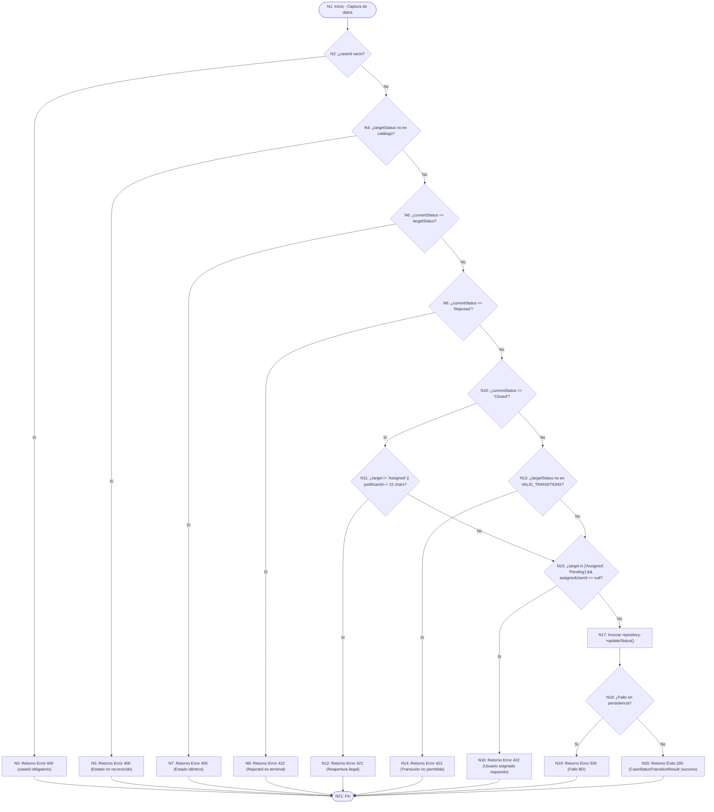
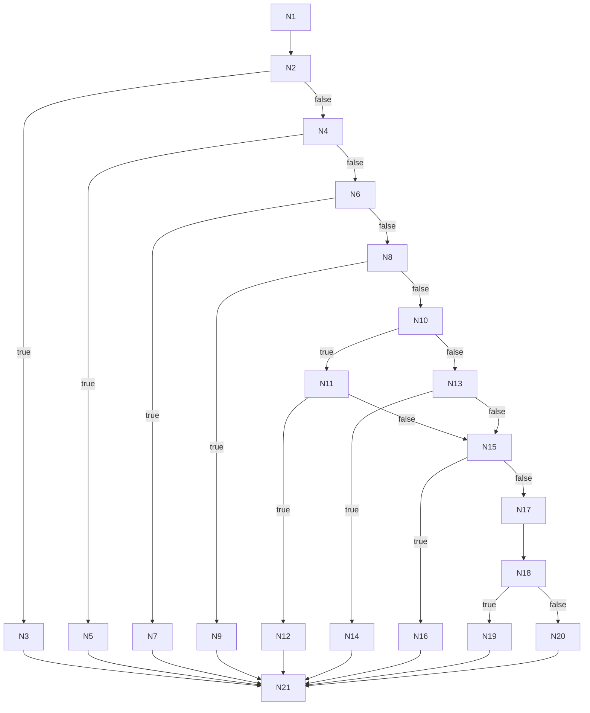
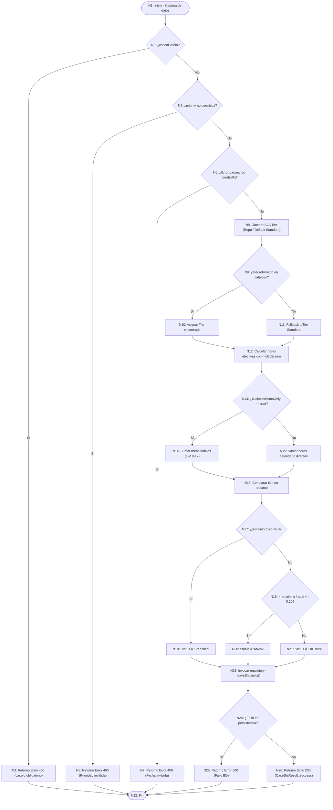
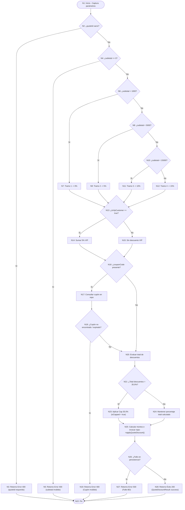

# 🔍 ANÁLISIS ESTRUCTURAL Y PRUEBAS DE CAJA BLANCA
## Validación y Verificación de Software — EspoCRM
**Integrante Responsable:** Andrés Bedoya Cano  
**Módulos Evaluados:** Soporte (Casos), Ventas (Cotizaciones), Actividades (Tareas), Cuentas (Empresas)  
**Alcance:** 5 Funcionalidades individuales complejas (F1 a F5)  
**Criterio de Evaluación:** Criterio 5 (10 Puntos)

---

## ÍNDICE
1. [Funcionalidad 1: Validación de Transición de Estados de Casos (`CaseStatusTransitionValidator`)](#1-funcionalidad-1-validación-de-transición-de-estados-de-casos)
2. [Funcionalidad 2: Cálculo de SLA y Tiempo Límite de Atención (`CaseSlaCalculator`)](#2-funcionalidad-2-cálculo-de-sla-y-tiempo-límite-de-atención)
3. [Funcionalidad 3: Cálculo de Descuentos Escalonados en Cotizaciones (`QuoteDiscountCalculator`)](#3-funcionalidad-3-cálculo-de-descuentos-escalonados-en-cotizaciones)
4. [Funcionalidad 4: Evaluación y Escalado de Tareas Vencidas (`TaskOverdueEvaluator`)](#4-funcionalidad-4-evaluación-y-escalado-de-tareas-vencidas)
5. [Funcionalidad 5: Detección de Empresas Duplicadas (`AccountDuplicateDetector`)](#5-funcionalidad-5-detección-de-empresas-duplicadas)

---

## 1. FUNCIONALIDAD 1: Validación de Transición de Estados de Casos
* **Clase:** `Espo\VyV\CaseStatus\CaseStatusTransitionValidator`
* **Método Evaluado:** `transition(array $data): CaseStatusTransitionResult`

### 1.1 Diagrama de Flujo Detallado

### 1.2 Grafo de Control de Flujo (CFG)

### 1.3 Cálculo de la Complejidad Ciclomática de McCabe $V(G)$
* **Número de Nodos ($N$):** 21
* **Número de Aristas ($E$):** 29
* **Número de Nodos Predicado ($P$):** 9 (N2, N4, N6, N8, N10, N11, N13, N15, N18)

#### Justificación por los 3 métodos formales:
$$\text{Método 1 (Aristas y Nodos): } V(G) = E - N + 2 = 29 - 21 + 2 = 10$$
$$\text{Método 2 (Nodos Predicado): } V(G) = P + 1 = 9 + 1 = 10$$
$$\text{Método 3 (Regiones Planas): } V(G) = R = 9 \text{ regiones cerradas} + 1 \text{ región infinita} = 10$$

### 1.4 Conjunto Base de Caminos Independientes
| Camino | Secuencia de Nodos | Condición de Activación | Descripción | Caso de Prueba Unitario |
|:---:|---|---|---|:---:|
| **$P_1$** | N1 $\rightarrow$ N2 $\rightarrow$ N3 $\rightarrow$ N21 | `caseId === ''` | Rechazo inmediato por identificador de caso vacío | `testTransitionFailsWhenCaseIdIsEmpty` |
| **$P_2$** | N1 $\rightarrow$ N2 $\rightarrow$ N4 $\rightarrow$ N5 $\rightarrow$ N21 | `caseId` válido, `targetStatus` desconocido | Rechazo por estado destino no existente en el catálogo | `testTransitionFailsWhenTargetStatusIsInvalid` |
| **$P_3$** | N1 $\rightarrow$ N2 $\rightarrow$ N4 $\rightarrow$ N6 $\rightarrow$ N7 $\rightarrow$ N21 | `currentStatus === targetStatus` | Rechazo por transición redundante al mismo estado | `testTransitionFailsWhenCurrentAndTargetAreIdentical` |
| **$P_4$** | N1 $\rightarrow$ N2 $\rightarrow$ N4 $\rightarrow$ N6 $\rightarrow$ N8 $\rightarrow$ N9 $\rightarrow$ N21 | `currentStatus === 'Rejected'` | Rechazo por inmutabilidad de caso rechazado | `testTransitionFailsWhenCurrentStatusIsRejected` |
| **$P_5$** | N1 $\rightarrow$ N2 $\rightarrow$ N4 $\rightarrow$ N6 $\rightarrow$ N8 $\rightarrow$ N10 $\rightarrow$ N11 $\rightarrow$ N12 $\rightarrow$ N21 | `currentStatus === 'Closed'`, justificación < 15 chars | Rechazo por reapertura sin justificación técnica suficiente | `testTransitionFailsWhenReopeningClosedCaseWithoutJustification` |
| **$P_6$** | N1 $\rightarrow$ N2 $\rightarrow$ N4 $\rightarrow$ N6 $\rightarrow$ N8 $\rightarrow$ N10 $\rightarrow$ N11 $\rightarrow$ N15 $\rightarrow$ N16 $\rightarrow$ N21 | `currentStatus === 'Closed'`, reapertura válida pero `assignedUserId === null` | Rechazo por falta de usuario asignado en reapertura | `testTransitionFailsWhenReopeningWithoutAssignedUser` |
| **$P_7$** | N1 $\rightarrow$ N2 $\rightarrow$ N4 $\rightarrow$ N6 $\rightarrow$ N8 $\rightarrow$ N10 $\rightarrow$ N13 $\rightarrow$ N14 $\rightarrow$ N21 | `currentStatus === 'New'`, `targetStatus === 'Closed'` | Rechazo por salto ilegal en el flujo (ej. New a Closed directo) | `testTransitionFailsWhenIllegalTransitionFromNewToClosed` |
| **$P_8$** | N1 $\rightarrow$ N2 $\rightarrow$ N4 $\rightarrow$ N6 $\rightarrow$ N8 $\rightarrow$ N10 $\rightarrow$ N13 $\rightarrow$ N15 $\rightarrow$ N16 $\rightarrow$ N21 | `New` a `Assigned`, pero `assignedUserId === null` | Rechazo por transición a Assigned sin responsable asignado | `testTransitionFailsWhenAssignedUserIdIsMissing` |
| **$P_9$** | N1 $\rightarrow$ N2 $\rightarrow$ N4 $\rightarrow$ N6 $\rightarrow$ N8 $\rightarrow$ N10 $\rightarrow$ N13 $\rightarrow$ N15 $\rightarrow$ N17 $\rightarrow$ N18 $\rightarrow$ N19 $\rightarrow$ N21 | Transición válida, fallo simulado en base de datos (`save = false`) | Error interno 500 por fallo de persistencia | `testTransitionFailsWhenRepositoryReturnsFalse` |
| **$P_{10}$**| N1 $\rightarrow$ N2 $\rightarrow$ N4 $\rightarrow$ N6 $\rightarrow$ N8 $\rightarrow$ N10 $\rightarrow$ N13 $\rightarrow$ N15 $\rightarrow$ N17 $\rightarrow$ N18 $\rightarrow$ N20 $\rightarrow$ N21 | Transición válida, responsable presente, persistencia exitosa | Camino principal exitoso (Happy Path) | `testTransitionSucceedsWithValidParameters` |

---

## 2. FUNCIONALIDAD 2: Cálculo de SLA y Tiempo Límite de Atención
* **Clase:** `Espo\VyV\CaseSla\CaseSlaCalculator`
* **Método Evaluado:** `calculate(array $data): CaseSlaResult`

### 2.1 Diagrama de Flujo Detallado

### 2.2 Grafo de Control de Flujo (CFG) y Complejidad $V(G)$
* **Nodos Predicado ($P$):** 9 (N2, N4, N6, N9, N13, N17, N19, N24) + sub-condiciones = 9 predicados
* **Complejidad Ciclomática de McCabe:**
  $$V(G) = P + 1 = 9 + 1 = 10$$
  $$V(G) = E - N + 2 = 30 - 22 + 2 = 10$$
* **Caminos Independientes ($P_1 \dots P_{10}$):**
  1. $P_1$: Rechazo por `caseId` vacío.
  2. $P_2$: Rechazo por prioridad no válida.
  3. $P_3$: Rechazo por formato de fecha no válido.
  4. $P_4$: Cálculo con cuenta Platinum, horas hábiles, estatus `OnTrack`.
  5. $P_5$: Cálculo con cuenta Gold, horas hábiles, estatus `AtRisk`.
  6. $P_6$: Cálculo con cuenta Silver, tiempo agotado, estatus `Breached`.
  7. $P_7$: Cálculo con cuenta no encontrada (fallback Standard).
  8. $P_8$: Cálculo en modalidad horas calendario continuas (`businessHoursOnly = false`).
  9. $P_9$: Prioridad `Urgent` (multiplicador 0.5x) y cuenta Platinum.
  10. $P_{10}$: Fallo en persistencia de BD (error 500).

---

## 3. FUNCIONALIDAD 3: Cálculo de Descuentos Escalonados en Cotizaciones
* **Clase:** `Espo\VyV\QuoteDiscount\QuoteDiscountCalculator`
* **Método Evaluado:** `calculate(array $data): QuoteDiscountResult`

### 3.1 Diagrama de Flujo Detallado

### 3.2 Cálculo de la Complejidad Ciclomática de McCabe $V(G)$
* **Nodos Predicado ($P$):** 10 (N2, N4, N6, N8, N10, N13, N16, N18, N21, N26)
* **Complejidad Ciclomática:**
  $$V(G) = P + 1 = 10 + 1 = 11$$
  $$V(G) = E - N + 2 = 33 - 24 + 2 = 11$$
* **Caminos Independientes ($P_1 \dots P_{11}$):**
  1. $P_1$: Rechazo por `quoteId` vacío.
  2. $P_2$: Rechazo por `subtotal <= 0`.
  3. $P_3$: Subtotal < 1000, sin VIP, sin cupón (0% descuento).
  4. $P_4$: Subtotal en [1000, 5000), cliente regular (5% descuento).
  5. $P_5$: Subtotal en [5000, 15000), cliente regular (10% descuento).
  6. $P_6$: Subtotal $\ge$ 15000, cliente regular (15% descuento).
  7. $P_7$: Subtotal con beneficio cliente VIP (+5% adicional).
  8. $P_8$: Cupón promocional inexistente o expirado (error 400).
  9. $P_9$: Cupón válido aplicado sumando al total.
  10. $P_{10}$: Sumatoria excede el 35% de margen: activación de Cap a 35%.
  11. $P_{11}$: Fallo de persistencia en base de datos (error 500).

---

## 4. FUNCIONALIDAD 4: Evaluación y Escalado de Tareas Vencidas
* **Clase:** `Espo\VyV\TaskOverdue\TaskOverdueEvaluator`
* **Método Evaluado:** `evaluate(array $data): TaskOverdueResult`

### 4.1 Grafo de Control de Flujo y Nodos Predicado
* **Nodos Predicado ($P$):** 10
  1. `$taskId === ''`
  2. `!in_array($status, ALLOWED)`
  3. Error parseando `$dueDate`
  4. `in_array($status, ['Completed', 'Canceled'])`
  5. `$evalDate <= $dueDate` (En tiempo vs en mora)
  6. `$overdueDays <= 2 && priority !== 'Urgent'` (Mora menor)
  7. `$overdueDays <= 7 && priority !== 'Urgent'` (Mora moderada)
  8. Escalado moderado vs crítico
  9. Supervisor/Manager nulo (activación fallback)
  10. Fallo de persistencia en BD
* **Complejidad Ciclomática de McCabe:**
  $$V(G) = P + 1 = 10 + 1 = 11$$
* **Caminos Independientes ($P_1 \dots P_{11}$):**
  1. $P_1$: `taskId` vacío.
  2. $P_2$: Estado de tarea no reconocido.
  3. $P_3$: Formato de fecha `dueDate` inválido.
  4. $P_4$: Tarea en estado `Completed` (retorno 200 sin mora).
  5. $P_5$: Tarea en tiempo (`evalDate <= dueDate`, mora 0, severidad None).
  6. $P_6$: Mora menor ($\le 2$ días, severidad Minor, sin escalado).
  7. $P_7$: Mora moderada (3 a 7 días, severidad Moderate, escalado a Supervisor).
  8. $P_8$: Mora moderada con fallback al administrador por supervisor ausente.
  9. $P_9$: Mora crítica (>7 días, severidad Critical, escalado a Gerente).
  10. $P_{10}$: Mora con prioridad `Urgent` (salto directo a severidad Critical).
  11. $P_{11}$: Fallo de persistencia en base de datos (error 500).

---

## 5. FUNCIONALIDAD 5: Detección de Empresas Duplicadas
* **Clase:** `Espo\VyV\AccountDeduplication\AccountDuplicateDetector`
* **Método Evaluado:** `detect(array $data): AccountDuplicateResult`

### 5.1 Grafo de Control de Flujo y Nodos Predicado
* **Nodos Predicado ($P$):** 9
  1. `$rawName === ''`
  2. `$sicCode !== null && $sicCode !== ''`
  3. Coincidencia tributaria exacta encontrada (`$taxMatch !== null`)
  4. Candidato con coincidencia exacta de nombre normalizado
  5. Candidato con similitud Levenshtein $\ge 0.80$
  6. `$website !== null` y coincidencia de dominio web
  7. `$email !== null` y coincidencia de dominio de correo no genérico
  8. `finalScore >= 70` (Nivel High)
  9. `finalScore >= 40` (Nivel Moderate vs Low)
* **Complejidad Ciclomática de McCabe:**
  $$V(G) = P + 1 = 9 + 1 = 10$$
* **Caminos Independientes ($P_1 \dots P_{10}$):**
  1. $P_1$: Nombre de cuenta vacío (error 400).
  2. $P_2$: Coincidencia exacta de NIT/Tax ID (+90 puntos $\rightarrow$ High match).
  3. $P_3$: Coincidencia exacta de nombre tras remover sufijos legales SAS/SA (+70 puntos $\rightarrow$ High match).
  4. $P_4$: Similitud Levenshtein $\ge 80\%$ en nombre (+40 puntos $\rightarrow$ Moderate match).
  5. $P_5$: Coincidencia por dominio web corporativo (+30 puntos).
  6. $P_6$: Coincidencia por dominio de correo corporativo (+20 puntos).
  7. $P_7$: Combinación de nombre similar + dominio web ($40 + 30 = 70 \rightarrow$ High match).
  8. $P_8$: Descarte de dominios genéricos de correo (`gmail.com`, `hotmail.com`).
  9. $P_9$: Cuenta completamente única sin coincidencias (Score 0, Nivel Low, `isDuplicate = false`).
  10. $P_{10}$: Similitud menor al 80% descartada.
