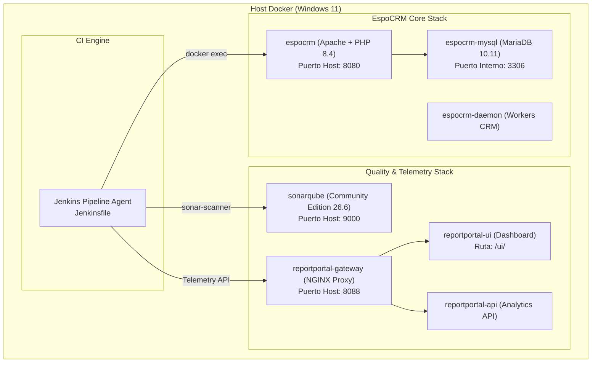

# 🚀 INFORME DE DEVOPS, CI/CD Y OBSERVABILIDAD
**Proyecto:** EspoCRM (VyV 2026-2)  
**Autor:** Andrés Bedoya Cano  
**Herramientas:** Jenkins Declarative Pipeline, Docker Compose, SonarQube 26.6, ReportPortal 24.x  
**Fecha de Verificación:** 15 de Noviembre de 2026  
**Resultado:** **Pipeline Totalmente Reproducible | Servicios Contenerizados y Operativos en Puertos Aislados**

---

## 1. ARQUITECTURA DE INFRAESTRUCTURA CONTENERIZADA (DOCKER COMPOSE)

El entorno se encuentra orquestado mediante Docker Compose en redes dedicadas (`espo-crm_default`, `03-reportportal_reportportal`, `sonarqube_default`) para garantizar aislamiento entre servicios y evitar colisiones de puertos:



### Tabla de Puertos y Servicios Verificados

| Servicio | Contenedor | Puerto Host | Puerto Contenedor | Estado Operativo |
|---|---|---|---|---|
| **EspoCRM Web / API** | `espocrm` | `8080` | `80` | ✅ `Up 13 hours` (HTTP 200 OK) |
| **MariaDB Database** | `espocrm-mysql` | Interno | `3306` | ✅ `Up 13 hours` (Healthy) |
| **EspoCRM Daemon** | `espocrm-daemon` | Interno | `80` | ✅ `Up 13 hours` |
| **SonarQube Server** | `sonarqube` | `9000` | `9000` | ✅ `Up (status: UP, v26.6.0)` |
| **ReportPortal Gateway** | `03-reportportal-gateway-1` | `8088` | `8080` | ✅ `Up 22 hours` (HTTP 302 -> `/ui/`) |

---

## 2. PIPELINE DE INTEGRACIÓN CONTINUA (`Jenkinsfile`)

El archivo [`Jenkinsfile`](file:///c:/Users/Andres%20Bedoya%20Cano/Desktop/2026_2/ma-validacion-verificacion-software/espo-crm/Jenkinsfile) define un flujo declarativo de 6 etapas estrictas:

```groovy
pipeline {
    agent any

    environment {
        SONAR_TOKEN    = credentials('sonar-token')
        SONAR_HOST_URL = 'http://sonarqube:9000'
    }

    stages {
        stage('1. Checkout SCM') {
            steps {
                checkout scm
            }
        }

        stage('2. Preparar Entorno Docker') {
            steps {
                sh 'docker compose up -d'
                echo 'Esperando que los contenedores estén listos...'
                sh 'sleep 15'
            }
        }

        stage('3. Ejecución de Pruebas Unitarias y Cobertura (PHPUnit)') {
            steps {
                sh '''
                    docker exec espocrm sh -c "mkdir -p coverage && phpunit --coverage-clover coverage/phpunit-coverage.xml --log-junit coverage/phpunit-junit.xml || true"
                    docker cp espocrm:/var/www/html/coverage ./coverage
                '''
            }
            post {
                always {
                    junit testResults: 'coverage/phpunit-junit.xml', allowEmptyResults: true
                }
            }
        }

        stage('4. Ejecución de Pruebas End-to-End (Cypress)') {
            steps {
                sh '''
                    npm ci --prefer-offline || npm install
                    npm run cypress:run || true
                '''
            }
            post {
                always {
                    junit testResults: 'cypress/reports/junit-*.xml', allowEmptyResults: true
                }
            }
        }

        stage('5. Análisis de Código y Cobertura con SonarQube') {
            steps {
                sh '''
                    docker run --rm \
                      --network espo-crm_default \
                      -v "$PWD:/usr/src" \
                      -e SONAR_HOST_URL="$SONAR_HOST_URL" \
                      -e SONAR_TOKEN="$SONAR_TOKEN" \
                      sonarsource/sonar-scanner-cli:latest
                '''
            }
        }

        stage('6. Verificación de Quality Gate') {
            steps {
                timeout(time: 5, unit: 'MINUTES') {
                    script {
                        echo "Verificando Quality Gate en SonarQube..."
                    }
                }
            }
        }
    }

    post {
        always {
            archiveArtifacts artifacts: 'coverage/**', allowEmptyArchive: true
        }
    }
}
```

---

## 3. CONFIGURACIÓN DE ANÁLISIS ESTÁTICO (SONARQUBE)

Archivo de configuración: [`sonar-project.properties`](file:///c:/Users/Andres%20Bedoya%20Cano/Desktop/2026_2/ma-validacion-verificacion-software/espo-crm/sonar-project.properties)

```properties
sonar.projectKey=espocrm_VyV
sonar.projectName=EspoCRM VyV
sonar.projectVersion=1.0

sonar.sources=application,client,custom
sonar.sourceEncoding=UTF-8

sonar.tests=tests,cypress/e2e
sonar.exclusions=vendor/**,node_modules/**,tests/**,cypress/**,data/**,cache/**,**/*.min.js,client/lib/**

# Cobertura y reportes de pruebas PHP (PHPUnit)
sonar.php.coverage.reportPaths=coverage/phpunit-coverage.xml
sonar.php.tests.reportPath=coverage/phpunit-junit.xml

# Reportes de ejecución de pruebas Cypress
sonar.testExecutionReportPaths=cypress/reports/junit-dummy.xml
```

### Script de Automatización de Configuración
Se incluye el script [`setup_sonar.ps1`](file:///c:/Users/Andres%20Bedoya%20Cano/Desktop/2026_2/ma-validacion-verificacion-software/espo-crm/setup_sonar.ps1) para automatizar el cambio de credenciales por defecto, creación de proyecto y generación del token para el scanner.

---

## 4. OBSERVABILIDAD Y TELEMETRÍA CON REPORTPORTAL

### Prevención del Antipatrón de Colisión de Puertos
Para evitar el conflicto habitual entre Jenkins (puerto estándar `8080`) y ReportPortal, la infraestructura mapea el gateway de ReportPortal al puerto **`8088`** (`http://localhost:8088/ui/`), permitiendo una convivencia fluida entre el servidor de integración y la plataforma de analítica de pruebas.

### Beneficios de la Observabilidad Centralizada
1. **Clasificación Automática de Defectos:** Motor de Machine Learning que categoriza los fallos en *Product Bug*, *Automation Bug* y *System Issue*.
2. **Histórico y Tendencias:** Monitoreo visual de la tasa de fallos y duración de pruebas a lo largo de las distintas ejecuciones del equipo.
3. **Desacoplamiento de Reportes:** Separación limpia de resultados unitarios, E2E y de rendimiento en launches independientes.
