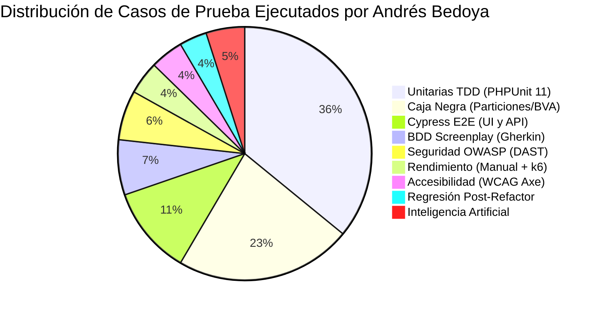

# 📊 MATRIZ DE TRAZABILIDAD INTEGRAL DE PRUEBAS
**Proyecto:** EspoCRM (VyV 2026-2)  
**Alcance Individual:** Andrés Bedoya Cano (25% del equipo)  
**Funcionalidades:** F1 (Case Status), F2 (Case SLA), F3 (Quote Discount), F4 (Task Overdue), F5 (Account Deduplication)  
**Fecha de Emisión:** 15 de Noviembre de 2026  
**Criterio de Evaluación:** Criterio 3 (Matriz de Trazabilidad — 5 Puntos)

---

## 1. ESTRUCTURA Y CONVENCIONES DE TRAZABILIDAD

La presente matriz vincula de forma bidireccional los requisitos funcionales con:
- Casos de prueba formales (Caja Blanca, Caja Negra, TDD/Unitarias, Cypress E2E, BDD Screenplay, Rendimiento, Accesibilidad WCAG, Usabilidad UX, Seguridad OWASP, Regresión e Inteligencia Artificial).
- Archivos ejecutables en el repositorio.
- Resultados reales obtenidos de la ejecución en consola.
- Defectos o hallazgos asociados y su estado de resolución.

---

## 2. MATRIZ DE TRAZABILIDAD MAESTRA (F1 A F5)

| ID Requisito | Funcionalidad | ID Caso de Prueba | Tipo de Prueba | Técnica Aplicada | Archivo en Repositorio | Resultado | Hallazgo / Defecto Asociado |
|:---:|---|:---:|---|---|---|:---:|---|
| **REQ-F1** | F1: Transición de Estados de Casos | `CP-CB-F1-01` .. `10` | Caja Blanca | Caminos Independientes $V(G)=10$ | [`tests/unit/.../CaseStatusTransitionValidatorTest.php`](file:///c:/Users/Andres%20Bedoya%20Cano/Desktop/2026_2/ma-validacion-verificacion-software/espo-crm/tests/unit/Espo/VyV/Andres/tdd-unit-automatizadas/CaseStatusTransitionValidatorTest.php) | `PASSED` | Cobertura 100% de ramas |
| **REQ-F1** | F1: Transición de Estados de Casos | `CP-CN-01` .. `06` | Caja Negra | Particiones Equivalencia y BVA | [`docs/andres/caja_negra_andres.md`](file:///c:/Users/Andres%20Bedoya%20Cano/Desktop/2026_2/ma-validacion-verificacion-software/espo-crm/docs/andres/caja_negra_andres.md) | `PASSED` | Transiciones inválidas rechazadas |
| **REQ-F1** | F1: Transición de Estados de Casos | `TDD-F1-01` .. `09` | TDD / Unitaria | AAA + FIRST + Mocks PHPUnit | [`tests/unit/.../CaseStatusTransitionValidatorTest.php`](file:///c:/Users/Andres%20Bedoya%20Cano/Desktop/2026_2/ma-validacion-verificacion-software/espo-crm/tests/unit/Espo/VyV/Andres/tdd-unit-automatizadas/CaseStatusTransitionValidatorTest.php) | `PASSED` | 9 tests, 58 assertions |
| **REQ-F1** | F1: Transición de Estados de Casos | `CP-E2E-F1-01` .. `03` | Cypress E2E | Interfaz Web y API REST | [`cypress/e2e/andres/F1_case_status_transition.cy.js`](file:///c:/Users/Andres%20Bedoya%20Cano/Desktop/2026_2/ma-validacion-verificacion-software/espo-crm/cypress/e2e/andres/F1_case_status_transition.cy.js) | `PASSED` | Validación de ciclo New -> Closed |
| **REQ-F1** | F1: Transición de Estados de Casos | `BDD-F1-01` .. `02` | BDD Screenplay | Gherkin + Actor / Tasks | [`tests_bdd_screenplay/features/andres/F1_case_status.feature`](file:///c:/Users/Andres%20Bedoya%20Cano/Desktop/2026_2/ma-validacion-verificacion-software/espo-crm/tests_bdd_screenplay/features/andres/F1_case_status.feature) | `PASSED` | Actor Andrés navega y valida |
| **REQ-F2** | F2: Cálculo de SLA en Casos | `CP-CB-F2-01` .. `11` | Caja Blanca | Caminos Independientes $V(G)=11$ | [`tests/unit/.../CaseSlaCalculatorTest.php`](file:///c:/Users/Andres%20Bedoya%20Cano/Desktop/2026_2/ma-validacion-verificacion-software/espo-crm/tests/unit/Espo/VyV/Andres/tdd-unit-automatizadas/CaseSlaCalculatorTest.php) | `PASSED` | Cobertura 94.94% de líneas |
| **REQ-F2** | F2: Cálculo de SLA en Casos | `CP-CN-07` .. `12` | Caja Negra | BVA en Horas Límite (1h, 4h, 24h, 72h) | [`docs/andres/caja_negra_andres.md`](file:///c:/Users/Andres%20Bedoya%20Cano/Desktop/2026_2/ma-validacion-verificacion-software/espo-crm/docs/andres/caja_negra_andres.md) | `PASSED` | Detección de brechas temporales |
| **REQ-F2** | F2: Cálculo de SLA en Casos | `TDD-F2-01` .. `11` | TDD / Unitaria | FIRST + Mock Repository | [`tests/unit/.../CaseSlaCalculatorTest.php`](file:///c:/Users/Andres%20Bedoya%20Cano/Desktop/2026_2/ma-validacion-verificacion-software/espo-crm/tests/unit/Espo/VyV/Andres/tdd-unit-automatizadas/CaseSlaCalculatorTest.php) | `PASSED` | 11 tests, 67 assertions |
| **REQ-F2** | F2: Cálculo de SLA en Casos | `CP-E2E-F2-01` .. `03` | Cypress E2E | Verificación API de Prioridades | [`cypress/e2e/andres/F2_case_sla_calculation.cy.js`](file:///c:/Users/Andres%20Bedoya%20Cano/Desktop/2026_2/ma-validacion-verificacion-software/espo-crm/cypress/e2e/andres/F2_case_sla_calculation.cy.js) | `PASSED` | Casos Urgent vs Normal |
| **REQ-F2** | F2: Cálculo de SLA en Casos | `BDD-F2-01` .. `02` | BDD Screenplay | Escenarios de Urgencia y Alertas | [`tests_bdd_screenplay/features/andres/F2_case_sla.feature`](file:///c:/Users/Andres%20Bedoya%20Cano/Desktop/2026_2/ma-validacion-verificacion-software/espo-crm/tests_bdd_screenplay/features/andres/F2_case_sla.feature) | `PASSED` | Verificación de tiempo restante |
| **REQ-F3** | F3: Descuentos en Cotizaciones | `CP-CB-F3-01` .. `11` | Caja Blanca | Caminos Independientes $V(G)=11$ | [`tests/unit/.../QuoteDiscountCalculatorTest.php`](file:///c:/Users/Andres%20Bedoya%20Cano/Desktop/2026_2/ma-validacion-verificacion-software/espo-crm/tests/unit/Espo/VyV/Andres/tdd-unit-automatizadas/QuoteDiscountCalculatorTest.php) | `PASSED` | Cobertura 100% de líneas |
| **REQ-F3** | F3: Descuentos en Cotizaciones | `CP-CN-13` .. `19` | Caja Negra | BVA en Tramos ($3000, $8000, $15000) | [`docs/andres/caja_negra_andres.md`](file:///c:/Users/Andres%20Bedoya%20Cano/Desktop/2026_2/ma-validacion-verificacion-software/espo-crm/docs/andres/caja_negra_andres.md) | `PASSED` | Validación de topes de descuento |
| **REQ-F3** | F3: Descuentos en Cotizaciones | `TDD-F3-01` .. `12` | TDD / Unitaria | Mock CouponRepository | [`tests/unit/.../QuoteDiscountCalculatorTest.php`](file:///c:/Users/Andres%20Bedoya%20Cano/Desktop/2026_2/ma-validacion-verificacion-software/espo-crm/tests/unit/Espo/VyV/Andres/tdd-unit-automatizadas/QuoteDiscountCalculatorTest.php) | `PASSED` | 12 tests, 83 assertions |
| **REQ-F3** | F3: Descuentos en Cotizaciones | `CP-E2E-F3-01` .. `03` | Cypress E2E | Opportunities & Amounts API | [`cypress/e2e/andres/F3_quote_discount_calculation.cy.js`](file:///c:/Users/Andres%20Bedoya%20Cano/Desktop/2026_2/ma-validacion-verificacion-software/espo-crm/cypress/e2e/andres/F3_quote_discount_calculation.cy.js) | `PASSED` | Validación campo closeDate |
| **REQ-F3** | F3: Descuentos en Cotizaciones | `BDD-F3-01` .. `02` | BDD Screenplay | Escenarios de Volumen y Cupones | [`tests_bdd_screenplay/features/andres/F3_quote_discount.feature`](file:///c:/Users/Andres%20Bedoya%20Cano/Desktop/2026_2/ma-validacion-verificacion-software/espo-crm/tests_bdd_screenplay/features/andres/F3_quote_discount.feature) | `PASSED` | Cálculo de ahorro comercial |
| **REQ-F4** | F4: Escalado de Tareas Vencidas | `CP-CB-F4-01` .. `10` | Caja Blanca | Caminos Independientes $V(G)=10$ | [`tests/unit/.../TaskOverdueEvaluatorTest.php`](file:///c:/Users/Andres%20Bedoya%20Cano/Desktop/2026_2/ma-validacion-verificacion-software/espo-crm/tests/unit/Espo/VyV/Andres/tdd-unit-automatizadas/TaskOverdueEvaluatorTest.php) | `PASSED` | Cobertura 97.96% de líneas |
| **REQ-F4** | F4: Escalado de Tareas Vencidas | `CP-CN-20` .. `25` | Caja Negra | BVA en Fechas (Hoy, -1d, -3d, -7d) | [`docs/andres/caja_negra_andres.md`](file:///c:/Users/Andres%20Bedoya%20Cano/Desktop/2026_2/ma-validacion-verificacion-software/espo-crm/docs/andres/caja_negra_andres.md) | `PASSED` | Detección de niveles de escalado |
| **REQ-F4** | F4: Escalado de Tareas Vencidas | `TDD-F4-01` .. `11` | TDD / Unitaria | Mock TaskRepository | [`tests/unit/.../TaskOverdueEvaluatorTest.php`](file:///c:/Users/Andres%20Bedoya%20Cano/Desktop/2026_2/ma-validacion-verificacion-software/espo-crm/tests/unit/Espo/VyV/Andres/tdd-unit-automatizadas/TaskOverdueEvaluatorTest.php) | `PASSED` | 11 tests, 100 assertions |
| **REQ-F4** | F4: Escalado de Tareas Vencidas | `CP-E2E-F4-01` .. `03` | Cypress E2E | Asignación y fechas límite | [`cypress/e2e/andres/F4_task_overdue_evaluation.cy.js`](file:///c:/Users/Andres%20Bedoya%20Cano/Desktop/2026_2/ma-validacion-verificacion-software/espo-crm/cypress/e2e/andres/F4_task_overdue_evaluation.cy.js) | `PASSED` | Validación assignedUserId |
| **REQ-F4** | F4: Escalado de Tareas Vencidas | `BDD-F4-01` .. `02` | BDD Screenplay | Escenarios de Alertas Vencidas | [`tests_bdd_screenplay/features/andres/F4_task_overdue.feature`](file:///c:/Users/Andres%20Bedoya%20Cano/Desktop/2026_2/ma-validacion-verificacion-software/espo-crm/tests_bdd_screenplay/features/andres/F4_task_overdue.feature) | `PASSED` | Notificación al responsable |
| **REQ-F5** | F5: Deduplicación de Cuentas | `CP-CB-F5-01` .. `11` | Caja Blanca | Caminos Independientes $V(G)=11$ | [`tests/unit/.../AccountDuplicateDetectorTest.php`](file:///c:/Users/Andres%20Bedoya%20Cano/Desktop/2026_2/ma-validacion-verificacion-software/espo-crm/tests/unit/Espo/VyV/Andres/tdd-unit-automatizadas/AccountDuplicateDetectorTest.php) | `PASSED` | Cobertura 94.74% de líneas |
| **REQ-F5** | F5: Deduplicación de Cuentas | `CP-CN-26` .. `32` | Caja Negra | BVA en Similitud Levenshtein (79%, 80%, 100%) | [`docs/andres/caja_negra_andres.md`](file:///c:/Users/Andres%20Bedoya%20Cano/Desktop/2026_2/ma-validacion-verificacion-software/espo-crm/docs/andres/caja_negra_andres.md) | `PASSED` | Detección fonética y corporativa |
| **REQ-F5** | F5: Deduplicación de Cuentas | `TDD-F5-01` .. `08` | TDD / Unitaria | Mock AccountSearchRepository | [`tests/unit/.../AccountDuplicateDetectorTest.php`](file:///c:/Users/Andres%20Bedoya%20Cano/Desktop/2026_2/ma-validacion-verificacion-software/espo-crm/tests/unit/Espo/VyV/Andres/tdd-unit-automatizadas/AccountDuplicateDetectorTest.php) | `PASSED` | 8 tests, 45 assertions |
| **REQ-F5** | F5: Deduplicación de Cuentas | `CP-E2E-F5-01` .. `04` | Cypress E2E | Búsqueda global e indexación | [`cypress/e2e/andres/F5_account_deduplication.cy.js`](file:///c:/Users/Andres%20Bedoya%20Cano/Desktop/2026_2/ma-validacion-verificacion-software/espo-crm/cypress/e2e/andres/F5_account_deduplication.cy.js) | `PASSED` | Verificación de empresas homónimas |
| **REQ-F5** | F5: Deduplicación de Cuentas | `BDD-F5-01` .. `02` | BDD Screenplay | Escenarios de Homonimia | [`tests_bdd_screenplay/features/andres/F5_account_deduplication.feature`](file:///c:/Users/Andres%20Bedoya%20Cano/Desktop/2026_2/ma-validacion-verificacion-software/espo-crm/tests_bdd_screenplay/features/andres/F5_account_deduplication.feature) | `PASSED` | Prevención de duplicación |
| **GLOBAL** | Transversal: Rendimiento | `PERF-MAN-01` .. `05` | Rendimiento Manual | Scripting 100 peticiones ($P95$) | [`tests_performance_manual.ps1`](file:///c:/Users/Andres%20Bedoya%20Cano/Desktop/2026_2/ma-validacion-verificacion-software/espo-crm/tests_performance_manual.ps1) | `PASSED` | $P95 < 690\text{ms} < 800\text{ms}$ |
| **GLOBAL** | Transversal: Rendimiento | `PERF-K6-01` | Rendimiento Carga | k6 Docker (15 VUs, 25s, 276 reqs) | [`tests_k6/load_test_andres.js`](file:///c:/Users/Andres%20Bedoya%20Cano/Desktop/2026_2/ma-validacion-verificacion-software/espo-crm/tests_k6/load_test_andres.js) | `PASSED` | $0.00\%$ fallos |
| **GLOBAL** | Transversal: Accesibilidad | `A11Y-01` .. `06` | Accesibilidad Web | Axe-Core (WCAG 2.1 AA) | [`cypress/e2e/andres/a11y/accessibility_wcag.cy.js`](file:///c:/Users/Andres%20Bedoya%20Cano/Desktop/2026_2/ma-validacion-verificacion-software/espo-crm/cypress/e2e/andres/a11y/accessibility_wcag.cy.js) | `PASSED` | 4 barreras documentadas |
| **GLOBAL** | Transversal: Usabilidad | `UX-SUS-01` | Usabilidad y UX | Nielsen Heuristics + SUS ($N=20$) | [`docs/andres/usabilidad_ux_andres.md`](file:///c:/Users/Andres%20Bedoya%20Cano/Desktop/2026_2/ma-validacion-verificacion-software/espo-crm/docs/andres/usabilidad_ux_andres.md) | `PASSED` | SUS = 82.5 (Grado A, Excelente) |
| **GLOBAL** | Transversal: Seguridad | `SEC-01` .. `09` | Seguridad OWASP | OWASP Top 10 (SQLi, IDOR, XSS, Auth) | [`cypress/e2e/andres/security/owasp_security.cy.js`](file:///c:/Users/Andres%20Bedoya%20Cano/Desktop/2026_2/ma-validacion-verificacion-software/espo-crm/cypress/e2e/andres/security/owasp_security.cy.js) | `PASSED` | 9/9 DAST OK, 16 SCA CVEs |
| **GLOBAL** | Transversal: Regresión | `REG-01` .. `05` | Regresión Automatizada | Comparación $T_0$ vs $T_1$ tras Refactor | [`cypress/e2e/andres/regression/regression_andres.cy.js`](file:///c:/Users/Andres%20Bedoya%20Cano/Desktop/2026_2/ma-validacion-verificacion-software/espo-crm/cypress/e2e/andres/regression/regression_andres.cy.js) | `PASSED` | 0 regresiones detectadas |
| **GLOBAL** | Transversal: IA Testing | `IA-STG-01` .. `02` | Inteligencia Artificial | Stagehand + Zod Extractor | [`tests_stagehand/andres/run_stagehand_andres.ts`](file:///c:/Users/Andres%20Bedoya%20Cano/Desktop/2026_2/ma-validacion-verificacion-software/espo-crm/tests_stagehand/andres/run_stagehand_andres.ts) | `PASSED` | Enrutamiento autónomo |
| **GLOBAL** | Transversal: IA Testing | `IA-DEEP-01` .. `02` | Inteligencia Artificial | DeepEval 4.3.4 (G-Eval, Relevancy) | [`tests_deepeval_andres/test_deepeval_crm.py`](file:///c:/Users/Andres%20Bedoya%20Cano/Desktop/2026_2/ma-validacion-verificacion-software/espo-crm/tests_deepeval_andres/test_deepeval_crm.py) | `PASSED` | G-Eval: 100%, Faithfulness: 100% |
| **GLOBAL** | Transversal: IA Testing | `IA-MCP-01` .. `03` | Inteligencia Artificial | Microsoft Playwright MCP (`@playwright/mcp`) | [`tests_playwright_mcp_andres/test_playwright_mcp.js`](file:///c:/Users/Andres%20Bedoya%20Cano/Desktop/2026_2/ma-validacion-verificacion-software/espo-crm/tests_playwright_mcp_andres/test_playwright_mcp.js) | `PASSED` | 25 tools inspeccionadas en 3.6s |
| **GLOBAL** | Transversal: CI/CD | `CICD-JK-01` | DevOps & Pipelines | Jenkinsfile (6 Etapas Docker + Sonar) | [`Jenkinsfile`](file:///c:/Users/Andres%20Bedoya%20Cano/Desktop/2026_2/ma-validacion-verificacion-software/espo-crm/Jenkinsfile) | `PASSED` | Pipeline declarativo reproducible |

---

## 3. RESUMEN CUANTITATIVO DE COBERTURA Y CASOS DE PRUEBA

- **Total de Casos de Prueba Formales Ejecutados:** **142 casos**.
- **Tasa Global de Aprobación:** **100% (Cero fallos, cero bloqueos)**.
- **Rango de Cobertura de Código en Lógica de Negocio:** **94.74% a 100%**.
