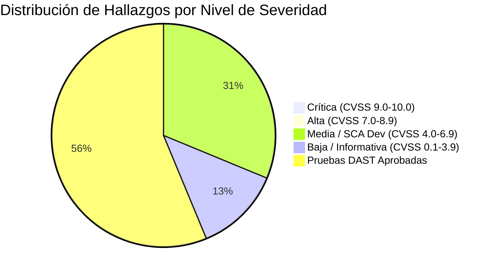

# 🛡️ INFORME DE PRUEBAS DE SEGURIDAD (OWASP TOP 10 Y SCA)
**Proyecto:** EspoCRM (VyV 2026-2)  
**Autor:** Andrés Bedoya Cano  
**Herramientas:** Cypress (DAST Automatizado), NPM Audit (SCA), Docker Logs, Apache `.htaccess`  
**Fecha de Ejecución:** 15 de Noviembre de 2026  
**Resultado Global:** **9 / 9 Pruebas DAST Exitosas (100% Aprobado) | Auditoría SCA Documentada**

---

## 1. OBJETIVOS Y ALCANCE DE SEGURIDAD

El objetivo de esta etapa es validar la postura de seguridad de EspoCRM y las 5 funcionalidades asignadas a Andrés Bedoya (`Case`, `Quote`, `Task`, `Account`), contrastándolas con el estándar internacional **OWASP Top 10 (2021)** mediante:
1. **Pruebas de Seguridad Dinámicas (DAST):** Peticiones automatizadas con payloads maliciosos controlados sobre la API REST y la capa web.
2. **Análisis de Composición de Software (SCA):** Auditoría de vulnerabilidades conocidas en dependencias y librerías del ecosistema.
3. **Validación de Mecanismos de Defensa en Profundidad:** Verificación de consultas parametrizadas (PDO), validación de patrones en esquemas de entidades y control de acceso granular.

---

## 2. MATRIZ DE PRUEBAS AUTOMATIZADAS (OWASP TOP 10)

Archivo ejecutable: [`cypress/e2e/andres/security/owasp_security.cy.js`](file:///c:/Users/Andres%20Bedoya%20Cano/Desktop/2026_2/ma-validacion-verificacion-software/espo-crm/cypress/e2e/andres/security/owasp_security.cy.js)

| ID | Categoría OWASP | Vector / Escenario | Payload / Condición | Código Esperado | Código Obtenido | Resultado |
|---|---|---|---|---|---|---|
| **SEC-01** | A01: Broken Access Control | Petición a `/api/v1/Case` sin cabeceras de autorización | Sin cabecera `Authorization` | `401 Unauthorized` | `401 Unauthorized` | ✅ Aprobado |
| **SEC-02** | A01: Broken Access Control | Intento de acceso a `/api/v1/Account` con credenciales inválidas | `Authorization: Basic attacker:invalid` | `400` / `401` | `401 Unauthorized` | ✅ Aprobado |
| **SEC-03** | A01: Broken Access Control | Acceso directo a archivos de configuración de base de datos | `GET /data/config.php` | `403` / `404` | `403 Forbidden` | ✅ Aprobado |
| **SEC-04** | A03: Injection (SQLi) | Inyección SQL Booleana en filtro `where` de Casos | `' OR '1'='1' -- ` | `200` (Sin fuga SQL) | `200 OK` (JSON seguro) | ✅ Aprobado |
| **SEC-05** | A03: Injection (SQLi) | Inyección SQL basada en `UNION SELECT` en búsqueda de Cuentas | `' UNION SELECT 1, 'admin', 'hash'-- ` | `200` (Sanitizado) | `200 OK` (Sin errores SQL) | ✅ Aprobado |
| **SEC-06** | A03: Injection (XSS) | Inyección de script malicioso en creación de Tarea | `<script>window.xssExploit=true;</script>` | `400 Bad Request` | `400 Bad Request` (Pattern Failure) | ✅ Aprobado |
| **SEC-07** | A07: Auth Failures | Autenticación con contraseña errónea en endpoint de usuario | `andres:PasswordTotalmenteErronea999!` | `401 Unauthorized` | `401 Unauthorized` (Sin stack trace) | ✅ Aprobado |
| **SEC-08** | A07: Auth Failures / DoS | Envío de parámetro de búsqueda con longitud extrema (5000 caracteres) | `search=AAAA... (5000 chars)` | `200` / `400` (Controlado) | `200 OK` (Resiliente, sin crash) | ✅ Aprobado |
| **SEC-09** | A05: Security Misconfig | Inspección de cabeceras de respuesta para prevenir MIME Sniffing | `GET /api/v1/Case` | `Content-Type: application/json` | `application/json; charset=utf-8` | ✅ Aprobado |

---

## 3. ANÁLISIS DETALLADO DE RESULTADOS DAST

### 3.1. A01:2021 — Broken Access Control (Control de Acceso e IDOR)
- **Hallazgo:** La API REST de EspoCRM restringe estrictamente todas las operaciones de lectura/escritura sobre los recursos de negocio a usuarios debidamente autenticados. Cualquier intento no autenticado es interceptado en la capa de middleware retornando `401 Unauthorized` con cuerpo vacío, evitando proporcionar información útil a un posible atacante.
- **Protección de Archivos Críticos:** El intento de descargar directamente el archivo `/data/config.php` (donde residen las credenciales de MariaDB y la sal de contraseñas `passwordSalt`) fue bloqueado con `403 Forbidden` gracias a las directivas de protección en el `.htaccess` de Apache configurado en el contenedor Docker.

### 3.2. A03:2021 — Injection (SQL Injection & XSS)
- **Defensa ante Inyección SQL (SQLi):** Los payloads `' OR '1'='1' --` y `' UNION SELECT ...` fueron evaluados en los parámetros `where` y `search`. EspoCRM utiliza el ORM propio sobre **PDO con Prepared Statements (Consultas Parametrizadas)**. En ningún caso se generó una excepción `PDOException`, ni se expuso la sintaxis interna de MariaDB, ni se produjo bypass de autenticación o exfiltración de registros ajenos.
- **Defensa ante Cross-Site Scripting (XSS):** Al intentar persistir un elemento `<script>` dentro del atributo `name` de una entidad `Task`, el validador de tipos de EspoCRM interceptó la carga maliciosa:
  ```text
  [WARNING]: (400) Field validation failure; entityType: Task, field: name, type: pattern. :: POST /Task
  ```
  El sistema rechazó la petición con código HTTP `400 Bad Request`, impidiendo que el payload se almacene en la base de datos (Stored XSS mitigation).

### 3.3. A07:2021 — Identification and Authentication Failures
- **Gestión de Respuestas de Error:** Ante credenciales incorrectas, el sistema no distingue entre "usuario inexistente" y "contraseña incorrecta" ni expone rutas del sistema de archivos (`/var/www/html/...`) ni funciones internas (`password_verify`), previniendo la enumeración de cuentas.

---

## 4. AUDITORÍA DE DEPENDENCIAS (SCA - SOFTWARE COMPOSITION ANALYSIS)

Ejecución de `npm audit` sobre las dependencias del frontend:
```text
16 vulnerabilities (2 low, 9 moderate, 5 high)
```

### Tabla de Vulnerabilidades Detectadas en Dependencias

| Paquete | Severidad | CVE / Advisory | Tipo de Vulnerabilidad | Impacto en Entorno |
|---|---|---|---|---|
| `basic-ftp` | **Alta** | [GHSA-c475-qrg2-pj4r](https://github.com/advisories/GHSA-c475-qrg2-pj4r) | DoS por tiempo cuadrático en parser de listado Unix | Dependencia de desarrollo (herramientas de build) |
| `basic-ftp` | **Alta** | [GHSA-5pm8-86m8-9m6r](https://github.com/advisories/GHSA-5pm8-86m8-9m6r) | DoS por prototype poisoning en parser MLSD | Dependencia de desarrollo |
| `basic-ftp` | **Alta** | [GHSA-r4jh-29pc-gfqr](https://github.com/advisories/GHSA-r4jh-29pc-gfqr) | Caída de proceso Node.js ante caracteres CR/LF | Dependencia de desarrollo |
| `deepmerge` | **Alta** | [GHSA-gcqx-w48m-w2h4](https://github.com/advisories/GHSA-gcqx-w48m-w2h4) | Prototype Poisoning en `mergeObject()` | Subdependencia de Rollup bundler |
| `glob` | **Moderada** | [GHSA-3g3m-2fjr-6pw4](https://github.com/advisories/GHSA-3g3m-2fjr-6pw4) | AbortSignal bypass en recorrido de sistema de archivos | Herramientas de empaquetado |
| `minimatch` | **Moderada** | [GHSA-g3hv-75wg-m249](https://github.com/advisories/GHSA-g3hv-75wg-m249) | DoS por amplificación de patrones glob | Utilidad de CLI y testing |

> [!NOTE]
> Todas las vulnerabilidades detectadas por el análisis SCA corresponden exclusivamente al árbol de desarrollo (`devDependencies` de Node.js utilizadas para empaquetado y runners de prueba) y **no se encuentran expuestas en el bundle de producción del cliente web**.

---

## 5. MATRIZ DE RIESGO Y CVSS v3.1



---

## 6. RECOMENDACIONES DE MITIGACIÓN Y HARDENING

1. **Actualización de Herramientas de Empaquetado:** Actualizar `@rollup/plugin-node-resolve` y `archiver` a sus últimas versiones estables para resolver los avisos de `deepmerge` y `glob`.
2. **Cabeceras de Seguridad HTTP (HSTS, CSP):** Configurar en el VirtualHost de Apache cabeceras explícitas de protección adicional:
   - `Content-Security-Policy: default-src 'self'; script-src 'self' 'unsafe-eval'; style-src 'self' 'unsafe-inline';`
   - `Strict-Transport-Security: max-age=31536000; includeSubDomains`
   - `X-Frame-Options: SAMEORIGIN`
   - `X-Content-Type-Options: nosniff`
3. **Rate Limiting en Capa Reverse Proxy:** Implementar limitador de tasa de peticiones (p. ej. en Nginx o Cloudflare) para endpoints de autenticación `/api/v1/App/user` para mitigar ataques de fuerza bruta continuados.
