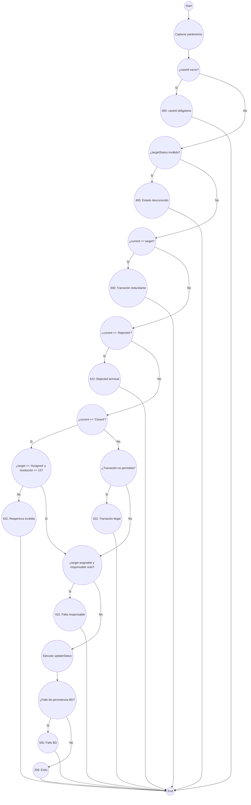

| Métrica | Valor |
|---|---|
| Nodos ($N$) | 21 |
| Aristas ($E$) | 29 |
| Nodos Predicado ($P$) | 9 (n2, n4, n6, n8, n10, n11, n13, n15, n18) |
| $V(G) = E - N + 2$ | **29 - 21 + 2 = 10** |
| $V(G) = P + 1$ | **9 + 1 = 10** |
| $V(G) = 	ext{Regiones } R$ | **9 cerradas + 1 infinita = 10** |
