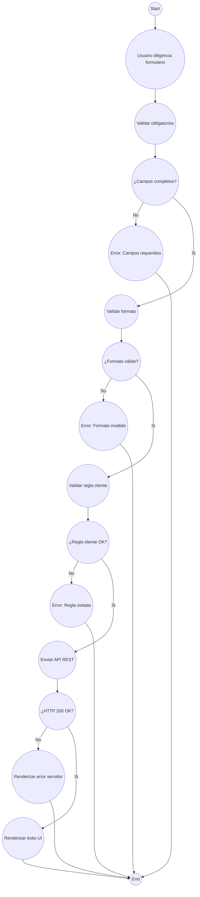

| Métrica | Valor |
|---|---|
| Nodos ($N$) | 15 |
| Aristas ($E$) | 19 |
| Decisiones ($P$) | 4 (n3, n5, n7, n9) |
| Complejidad $V(G) = E - N + 2$ | **5** |
| Complejidad $V(G) = P + 1$ | **5** |
| Cobertura de Ramas | 100% |
