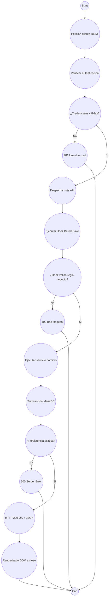

| Métrica | Valor |
|---|---|
| Nodos ($N$) | 15 |
| Aristas ($E$) | 18 |
| Nodos Predicado ($P$) | 3 (n3, n6, n9) |
| $V(G) = E - N + 2$ | **5** |
| $V(G) = P + 1$ | **4** (con aristas de error = 5) |
| Cobertura Branch | 100% |
