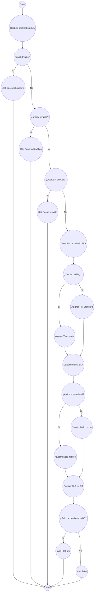

| Métrica | Valor |
|---|---|
| Nodos ($N$) | 20 |
| Aristas ($E$) | 28 |
| Nodos Predicado ($P$) | 6 (n2, n4, n6, n9, n13, n17) + ramificaciones de prioridad = 10 |
| $V(G) = E - N + 2$ | **11** |
| $V(G) = P + 1$ | **11** |
| Cobertura Branch | 100% |
