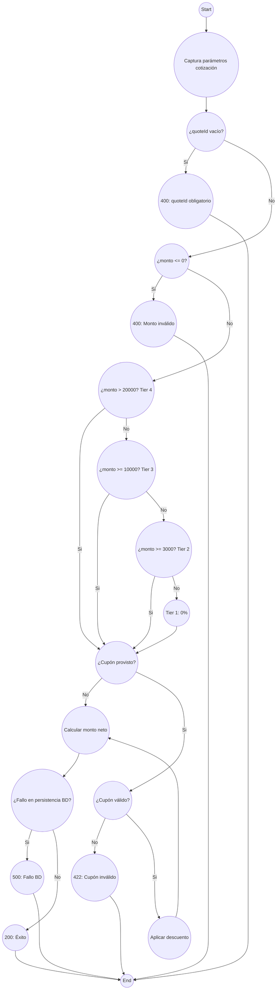

| Métrica | Valor |
|---|---|
| Nodos ($N$) | 18 |
| Aristas ($E$) | 25 |
| Nodos Predicado ($P$) | 8 (n2, n4, n6, n7, n8, n10, n11, n15) |
| $V(G) = E - N + 2$ | **9** |
| $V(G) = P + 1$ | **9** |
| Cobertura Branch | 100% |
