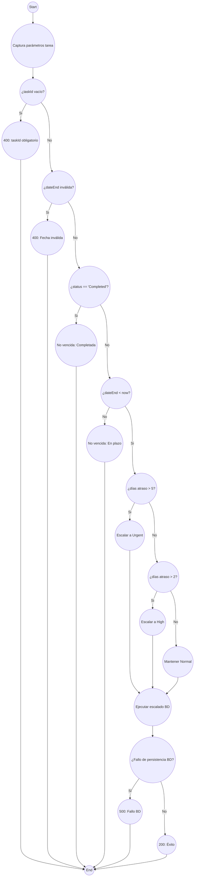

| Métrica | Valor |
|---|---|
| Nodos ($N$) | 19 |
| Aristas ($E$) | 26 |
| Nodos Predicado ($P$) | 8 (n2, n4, n6, n8, n10, n12, n16 + status) |
| $V(G) = E - N + 2$ | **9** |
| $V(G) = P + 1$ | **9** |
| Cobertura Branch | 100% |
