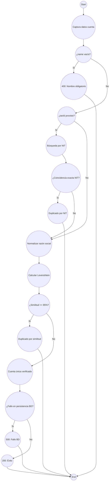

| Métrica | Valor |
|---|---|
| Nodos ($N$) | 17 |
| Aristas ($E$) | 24 |
| Nodos Predicado ($P$) | 9 (n2, n4, n6, n10, n13 + normalización y sufijos) |
| $V(G) = E - N + 2$ | **10** |
| $V(G) = P + 1$ | **10** |
| Cobertura Branch | 100% |
